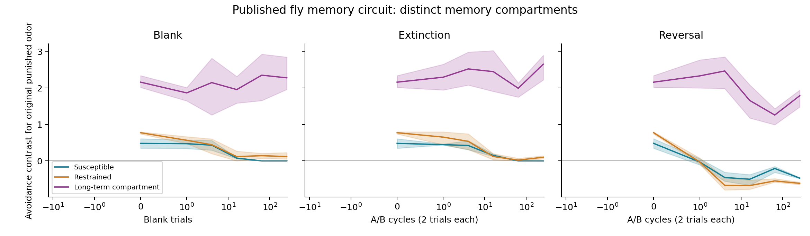

# Fly memory pilot

Completed simulation, not a whole-brain or MaleCNS experiment.

Published Incentive Circuit revision `1610c80072fe8bb59bd397e7a61f716393a509b9`; 3 noise seeds, both punished-odor assignments per seed.

## Protocol and checks

Six A/B conditioning cycles; three native timesteps per trial. Shock coincides with the final odor timestep. Original Python equations and default manuscript-example parameters are unchanged. Trials are model units, not biological hours.

All three original reversal/extinction/unpaired routines execute. The custom stimulus driver matches their complete activity and weight histories exactly. This verifies the driver, but is not an independent quantitative reproduction of the paper's biological results.

Probes use separate clones with plasticity disabled; assertions check frozen weights and source-checkpoint preservation. Positive contrast means stronger avoidance of the original punished odor; negative means the opposite. This is a circuit-response contrast, not percent correct or a calibrated behavioral probability.

## Endpoints

Mean contrasts across counterbalanced odors and seeds:

| Arm | Phase | Susceptible | Restrained | Long-term compartment |
|---|---|---:|---:|---:|
| full | acquisition | 0.482 | 0.774 | 2.162 |
| full | blank | 0.000 | 0.119 | 2.281 |
| full | extinction | 0.000 | 0.100 | 2.655 |
| full | reversal | -0.474 | -0.616 | 1.791 |
| no_ltm | acquisition | 0.482 | 0.802 | 0.000 |
| no_ltm | blank | 0.000 | 0.111 | 0.000 |
| no_ltm | extinction | 0.000 | 0.000 | 0.000 |
| no_ltm | reversal | -0.474 | -0.774 | 0.000 |
| no_plasticity | acquisition | 0.000 | 0.000 | 0.000 |
| no_plasticity | blank | 0.000 | 0.000 | 0.000 |
| no_plasticity | extinction | 0.000 | 0.000 | 0.000 |
| no_plasticity | reversal | 0.000 | 0.000 | 0.000 |
| unpaired | acquisition | -0.000 | 0.015 | -2.028 |
| unpaired | blank | 0.000 | -0.006 | -2.143 |
| unpaired | extinction | 0.000 | -0.100 | -2.655 |
| unpaired | reversal | 0.000 | -0.090 | -1.784 |

## Interpretation and limits

Inspect compartments separately: an average can conceal opposite memories after reversal. Removing the long-term pathway also removes a direct contributor to the average, so that average alone is not evidence for a consolidation mechanism.

Unpaired shock is a timing manipulation, not a guaranteed zero-memory baseline: it can produce opposite-sign associations in this model. Plasticity-disabled acquisition is the no-learning control.

Activity-reset probes retain learned synapses; weight-reset probes preserve current activity. Both use baseline state as defined by the implementation. Reset results and seed-bootstrap 95% intervals are in summary.csv. Intervals describe input-noise realizations of this circuit, not biological animals or uncertainty in the model's mechanism.

Blank intervals include the upstream weak spontaneous KC noise and native synaptic updates. Repeated unrewarded odor exposure can change memory, so extinction is not equivalent to passive delay. Blank counts are single trials; extinction/reversal counts are two-trial A/B cycles and should not be compared as equal elapsed time.

This first pilot measures learned odor association retention, not learned event order. It uses a reduced biologically motivated circuit, not detailed neuronal biophysics or the Google/Janelia wiring map. Follow-up: validate paper figure trajectories, test matched-duration interference with additional odors, inspect causal pathway interventions, and then attempt AB versus BA learning.

Sources: [model and original code](https://github.com/InsectRobotics/IncentiveCircuit), [eLife paper](https://elifesciences.org/articles/75611), [Google MaleCNS release](https://www.research.google/blog/a-connectomics-milestone-mapping-the-complete-male-fruit-fly-brain/).

Runtime: 24.1 s. Raw metrics, native histories, acquisition checkpoints and provenance are in `/Users/harikrishna/Documents/lossfunk/graph_cl/q_graph_cl/bdh-d/results/biological_memory_20261017_smoke`.
