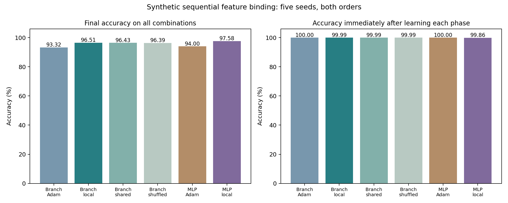

# Does branch-local learning reduce interference? — 25 October 2026

**Result: this test did not establish a branch-specific advantage.** Activity-dependent regulation improved retention versus unrestricted Adam, but shared and shuffled regulation performed similarly. An equally sized ordinary MLP with local regulation was at least competitive. These are synthetic feature-binding results, not Split MNIST class-incremental accuracy.

## What was tested

Each example contains one of eight shapes and one of eight colours, encoded as two noisy one-hot vectors (16 inputs). Four successive phases introduce disjoint sets of 16 shape–colour conjunctions. Each phase has identical shape and colour marginals, balanced binary labels, and a single fixed label function throughout training. The target depends on the conjunction. There are 1,024 training observations and 1,024 independent noisy evaluation observations per phase. All 64 conjunctions are eventually learned. This tests retention of familiar combinations under observation noise, not generalization to unseen combinations.

The network receives only the current observation. There are no task IDs, task-boundary inputs, replay, stored input cues, external configurations, or per-phase optimizer/state resets. Evaluation labels are used only for metrics. The experiment scheduler presents four blocks; this is not a boundary-free real-world data stream.

The branched network has 16 groups of four ReLU subunits; each group sums its branch outputs before a shared binary classifier. The ordinary MLP has 59 ReLU units and a binary classifier. Parameter counts are 1,122 versus 1,123. A linear-branch control removes ReLU; its chance-level acquisition makes it a representational diagnostic, not a fair retention comparator.

## Learning rule

For each branch (or MLP hidden unit), accumulate past mean-squared activity: $u_j\leftarrow u_j+\operatorname{mean}_{batch}a_j^2$. Before that write, scale its incoming Adam parameter update by $s_j=1/(1+\lambda u_j)$. The shared control applies the mean multiplier to every unit; the shuffled control randomly permutes the same current multiplier vector. The classifier is not regulated. No oracle or counterfactual branch errors are computed.

This is an engineered plasticity regulator applied to backpropagation/Adam. It is not a fully local biological learning rule. Its state is cumulative, not fading short-term memory. It is applied after Adam because scaling gradients before Adam can be cancelled by normalization. Shuffled vectors are regenerated each update, so their effect can resemble uniform slowing.

## Locked validation and confirmation

Development used seeds 700/701 with forward order, three learning rates and two regulation strengths. Every candidate was retained (90 runs). Each architecture/rule independently selected the harmonic mean of acquisition and final retention; no official confirmation measurements selected settings. Fresh seeds 702–706, both orders, produced 150 confirmation runs, including equal-local-setting controls and joint references. The equal-setting controls were added and locked before confirmation to address generic learning-rate slowing. Each sequential run uses 384 updates, 12 passes per current phase, batch 128. Joint references use the same total observations/updates but mix all phases and use the sequentially selected unregulated LR; they were not independently optimized.

| Model | Final all-phase accuracy | New-phase acquisition | Earlier-three final accuracy | Forgetting |
|---|---:|---:|---:|---:|
| Branches + local regulation | 96.51% | 99.99% | 95.35% | 4.65 pp |
| Branches + Adam | 93.32% | 100.00% | 91.10% | 8.90 pp |
| Branches + Adam, local-matched LR | 94.51% | 100.00% | 92.68% | 7.32 pp |
| Branches + shared regulation | 96.43% | 99.99% | 95.25% | 4.75 pp |
| Branches + shuffled regulation | 96.39% | 99.99% | 95.21% | 4.79 pp |
| MLP + Adam | 94.00% | 100.00% | 92.00% | 8.00 pp |
| MLP + local regulation | 97.58% | 99.86% | 96.97% | 3.03 pp |
| MLP + shared, selected settings | 95.95% | 100.00% | 94.60% | 5.40 pp |
| MLP + shared, local-matched settings | 97.32% | 99.84% | 96.62% | 3.37 pp |
| MLP + shuffled, selected settings | 96.00% | 100.00% | 94.67% | 5.33 pp |
| MLP + shuffled, local-matched settings | 97.40% | 99.83% | 96.75% | 3.24 pp |
| Linear branches + Adam | 50.01% | 49.76% | 50.04% | 3.70 pp |

Acquisition is accuracy on a phase immediately after its training. Forgetting averages the drop from the maximum post-acquisition accuracy to final accuracy over the earlier three phases. Both nonlinear architectures reach 100% joint-reference accuracy; linear joint accuracy is approximately chance.



## Paired evidence

Intervals below are descriptive, unadjusted 95% t intervals over five seed-level differences, averaging the two orders within each seed. Primary endpoint is local versus shared regulation within the branched model. Other contrasts are supporting; multiple comparisons and a small seed count limit claims.

| Contrast in final accuracy | Difference | 95% interval |
|---|---:|---:|
| primary branch local minus shared | +0.08 pp | [-0.28, +0.44] |
| branch local minus shuffled | +0.11 pp | [-0.23, +0.46] |
| branch local minus unregulated equal LR | +2.00 pp | [+0.18, +3.82] |
| branch local minus MLP local | -1.08 pp | [-4.56, +2.41] |
| MLP local minus shared equal settings | +0.27 pp | [-0.48, +1.01] |

New-phase acquisition differs by less than two percentage points for all nonlinear controls. The primary comparison has a near-zero point estimate; its interval includes zero. This does not prove exact equivalence, but gives no support for a meaningful benefit of aligning this regulator with individual branch histories. The same generic regulation can help an ordinary MLP. The positive comparison with unregulated Adam therefore does not establish a dendritic mechanism.

## Mechanism and implementation checks

The branch computation is exactly representable as an ordinary ReLU layer whose readout columns are tied within groups. Outputs and parameter gradients agree numerically. This equivalence is expected: useful architectural inductive biases can be represented as ordinary computation graphs. Here it prevents treating the word “branch” as an additional mechanism. The unconstrained MLP comparison additionally changes hidden width and readout tying, so it is a practical near-budget comparison rather than a perfect single-factor ablation.

All 120 saved sequential checkpoints reproduce recorded final accuracy exactly under reevaluation; evaluation leaves model/activity state unchanged. Phase marginals and labels are balanced; the saved-state audit and source hashes are archived. First-update held-out old-loss rise and new-loss reduction were recorded for every transition in the raw results, without using them as feedback or hyperparameter selection. A single Adam update is not a full adaptation-cost curve, so these probes are secondary diagnostics.

## Resources and timing

Activity state is training-only: 256 bytes for branches or 236 for the ordinary MLP. Deployment uses only weights/biases: 4,488 versus 4,492 bytes. Training-persistent counts below include FP32 weights, actual Adam moments/scalar steps, and activity state; they exclude transient gradients/activations, allocator/Python overhead and data. Thus inference storage is matched closely, but regulated arms are not exactly matched for training state.

| Model | Training persistent state | Inference state | Train step, batch 128 | Inference, batch 128 |
|---|---:|---:|---:|---:|
| branches / none | 13,480 B | 4,488 B | 0.1491 ms | 0.0273 ms |
| branches / local | 13,736 B | 4,488 B | 0.1737 ms | 0.0256 ms |
| branches / shared | 13,736 B | 4,488 B | 0.1755 ms | 0.0253 ms |
| mlp / none | 13,492 B | 4,492 B | 0.1358 ms | 0.0191 ms |
| mlp / local | 13,728 B | 4,492 B | 0.1582 ms | 0.0192 ms |

Fresh CPU profiles use two threads and repeated checkpoint clones. No large retrieval bank or iterative communication is present. Times are for a tiny model; they do not establish deep-network efficiency, energy use or GPU performance. All compared runs use equal presentations/update counts, not exactly equal elapsed compute. The local rule adds training work; no branch advantage was established even with that allowance.

## What this means and the next decision

**Supported:** nonlinear hidden computation solves the binding task; modest activity-dependent plasticity regulation can improve retention without blocking new learning in this toy setting.

**Not supported:** branch-specific plasticity is the cause of that improvement, branches beat a matched ordinary network, the grant’s short-term-memory mechanism is validated, or the method solves general task-ID-free class-incremental learning.

This negative mechanism result should narrow the hypothesis, not trigger a search for a favourable seed. Do not expand this regulator merely because it beats unrestricted Adam. A subsequent project would need a genuinely different branch mechanism (for example, input-specific local competition/plasticity), explicit predictions that distinguish it from shared slowing and ordinary sparse gating, and a predeclared harder transfer test. A larger benchmark alone will not fix missing mechanism attribution.

## Reproduce and inspect

- [Experiment driver](../../bdh_cl/scripts/branch_binding_interference.py), [report/audit/profile driver](../../bdh_cl/scripts/report_branch_binding_interference.py).
- [Protocol](../../results/branch_binding_interference_20261025/protocol.json), [pre-confirmation addendum](../../results/branch_binding_interference_20261025/confirmation_addendum.json), [locked selection](../../results/branch_binding_interference_20261025/selection_lock.json).
- [All validation runs](../../results/branch_binding_interference_20261025/development.json), [all confirmation runs and trajectories](../../results/branch_binding_interference_20261025/confirmation.json), [paired contrasts](../../results/branch_binding_interference_20261025/contrasts.json).
- [Checkpoint audit](../../results/branch_binding_interference_20261025/audit.json), [CPU profile](../../results/branch_binding_interference_20261025/profile.json), [source hashes](../../results/branch_binding_interference_20261025/source_hashes.json).

Commands (from repository root, using the project Python environment):

```sh
python -m bdh_cl.scripts.branch_binding_interference development
python -m bdh_cl.scripts.branch_binding_interference confirmation
python -m bdh_cl.scripts.report_branch_binding_interference
```

Training drivers refuse to overwrite existing results. Archive/change the output directory for a deliberate reproduction; do not delete the recorded evidence.
