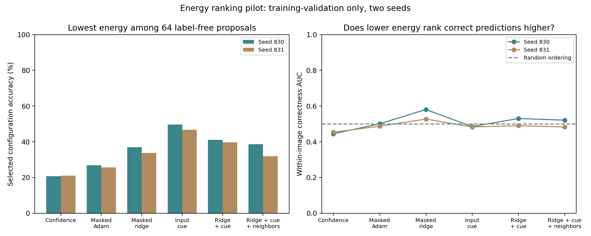

# Input-conditioned branch energy: validation pilot — 26 October 2026

**No new energy passed the predeclared screen for recurrent descent.** Masked prediction gave a weak ranking signal, but adding it to a simple input-cue energy reduced selected accuracy in both validation runs. No official-test benchmark or classification descent experiment was run. This result concerns the tested energies, not whether an appropriate energy landscape can exist.

## Question and scope

Could a label-free energy assign lower values to branch configurations that classify a particular input correctly? This is a necessary practical diagnostic for the proposed retrieval mechanism, but high average ranking AUC is not a mathematical prerequisite for a useful minimum. We tested energy ranking before spending on recurrent inference.

Two fresh backbone seeds (830/831) each learned sequential Split MNIST using 50,000 training images, two passes per current digit pair. A stratified 10,000-image subset of the original training split was held out; 100 images per class (1,000 total) formed each ranking set. A different 100 per class was reserved for conditional dynamics, but was not used because the screen failed. Both orders, independent seeds and official-test accuracy have not been confirmed in this pilot. The standard loader reads both raw splits; no official-test images or labels enter these calculations.

All ten output classes remain eligible. The supervised backbone and global usefulness traces are unchanged from the earlier 25-neuron, four-branch protocol. Current labels train the backbone and a reference direct classifier only. Energy learners receive current images, masked responses and pre-update branch activity; no class labels, task IDs or boundary inputs. Optimizers and state are not reset between phases. Historical configurations are kept only for explicitly assisted diagnostics.

## Energy construction

- **Confidence:** low classification entropy, a baseline that can prefer confidently incorrect predictions.
- **Masked Adam / masked ridge:** hide each of four 14×14 quadrants, and predict the four coarse image cells belonging to the hidden region from the selected branch responses to the remaining image. Four linear decoders, 416 weights total, learn from current pixel targets. Adam updates can forget; ridge retains cumulative covariance/cross statistics. Their linear hypothesis spaces are identical.
- **Input cue:** compatibility with a 16-dimensional mean input description stored separately for each branch. This is explicit auxiliary input memory, closely related to our earlier cue method.
- **Ridge + cue / + neighbors:** combine standardized prediction and cue energies, optionally adding 0.25 times a learned local PMI compatibility energy over a 40-edge grid.

Component energies are centered/scaled per image using the same label-free candidate pool. The scales would stay fixed during descent. All energy variants add a fixed 0.05 mean branch-gate entropy penalty. Coefficients, predictor learning rate (.003), ridge regularization (1.0), and cue decay (.995) were fixed before results; no rescue sweep was performed. Low reconstruction error is a hypothesis for useful configurations, not an assumed proxy for classification correctness.

## Autonomous proposals versus assisted diagnostics

The main pool has 64 configurations per image: final hard gates, uniform gates, cue-selected hard gates, softened final gates, 24 random hard configurations, 24 perturbations of the final configuration and 12 random soft configurations. These are generated without labels and contain no historical route bank. The SAME pool is scored by every energy.

**The proposal pool itself uses the 6,800-byte cue memory**, even for confidence and prediction-only energies. Their selected accuracy therefore is not evidence of memory-free retrieval. The bank-assisted diagnostic separately tries all five saved historical configurations; it is not the autonomous result.

## Ranking and selection results

| Energy | Seed 830 selected accuracy | Seed 831 selected accuracy | Correctness AUC, 830 / 831 | Mean energy–classification-loss rank correlation |
|---|---:|---:|---:|---:|
| confidence | 20.70% | 21.10% | 0.445 / 0.453 | -0.389 |
| masked adam | 26.90% | 25.70% | 0.501 / 0.487 | -0.001 |
| masked ridge | 36.90% | 33.70% | 0.581 / 0.527 | +0.052 |
| cue | 49.60% | 46.70% | 0.485 / 0.483 | -0.228 |
| ridge cue | 41.00% | 39.70% | 0.530 / 0.490 | -0.144 |
| ridge cue pmi | 38.70% | 31.90% | 0.521 / 0.483 | -0.172 |

Correctness AUC compares correct versus incorrect candidate predictions within the SAME image, with ties scored one half. Only images with both outcomes contribute. Positive Spearman correlation means higher energy tends to accompany higher classification loss. Labels are used for these analyses only after energies and predictions are computed.

| Reference on the same ranking sets | Seed 830 | Seed 831 |
|---|---:|---:|
| final hard | 19.50% | 19.50% |
| uniform soft | 41.90% | 26.70% |
| cue onepass | 49.60% | 46.70% |
| final soft | 19.40% | 19.50% |
| candidate coverage label assisted diagnostic | 97.60% | 99.90% |
| historical oracle label assisted | 96.40% | 86.00% |
| direct ridge16 supervised reference | 68.90% | 70.10% |

The direct ridge reference learns from current training class labels and has no neural backbone at inference; its 16-dimensional input statistics require 1,664 bytes plus any derived weight cache. It is a supervised baseline, not an energy learner. Candidate coverage is a label-assisted upper bound: the fraction of images with ANY correct candidate prediction. It is not achievable accuracy without a selector. Historical oracle uses the true digit pair to select a saved configuration. Neither is automatic class-incremental performance. These validation-only values must not be substituted for earlier official-test cohort results.

The masked ridge energy selects 35.30% accuracy on average, versus 34.30% for fixed uniform gates; it is worse than uniform on seed 830 and better on seed 831. The cue baseline averages 48.15%. Adding ridge prediction lowers cue selection to 40.35%, and adding neighbors further lowers it to 35.30%. Confidence is systematically poorly aligned with classification loss. These two-seed observations do not establish a general performance advantage or a confidence interval.

## What happened to downhill inference?

Before results, we required a novel prediction/composite energy to achieve correctness AUC at least 0.60 and selected accuracy at least five points above final routing in BOTH seeds. Composites also had to beat the direct cue baseline by one point in BOTH seeds. None qualified, so no label-free classification descent or official-test confirmation was launched.

This screen is conservative, not a theorem: the cue baseline itself has low average AUC while still selecting useful minima. Nevertheless, the new prediction terms failed the stronger practical comparison against the existing cue in both seeds. We therefore have no evidence that adding these terms makes the landscape more useful. We cannot claim an observed failure of gradient descent, because classification descent was not run.

## Separate historical-bank-assisted diagnosis

| Energy selecting among five saved routes | Seed 830 | Seed 831 |
|---|---:|---:|
| confidence | 34.70% | 32.70% |
| masked adam | 23.90% | 24.50% |
| masked ridge | 54.00% | 47.10% |
| cue | 53.60% | 44.20% |
| ridge cue | 59.20% | 55.40% |
| ridge cue pmi | 59.40% | 55.00% |

The bank contains old useful configurations, but the energy does not reliably identify them. This helps separate absence of candidate solutions from poor scoring, without converting the diagnostic into a no-bank claim.

## Costs

The backbone has 78,760 learned parameters plus its 100-value usefulness state. The cue proposal memory adds 6,800 bytes. Masked decoders have 416 FP32 weights (1,664 bytes). Ridge training retains 12,480 bytes of sufficient statistics; caching its derived decoder weights adds 1,664 bytes. The optional neighbor table adds 2,560 bytes. A ridge+cue+neighbor system retaining its training statistics and derived cache therefore adds **23,504 bytes**, excluding transient workspaces. If training statistics are discarded after learning, its inference-only extra state is 11,024 bytes, but future continual updates would then lose those statistics. Adam decoder weights/moments/scalar step add 4,996 bytes during training, in addition to the common cue state.

Masked prediction needs four occluded branch-response passes plus a clean classification pass. Evaluating 64 proposed configurations adds substantial work. The saved screening profile measures all six energies together, including model construction and all views; it is not isolated deployment latency. There is no demonstrated compute or memory advantage over an ordinary MLP or our simpler cue retrieval.

## Verification and conclusion

Saved-checkpoint ranking metrics reproduce exactly; ridge weights match the stored sufficient-statistic solve; target regions are absent from masked inputs; simplex projection and the composite energy directional derivative are checked. An independently trained backbone without energy learners matches seed 830 bitwise. Decoder learning therefore did not alter the stored skills being compared.

**Supported:** masked prediction error contains a weak, inconsistent relationship to useful routing, stronger than confidence in this pilot.

**Not established:** a reliably correct energy landscape, improved retrieval beyond cue memory, useful recurrent descent, unique dendritic benefit or a biological learning mechanism. The decoder is a shared learned module and can itself suffer drift/forgetting; covariance retention carries explicit memory costs.

The hypothesis remains viable only with a better specified energy. A subsequent study should identify a signal tied to task-relevant features, test ranking against the cue baseline on independent validation data, and show benefits beyond simply relabeling the existing cue method as energy minimization. More iterations alone are not justified by this pilot.

## Evidence

- [Experiment driver](../../bdh_cl/scripts/branch_energy_landscape.py), [audit/report driver](../../bdh_cl/scripts/report_branch_energy_landscape.py).
- [Protocol](../../results/branch_energy_landscape_20261026/protocol.json), [all ranking results](../../results/branch_energy_landscape_20261026/ranking.json), [qualification decision](../../results/branch_energy_landscape_20261026/qualification.json), [summary](../../results/branch_energy_landscape_20261026/summary.json).
- [Audit](../../results/branch_energy_landscape_20261026/audit.json), [screening cost](../../results/branch_energy_landscape_20261026/screening_profile.json), [source hashes](../../results/branch_energy_landscape_20261026/source_hashes.json).
