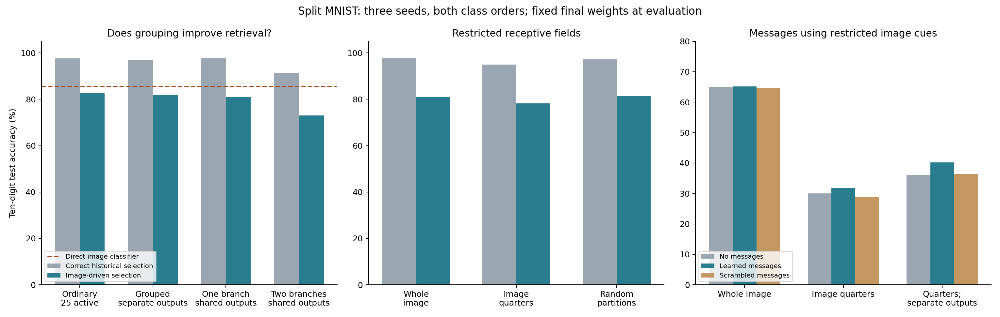

# Branch grouping, image regions, and communication

Completed 21 October 2026. **No automatic retrieval advantage for branches over ordinary selected neurons emerged. Restricted receptive fields preserve substantial skills with fewer effective input weights. Learned compatibility messages help when retrieval sees only partial images, but whole-image cues remain much stronger.**

The primary study has 54 confirmation runs. A 50-active-neuron control adds 12 and a direct sensory-exchange follow-up adds 36. All 102 confirmation runs reuse the same three initialization seeds and two paired class orders; they are not 102 independent replications. There are 34 development runs. Every automatic method uses images only at evaluation.

## Definitions

- **Ordinary network:** a fully connected multilayer perceptron (MLP), here 784 inputs ->100 tanh hidden responses ->10 digit scores. Recent usefulness selects 25 or 50 responses globally.
- **Grouped, separate outputs:** the same 100 responses are arranged in 25 groups of four. One response wins per group, but each has its own output connections. This isolates grouping from shared output weights relative to the ordinary 25-active model.
- **Branch network:** one or two responses participate within each group, and branches in a group share output connections. Two responses are summed and divided by sqrt(2). There are 25 groups and four branches per group.
- **Usefulness trace:** an exponentially weighted recent estimate of the benefit of a response, computed as negative loss-gradient times response, EMA decay .95. It controls training selection and is supervised by digit labels through the prediction loss.
- **Historical selection:** the correct digit pair selects a phase-end neuron/branch mask. This diagnostic changes no final learned weight or classifier connection; all ten outputs remain eligible. It requires task information.
- **Image-driven selection:** an online ridge-regression association learns to predict the current mask from a 64-dimensional fixed pooled image key. At evaluation the predicted scores select neurons/branches; no saved mask bank, task ID, or label is available.
- **Direct classifier:** the same ridge-regression learner predicts digits from the same image keys directly, requiring no neural backbone. Its supervised targets differ from the mask targets, so it is a complete-method baseline rather than a pure architecture intervention.
- **Receptive field:** the pixels a response can directly read. Whole-image responses see 784 pixels. Quarter-image responses see one 196-pixel quadrant. Random-partition responses see 196 scattered pixels; the four fields partition the image.
- **Local cue memory:** each response stores the sum of input keys observed while it was active. Similarity to that stored sum supplies a retrieval score. Whole-image cues use all pixels; field cues use only the response's allowed pixels.
- **Compatibility messages:** counts of which alternatives were active together in neighboring groups adjust their retrieval scores for three rounds. These are selection messages, not direct sensory activation exchange.
- **Sensory exchange:** a separate follow-up lets branches directly mix neighboring partial-image responses before selection. Its equal-parameter self-only control performs the same extra computation using the branch's own response.

## Primary accuracy results

All values are mean percentages across three seeds and both orders. Acquisition means accuracy on each pair immediately after learning it; it is not final ten-digit retention. Latest-mask accuracy remains near 20% for these models.

| Network and input access | Acquisition | Correct historical selection | Automatic image-driven selection |
|---|---:|---:|---:|
| Whole image; ordinary neurons, 25 active | 98.78 | 97.56 | 82.57 |
| Whole image; ordinary neurons, 50 active | 98.86 | 79.73 | 61.52 |
| Whole image; grouped, separate output weights | 98.77 | 96.96 | 81.89 |
| Whole image; one branch per group | 98.81 | 97.80 | 80.90 |
| Whole image; two branches per group | 98.81 | 91.47 | 73.02 |
| Image quarters; ordinary neurons, 25 active | 98.54 | 96.82 | 81.25 |
| Image quarters; ordinary neurons, 50 active | 98.18 | 87.35 | 68.46 |
| Image quarters; grouped, separate output weights | 98.57 | 95.98 | 80.09 |
| Image quarters; one branch per group | 98.62 | 94.95 | 78.16 |
| Image quarters; two branches per group | 98.14 | 93.79 | 76.96 |
| Random pixel partitions; one branch per group | 98.22 | 97.21 | 81.25 |

The direct image classifier reaches approximately **85.53%**, above every neural retrieval pipeline in this experiment. It stores 18,944 numeric bytes and uses labels while each example is current. Its fixed features are not independently learned across seeds; tiny seed variation comes from accumulation order/precision.

Grouping alone does not improve automatic retrieval here. Sharing output weights also supplies no gain in the full-image comparison. Allowing two branches harms the best one-branch configuration, although grouped two-branch models outperform the 50-active ordinary-neuron control. Thus more simultaneous activity is not automatically better for retention.

Quarter-image branches have 19,960 effective learned parameters, compared with 78,760 for whole-image branches. The dense implementation still allocates masked-out weights and computes dense matrix products; no actual speedup or compressed deployment is established. Ordinary quarter-image networks have 20,710 effective parameters and perform at least as well, so parameter efficiency is not unique to dendritic grouping. The random-partition control also performs well: spatially contiguous quarters are not uniquely beneficial.

## Do partial views make compatibility messages more useful?

Same trained weights and associative sums in each off/on/scrambled comparison. Retrieval here uses only each response's own receptive-field cue. Scrambling permutes branch labels at each group in the connection matrices, preserving their values but breaking alignment with the learned cues. Five predetermined permutations are averaged; none is selected for performance.

| Network | Messages off | Learned messages | Scrambled messages |
|---|---:|---:|---:|
| Whole image; one branch per group | 65.06 | 65.22 | 64.61 |
| Image quarters; one branch per group | 30.03 | 31.76 | 28.93 |
| Image quarters; grouped, separate output weights | 36.13 | 40.23 | 36.37 |
| Image quarters; two branches per group | 36.84 | 37.23 | 37.12 |
| Random pixel partitions; one branch per group | 46.42 | 47.39 | 43.40 |

This supports a bounded positive result: learned compatibility can help select computations from incomplete local cues. The gain also appears with separate output weights, so it does not require the branch model's shared classifier connections. It remains far below whole-image-key retrieval. In the quadrant one-branch network, whole-image local cue retrieval reaches 63.04%, versus 31.76% for field cues plus messages, and global ridge retrieval reaches 78.16%.

## Direct sensory-response exchange

This follow-up tests actual information transfer between branches, separately from routing messages. One step mixes each branch's local response with the mean responses of its two geometrically neighboring image quarters. There are 100 trainable gains. The self-only control uses its own response in place of neighboring evidence and has identical parameter count and computation depth.

| Field and active branches | Self-only historical | Neighbor-exchange historical | Self-only automatic | Neighbor-exchange automatic |
|---|---:|---:|---:|---:|
| Whole image; one branch | 97.71 | 97.18 | 80.76 | 80.64 |
| Quarters; one branch | 95.45 | 97.20 | 78.38 | 79.84 |
| Quarters; two branches | 93.94 | 94.39 | 77.01 | 75.61 |

For one branch per quarter-image group, sensory exchange improves automatic accuracy by 1.46 percentage points relative to the self-only control. All three seed means improve, but the 95% paired-seed interval is -1.54 to +4.46 points, so the magnitude and reliability need fresh confirmation. There is no corresponding gain for full-image branches or two participating branches.

This limited sensory-exchange rule is not a general test of all branch communication. It changes feature integration and also lets gradients reach unselected sending branches, potentially weakening selective preservation. Its settings are selected on development data; the reused confirmation cohort is not independent replication.

## Paired comparisons and uncertainty

Differences below are automatic image-driven accuracy in percentage points. Both orders are averaged within each seed. Intervals use a t distribution with two degrees of freedom over three independent seed differences. They are exploratory and not corrected for the many comparisons.

| Comparison | Difference | 95% interval |
|---|---:|---:|
| grouping without output sharing | -0.68 | -1.94 to +0.59 |
| output sharing within groups | -0.99 | -2.32 to +0.35 |
| two versus one full branches | -7.89 | -11.20 to -4.58 |
| two branches versus fifty ordinary | +11.50 | +6.97 to +16.03 |
| quarter versus full branch 1 | -2.74 | -4.87 to -0.61 |
| quarter versus random partition | -3.09 | -3.66 to -2.52 |
| full branch 1 sensory neighbor minus self | -0.11 | -2.44 to +2.22 |
| quadrant branch 1 sensory neighbor minus self | +1.46 | -1.54 to +4.46 |
| quadrant branch 2 sensory neighbor minus self | -1.40 | -6.74 to +3.95 |

## Protocol, information access, and limits

- Real MNIST, pixels/255, five sequential pairs, two epochs per pair, batch 128, one continuous Adam optimizer, clipping 5. No old-example replay, pretraining, task-ID input, phase-boundary resets, or usage protection. Boundaries schedule the benchmark and diagnostic mask snapshots only.
- Development seed 560 uses a stratified 50 k fit/10 k held-out training split. Each architecture chooses rate .001/.003 by historical validation recovery, with acquisition as tiebreak. Associative readers choose their ridge strength or message gain by automatic validation accuracy. This optimizes recoverable computation first, not the end-to-end automatic training objective. Official test data selects no settings.
- Fresh seeds 561–563, forward/reverse orders, full 60 k training and 10 k official test. The original 25-active ordinary/grouped models and shared-head models use identical hidden initialization and minibatch order for a given seed. Output head shapes differ when sharing changes. Separate learning-rate choices and different active counts prevent interpreting every comparison as a single-factor causal effect.
- Every association write occurs before the current neural update and sees only current images and current selected masks. Labels supervise neural training and the direct-classifier control, but never routing associations. No historical mask bank enters automatic prediction. Evaluation asserts unchanged model and associative memory checksums.
- Ridge stores 64 x 64 covariance and 100 x 64 mask cross-statistics:41,984 bytes, common to all architectures here. A single local cue scope stores 100 x 64 sums:25,600 bytes; optional 25 x 4 x 4 links add 1,600 bytes. All-candidate experiment checkpoints contain several competing memories; their combined storage is not the deployed budget. The direct classifier stores 18,944 bytes. Numeric budgets omit scalar metadata and transient workspaces.
- Whole-image flat models have 79,510 allocated trainable parameters; shared-head branch models 78,760. Region masks reduce effective parameter counts but are implemented using full dense tensors. Field masks, trace buffers, and audit artifacts must be distinguished from learned weights. No GPU, latency, or peak-memory advantage is claimed.
- Local associative writes are cumulative; adaptive forgetting and discriminative local learning were not tuned. The ring of neighboring groups is arbitrary. All branches of the same quarter index use the same quarter, rather than independently learned receptive fields. These are bounded mechanism pilots.
- Checks verify field partitions, independence from pixels outside a response's field before sensory exchange, correct two-branch pooling, finite gradients, current-mask association targets, zero-gain sensory-exchange equivalence, causal cross-field influence, and unchanged evaluation state. Scrambling evaluates frozen primary models and is a post-primary mechanism audit.

## Next discriminating experiments

1. Learn receptive fields or use overlapping regions, comparing against ordinary region-restricted neurons at matched effective contacts and active computation.
2. Improve local cue learning before adding more message rounds. Whole-image retrieval and the direct classifier remain much stronger controls.
3. If pursuing sensory exchange, separate inference-only exchange from gradients flowing through inactive branches, with an equal-parameter self-only control.
4. Confirm promising message effects on a new cohort and a harder dataset after demonstrating strong acquisition; three seeds on MNIST do not establish a general branch advantage.

## Reproducibility

- [Primary driver](../../bdh_cl/scripts/branch_fields_retrieval.py), [50-active control](../../bdh_cl/scripts/branch_fields_flat50_control.py), [scrambling audit](../../bdh_cl/scripts/audit_branch_field_communication.py), [sensory exchange](../../bdh_cl/scripts/branch_field_feature_exchange.py).
- [Primary protocol](../../results/branch_fields_retrieval_20261021/protocol.json), [validation selection](../../results/branch_fields_retrieval_20261021/selection.json), [primary results](../../results/branch_fields_retrieval_20261021/results.json), [50-active results](../../results/branch_fields_retrieval_20261021/flat50_results.json).
- [Scrambled-message audit](../../results/branch_fields_retrieval_20261021/communication_scramble_audit.json), [sensory-exchange results](../../results/branch_fields_retrieval_20261021/feature_exchange_results.json), [summary and paired comparisons](../../results/branch_fields_retrieval_20261021/summary.json).
- Complete checkpoints, all development candidates, verification records and completion manifests are in the results directory. Supplemental selection protocols are saved separately. No test-based model selection or discarded failed arm.
