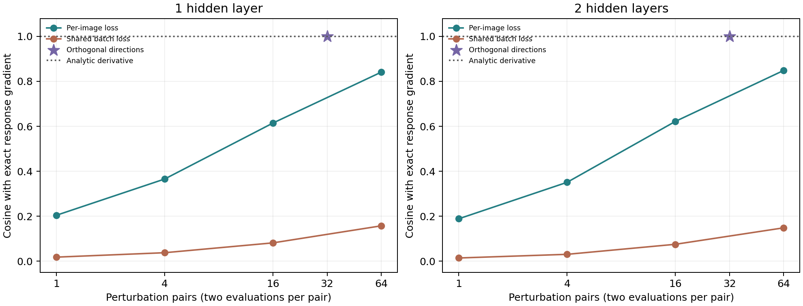
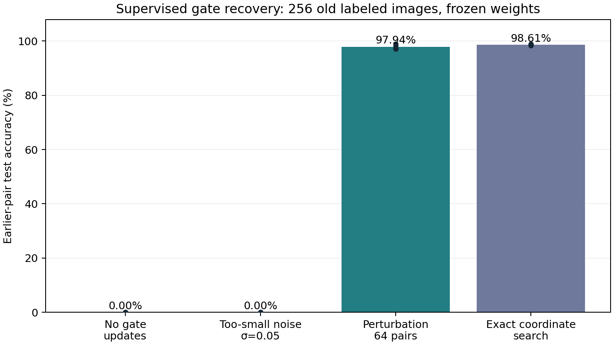

# Branch node-perturbation audit

Completed 23 October 2026. **Scalar-feedback perturbations can optimize hard branch choices, but do not provide independent credit for every branch in a single jointly perturbed forward. Repeated or orthogonal directions improve credit quality at a substantial compute cost. No autonomous continual-learning improvement is established.**

## What was tested

This is a mechanism audit, not a reproduction of Dust or a full gradient-free training run. Existing one-layer (25 neurons × 4 branches) and two-layer (24 × 4 per layer) MNIST networks remain frozen. They were originally trained with ordinary backpropagation and gradient-estimated usefulness. We test first-layer branch-response credit and, separately, optimization of discrete first-layer route choices.

## 1. How accurately does perturbation assign branch credit?

At the current route, compute the actual loss of every single-neuron alternative branch. This exact finite-change score is the reference. Compare analytic first-order scores with two-sided perturbation estimates of the selected response gradient. The candidate score is the batch mean of estimated gradient × (alternative response − current response). Even a perfect gradient can disagree with exact finite-change scores because branch replacements are not infinitesimal.

Gaussian noise uses independent directions per image. Each pair evaluates h+σz and h−σz. Per-image feedback supplies each image’s own loss difference; shared feedback supplies one batch-mean difference and rescales to match the per-image gradient convention. Orthogonal noise uses all 32 Hadamard directions, truncated to 24 or 25 response coordinates, with random signs per image. These complete directions cancel first-order cross terms; this is an engineered estimator, not a claim about biological noise.

| Depth | Credit estimator | Gradient cosine | Best-branch agreement with exact alternatives | Exact loss regret per neuron | Credit time | Versus analytic |
|---|---|---:|---:|---:|---:|---:|
| 1 | Analytic gradient | 1.000 | 98.75% | 0.000127 CE | 0.132 ms | 1.00× |
| 1 | Gaussian 1 pair, per-image | 0.204 | 65.00% | 0.045478 CE | 0.161 ms | 1.22× |
| 1 | Gaussian 4 pairs, per-image | 0.365 | 80.50% | 0.012941 CE | 0.211 ms | 1.61× |
| 1 | Gaussian 16 pairs, per-image | 0.614 | 89.00% | 0.002459 CE | 0.420 ms | 3.19× |
| 1 | Gaussian 64 pairs, per-image | 0.841 | 95.25% | 0.000687 CE | 1.334 ms | 10.14× |
| 1 | Gaussian 64 pairs, shared loss | 0.157 | 62.00% | 0.079143 CE | 1.352 ms | 10.27× |
| 1 | Orthogonal 32 pairs, per-image | 1.000 | 98.50% | 0.000135 CE | 0.340 ms | 2.58× |
| 2 | Analytic gradient | 1.000 | 82.55% | 0.004408 CE | 0.184 ms | 1.00× |
| 2 | Gaussian 1 pair, per-image | 0.189 | 56.51% | 0.021342 CE | 0.229 ms | 1.25× |
| 2 | Gaussian 4 pairs, per-image | 0.351 | 64.06% | 0.009766 CE | 0.374 ms | 2.04× |
| 2 | Gaussian 16 pairs, per-image | 0.622 | 72.66% | 0.009157 CE | 0.917 ms | 5.00× |
| 2 | Gaussian 64 pairs, per-image | 0.849 | 78.91% | 0.004708 CE | 3.067 ms | 16.71× |
| 2 | Gaussian 64 pairs, shared loss | 0.148 | 49.74% | 0.027463 CE | 3.072 ms | 16.74× |
| 2 | Orthogonal 32 pairs, per-image | 1.000 | 82.55% | 0.004408 CE | 1.277 ms | 6.96× |

Agreement above concerns the branch selected by a credit score, not digit-classification accuracy. Regret is the exact mean classification-loss penalty of the estimated best branch compared with the true best branch, averaging one-neuron interventions; it is not the loss of changing every neuron simultaneously. Analytic cosine is 1 by definition, but its finite-change agreement can be below 100%.

Independent Gaussian noise suppresses cross-talk only in expectation. With a finite number of draws, one shared loss mixes branch and image effects. Complete orthogonal directions nearly reproduce the analytic response gradient here, but require 64 downstream evaluations per image. Gaussian 64 pairs require 128. This directly contradicts the interpretation that 25 scalar branches automatically supply 25 independently rewarded population members.

## 2. Can feedback optimize a hard gate?

A separate diagnostic freezes a one-layer network after its full training sequence. It starts from the final route and learns 25×4 gate logits using 256 labeled training images from the earliest digit pair. Each draw perturbs all logits, applies argmax, evaluates the resulting ten-class loss, and estimates gate-logit updates with paired Gaussian noise. Adam updates only gate logits, without differentiating through argmax. Forty fixed updates; 64 pairs (128 joint route evaluations) per update.

**Old labeled examples are deliberately revisited for this recovery diagnostic. A single global configuration is relearned for one old pair. There is no input-dependent routing, no autonomous task retrieval, and no replay-free continual-learning claim.** The final neural weights and classifier never change.

| Gate method | Earlier-pair official test accuracy |
|---|---:|
| No gate update | 0.00% (seed SD 0.00 pp) |
| Perturbation, too-small noise σ=0.05 | 0.00% (seed SD 0.00 pp) |
| Perturbation, development-selected settings | 97.94% (seed SD 0.82 pp) |
| Exact greedy coordinate search | 98.61% (seed SD 0.25 pp) |

Historical snapshot reference: 95.33% on the earliest pair. This can be exceeded because supervised relearning may find a configuration better than the old snapshot; it is not a mathematical upper bound.

Small noise produces no useful gate changes from the initial one-unit winner margin. The successful setting crosses selection boundaries and gets a nonzero feedback signal. Exact coordinate search evaluates all 100 one-coordinate alternatives per update; it is a useful reference but does not have the same search trajectory or evaluation count as 128 jointly perturbed routes. Neither method needs gradients through a gate.

## Cost and experiment scope

| Depth | Exact alternative credit | Analytic credit |
|---|---:|---:|
| 1 | 0.244 ms | 0.132 ms |
| 2 | 1.748 ms | 0.184 ms |

Credit computation only, includes first-layer response computation and downstream scoring. No optimizer. Fixed checkpoint,3warmups,5x10calls,freshprocess. Exact first-layer counterfactuals only; analytic gradients only through downstream network. Perturbations vectorized over draws;2K downstream evaluations per image. CPU only.

Timing includes recomputing first-layer responses and downstream credit computation, but excludes optimizer updates, full-stream training, input retrieval, and state serialization. Scores perturb responses after tanh; translating this signal into branch-weight updates would require the local tanh derivative. The hard-gate test updates gate logits only. It does not test the pasted proposal’s full local weight-learning rule.

## Protocol, uncertainty and checks

- Development uses existing seed-531 forward-order checkpoints. For each depth, noise family, feedback type and pair count, select σ from 0.01/0.1/0.5 using exact-score regret on two balanced 100-image MNIST training batches and three noise repetitions. All 324 development records are retained.
- Credit confirmation uses existing seeds 532–535, both orders, both depths, two new balanced 100-image training batches/noise seeds per condition. Four independent checkpoint seeds; orders and batches are repeated paired measurements. All 320 records are retained. These are fixed-model calibration diagnostics, not generalization estimates for a new classifier.
- Hard-gate development uses 256 old-pair training images and a disjoint 512-image training query. Select σ=0.2/0.5/1 and learning rate=0.03/0.1/0.3; 40 updates are fixed. Confirmation uses 256 current diagnostic training images and the complete official test set of the earliest pair, on the four remaining checkpoint seeds and both orders. All 32 condition records are retained. No official test feedback selects settings, number of steps or checkpoints.
- Query accuracy is the sample-weighted score within each earliest pair; both orders are averaged within seed. Reported seed SD uses four seed means. No comparison to an ordinary MLP is made here, so no uniquely dendritic advantage can be inferred.
- Exact first-layer counterfactual scores match full forwards with directly changed routes. A complete orthogonal set recovers a linear-loss gradient exactly. Ordinary argmax gate derivatives are zero. Every audit asserts the backbone state remains unchanged.

## Selected settings

Gate diagnostic: {'sigma': 1.0, 'lr': 0.3, 'k': 64}.

| Depth | Noise | Feedback | Pairs | σ |
|---|---|---|---:|---:|
| 1 | gaussian | batch | 1 | 0.01 |
| 1 | gaussian | batch | 4 | 0.01 |
| 1 | gaussian | batch | 16 | 0.5 |
| 1 | gaussian | batch | 64 | 0.1 |
| 1 | gaussian | per_image | 1 | 0.5 |
| 1 | gaussian | per_image | 4 | 0.01 |
| 1 | gaussian | per_image | 16 | 0.5 |
| 1 | gaussian | per_image | 64 | 0.01 |
| 1 | orthogonal | per_image | 32 | 0.5 |
| 2 | gaussian | batch | 1 | 0.01 |
| 2 | gaussian | batch | 4 | 0.5 |
| 2 | gaussian | batch | 16 | 0.5 |
| 2 | gaussian | batch | 64 | 0.5 |
| 2 | gaussian | per_image | 1 | 0.1 |
| 2 | gaussian | per_image | 4 | 0.5 |
| 2 | gaussian | per_image | 16 | 0.01 |
| 2 | gaussian | per_image | 64 | 0.01 |
| 2 | orthogonal | per_image | 32 | 0.01 |

## Decision

The promising result is feedback-based optimization of a discrete branch configuration while retaining fixed weights, not improved continual learning. The noisy-credit results do not justify replacing the existing cheap analytic usefulness rule for efficiency. A subsequent local-learning experiment should establish acquisition with perturbation-trained weights and match compute against a standard network before claiming retention benefits. Any online route learner should still be tested without old-label revisits and against the direct input-memory classifier.

## Reproducibility

- [Driver](../../bdh_cl/scripts/branch_node_perturbation_audit.py), [protocol](../../results/branch_node_perturbation_20261023/protocol.json), [checks](../../results/branch_node_perturbation_20261023/verification.json), [completion](../../results/branch_node_perturbation_20261023/completion.json).
- [All development credit records](../../results/branch_node_perturbation_20261023/development_credit.json), [credit settings](../../results/branch_node_perturbation_20261023/selection.json), [confirmation credit records](../../results/branch_node_perturbation_20261023/credit_results.json).
- [Gate development candidates](../../results/branch_node_perturbation_20261023/gate_development.json), [gate settings](../../results/branch_node_perturbation_20261023/gate_selection.json), [gate confirmation and learned configurations](../../results/branch_node_perturbation_20261023/gate_results.json), [CPU profiles](../../results/branch_node_perturbation_20261023/profile.json).
