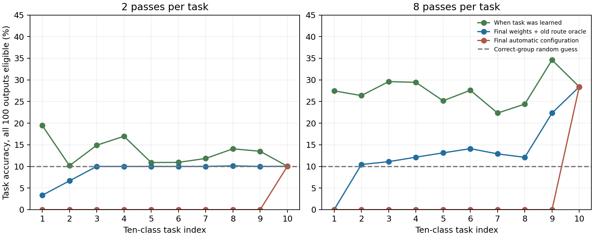
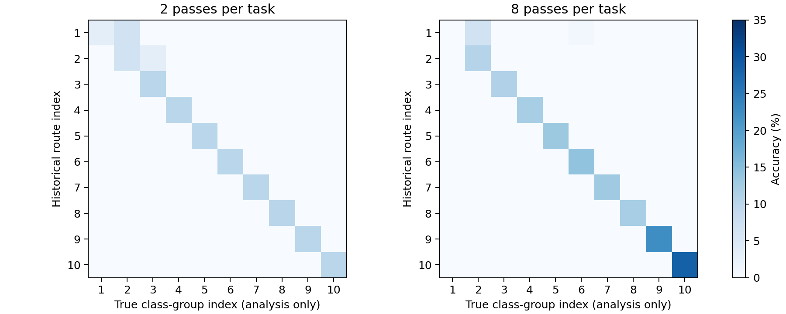

# Split CIFAR-100: historical branch-route oracle test

Completed on 14 October 2026. **Historical routes improve final accuracy, but the strong 98% MNIST recovery does not reproduce in this small raw-pixel CIFAR-100 model. Acquisition and joint capacity are also weak, so this is not a decisive test of the broader branch-memory hypothesis.**

## Results

| Sequential model | Passes per task | Mean accuracy when each task was learned | Final automatic accuracy | Final correct-route oracle |
|---|---:|---:|---:|---:|
| Original hard branch rule | 2 | 13.28% | 1.00% | 9.02% |
| Uniform branch averaging | 2 | 11.65% | 1.02% | 1.02% |
| Matched ordinary MLP | 2 | 17.02% | 1.79% | Not available |
| Original hard branch rule, longer training | 8 | 27.54% | 2.84% | 13.66% |

All values average three seeds (491–493), with one fixed random class order. Every prediction has all 100 logits eligible. Oracle route selection uses the true ten-class group to select an externally saved configuration, so it is explicitly task-assisted analysis. There is no output mask in the branch oracle. Uniform averaging ignores configurations.

| Joint exposure capacity control | Full 100-class accuracy |
|---|---:|
| Same branch architecture, 2 epochs with all classes mixed | 7.72% |
| Same branch architecture, 8 epochs with all classes mixed | 12.49% |

Joint exposure uses the same total number of gradient-training presentations as its sequential counterpart. These controls show limited acquisition of fine-grained CIFAR-100 distinctions in this architecture; they are not continual-learning results.

## Dataset and architecture

The official CIFAR-100 archive was found in the parent project, copied into the workspace and verified against its published archive checksum by the existing loader. Data comprise 45,000 fitting images, 5,000 held-out training images (50/class) and the full official 10,000 test images (100/class). The loader fixes a random class order with seed 2026; ten disjoint tasks each contain ten classes. That original-ID class order is recorded in the protocol.

The original MNIST architecture is adapted only for 3,072 RGB pixel inputs and 100 class outputs: 24 neurons × four tanh branches, a pooled 24-dimensional hidden vector and one shared linear classifier. Inputs are raw pixels scaled to [0,1]. Training uses current ten-class cross-entropy plus 0.5 times the mean counterfactual branch cross-entropy, branch-error EMA 0.95, hard minimum-error gates, Adam 0.001, clipping 5, batch size 128. There is no pretraining, convolution, augmentation, replay or optimizer/memory reset between tasks. This is a direct small-model transfer, not a competitive CIFAR-100 vision system.

The uniform arm has identical architecture, initialization and auxiliary objective but constant 1/4 branch weights. The ordinary baseline has 93 tanh hidden units and standard cross-entropy, selected to give a similar parameter count. It does not receive the counterfactual auxiliary loss.

| Model | Trainable parameters | Persistent numeric model bytes |
|---|---:|---:|
| local | 297,508 | 1,190,416 |
| uniform | 297,508 | 1,190,416 |
| mlp | 295,189 | 1,180,756 |

The branch model is 297,508 parameters and the MLP is 295,189, approximately 0.8% fewer. Each branch checkpoint stores a 96-value error buffer. The external ten-route bank adds 240 int64 indices, or 1,920 bytes. Optimizer state and temporary counterfactual tensors are excluded from the persistent inference figures.

## Oracle audit

After each task we externally saved the 24 winning branch indices. At the end, the same final network weights and classifier were evaluated under every saved configuration on every test image. Each configuration produced 100 logits. Only afterward did true class-group information select the corresponding route for the oracle metric. No correct class within the group was supplied.

Independent original forward calls, with only the gate buffer restored to each old route, reproduced all cached route predictions exactly. Final model state was restored and checked unchanged. A cyclic wrong-route control assigns each true group the next historical route and achieves 0.00% in both branch budgets. This is a diagnostic manipulation, not an inference algorithm.

## Retention of what was acquired

| Budget | First nine tasks at acquisition | First nine tasks under final oracle routes | Last task under final route |
|---|---:|---:|---:|
| 2 passes/task | 13.64% | 8.90% | 10.03% |
| 8 passes/task | 27.44% | 12.03% | 28.40% |

The historical routes do not recover most of the acquired accuracy on older tasks. This differs from the nearly intact MNIST recovery. But initial task learning was limited too, so a low final score combines acquisition limitations and loss of accessible earlier skills.

## Interpreting task assistance

Unrestricted random 100-class guessing has expected accuracy 1%. An oracle identifying the correct ten-class group permits a strategy that guesses within that group to achieve 10%. The branch oracle does **not** explicitly mask outputs, but its provided group information makes 10% a useful contextual reference. Its 9.02% two-pass score is below that reference; 13.66% after eight passes is only modestly above it. Comparing solely with 1% would exaggerate the strength of the oracle result.

The final ordinary MLP reaches 1.79% without assistance. A separate diagnostic explicitly masks its outputs to the true ten-class task and reaches 10.59%. This uses a different oracle intervention from branch-route restoration, so it is not a pure architecture comparison. It demonstrates that supplying task information can help an ordinary classifier too.

## Conclusion and next step

There is a measurable route-dependent effect at unchanged final weights, but no strong CIFAR-100 retained-skill result in this pilot. Increasing training improves acquisition and some recovery, without closing the gap. Results cannot establish a branch-specific advantage, and the original fixed hyperparameters were not independently tuned for CIFAR-100.

The next useful experiment should use a stronger visual representation shared by branch and ordinary controls, first demonstrate good acquisition, and then repeat this unrestricted 100-class oracle audit. A frozen pretrained encoder would test the downstream routing mechanism; a jointly learned encoder would test a broader learning system. Those settings must be reported separately from this from-scratch raw-pixel pilot.

## Reproducibility and checks

- [Experiment driver](../../bdh_cl/scripts/cifar100_oracle_routes.py), [protocol and class order](../../results/cifar100_oracle_routes_20261014/protocol.json), [18 run records](../../results/cifar100_oracle_routes_20261014/results.json), [final checkpoints and routes](../../results/cifar100_oracle_routes_20261014/models).
- Verified dataset checksum, counterfactual logits against direct neuron replacement, 100-output shape, all ten historical-route predictions against independent original forwards, and complete final-state invariance during oracle analysis.
- Three seeds, one class order, small raw-pixel architecture, fixed transferred optimizer/settings, and two predetermined training budgets. Test outcomes did not select hyperparameters. No novelty, broad MLP superiority or conference-readiness claim follows from these numbers.

## Added parameter-matched MLP capacity controls

Nine paired follow-up runs complete the ordinary MLP joint and eight-pass sequential comparisons. The same seeds, class order, fitting/test data, minibatch order, Adam settings and number of training presentations are used. No settings were selected from these test results.

| Training condition | Branch model | Ordinary MLP |
|---|---:|---:|
| joint, 2 passes | 7.72% | 10.95% |
| joint, 8 passes | 12.49% | 15.72% |
| sequential, 2 passes | 1.00% | 1.79% |
| sequential, 8 passes | 2.84% | 2.14% |

| Sequential acquisition | Branch model | Ordinary MLP |
|---|---:|---:|
| 2 passes/task, mean current-task accuracy | 13.28% | 17.02% |
| 8 passes/task, mean current-task accuracy | 27.54% | 31.04% |

The MLP’s two/eight-pass known-task output-mask diagnostics reach 10.59%/12.30%. Branch saved-route oracles reach 9.02%/13.66%. These are **different oracle interventions** and cannot establish a clean branch advantage: the MLP masks its 100 outputs, while the branch oracle changes its hidden route with all outputs eligible. Both exploit correct group information.

The ordinary MLP learns better in joint training and at current-task acquisition, but its joint accuracy remains low. Thus the poor raw-pixel CIFAR-100 capacity is shared, not unique to branches. Matching parameter counts does not match hidden output dimension (93 versus 24), auxiliary objective, or computation. Those differences remain relevant to architectural attribution.

[Follow-up driver](../../bdh_cl/scripts/cifar100_mlp_capacity_control.py), [protocol](../../results/cifar100_mlp_capacity_control_20261014/protocol.json), [nine paired results](../../results/cifar100_mlp_capacity_control_20261014/results.json).

## Extending the mechanism to convolutional networks

A convolutional output channel can have K alternative filters instead of one. For channel n and branch k, compute b_(n,k)=tanh(conv(X,W_(n,k))). Pool their feature maps with gates g_(n,k) to produce h_n=sum_k g_(n,k)b_(n,k). The branch-error/usage state can then belong to each channel and layer; a hard saved configuration selects one filter per channel. We have not trained this proposed architecture in the current study.

The simplest first experiment is a visual CNN encoder shared by a branch head and a matched ordinary head. Freezing the encoder isolates downstream branch routing from feature drift. A later experiment can replace the final convolution with a branched convolution and compare against a matched ordinary CNN. If the branch layer directly precedes global average pooling and a linear classifier, channel-level counterfactual logits can be computed exactly without rerunning a nonlinear downstream network. For earlier branched layers, that same linear shortcut is not exact.

A pretrained encoder must be disclosed and used equally by controls; it does not establish from-scratch continual learning. Before testing route retention, establish substantially better joint and current-task acquisition. Learned upstream convolutional features can also drift; restoring downstream branches cannot by itself undo upstream forgetting.
