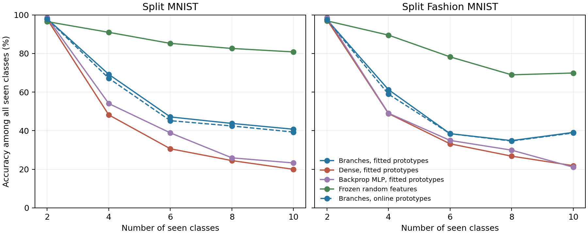

# Class-incremental branch learning with prototype classifiers

Completed on 13 October 2026. **Branches outperform the dense local-coded learner in this experiment, but both are far below frozen random features. This is a relative advantage under a restricted learning rule, not a successful general continual-learning result or a broad MLP superiority claim.**

## What was tested

Five successive disjoint pairs of classes: 0/1, 2/3, 4/5, 6/7, 8/9, and the reversed pair order. Each model receives two passes over the current classes, using all 60,000 training images in total per pass across the full sequence. Inference compares against every class observed so far, reaching all ten classes at the end. No task identity, correct pair, test label, saved route configuration, or replay examples enter prediction. Prototypes explicitly store class summaries; this is not memory-free learning.

The branch and dense learners use the same initial 785×256 input weights, normalized inputs, tanh responses, fixed supervised teaching codes, and local squared-error weight updates. Branches train one response in each of 64 groups of four and track neighboring reliable coactivity; dense learning updates all 256 responses. Protection slows updates as reliable usage accumulates. A frozen baseline keeps the same initial random response weights unchanged.

**Primary classifier:** each class has a 256-dimensional mean response vector. Both learners use exactly the same squared Euclidean nearest-prototype rule over their full 256 responses. This makes the readout comparison direct; the branch advantage in this classifier concerns selective learning/protection, not communication at inference.

**Secondary branch classifiers:** choose the best-matching branch per group, with or without learned neighbor compatibility. All class hypotheses are scored; the true class never selects a route. These secondary readouts use the same final input weights and prototypes as the flat classifier but are different classifiers from the dense primary.

## Prototype construction and fair-control checks

1. Online means average the post-update responses of current labeled training minibatches. Repeated epochs count as repeated observations. Old-class prototypes are never refreshed after their classes leave the stream.
2. A follow-up fits each current class prototype after its feature training finishes, using one additional non-learning pass over current training images. Earlier classes are never revisited. This uses the current-stage boundary to schedule fitting but supplies no task ID to prediction. It removes within-acquisition averaging drift, while allowing later feature drift to remain.

Each architecture independently selected its protected learning rate and usage scale on a 50,000/10,000 training/validation split, using one development seed per dataset and forward class order. Candidate base rates were 0.25 and 1, with scales 1,000 and 10,000; dense rates were divided by four and scales multiplied by four to adjust nominal update exposure. Official test images were not used for selection. Fresh confirmation uses three seeds per dataset and both pair orders. Orders are paired repeats, not six independent seeds. Protection-off is an ablation at the protected model’s chosen settings, not independently tuned. The prototype-fitting follow-up reuses these settings and seeds without retuning.

| Dataset | Branch selected rate / usage scale | Dense selected rate / usage scale |
|---|---|---|
| Split MNIST | 1.0 / 1000 | 0.25 / 40000 |
| Split Fashion MNIST | 1.0 / 1000 | 0.25 / 40000 |

Branches store 822,800 numeric bytes; dense and frozen controls store 818,768 bytes (about 0.5% less). This includes 10×256 FP32 prototypes and ten int64 counts, adding 10,320 bytes to each underlying model. Persistent budgets exclude temporary tensors and peak working memory. Dense updates four times as many response units; this is not an equal-compute test.

Curves average three seeds and two orders. The classifier always considers all seen classes; declining accuracy can reflect both representation drift and competition from newly introduced classes.

## Main comparison: identical nearest-prototype classifier

| Dataset | Prototype construction | Model | Final ten-class accuracy | Old eight classes | Newest pair | Seed SD of final accuracy |
|---|---|---|---:|---:|---:|---:|
| Split MNIST | Online | branch_protected | 39.29% | 24.81% | 95.96% | 1.42 pp |
| Split MNIST | Online | dense_protected | 19.92% | 0.00% | 97.13% | 0.04 pp |
| Split MNIST | Online | branch_unprotected | 33.86% | 17.47% | 98.13% | 4.81 pp |
| Split MNIST | Online | dense_unprotected | 20.03% | 0.03% | 97.54% | 0.03 pp |
| Split MNIST | Online | frozen | 80.80% | 79.88% | 83.34% | 0.60 pp |
| Split MNIST | Fitted after current training | branch_protected | 40.75% | 26.68% | 95.98% | 1.29 pp |
| Split MNIST | Fitted after current training | dense_protected | 19.98% | 0.04% | 97.31% | 0.06 pp |
| Split MNIST | Fitted after current training | backprop_mlp | 23.29% | 3.93% | 98.34% | 0.78 pp |
| Split Fashion MNIST | Online | branch_protected | 38.83% | 25.24% | 93.21% | 0.53 pp |
| Split Fashion MNIST | Online | dense_protected | 21.19% | 2.20% | 97.15% | 1.26 pp |
| Split Fashion MNIST | Online | branch_unprotected | 29.13% | 11.97% | 97.74% | 3.09 pp |
| Split Fashion MNIST | Online | dense_unprotected | 21.93% | 3.09% | 97.27% | 1.58 pp |
| Split Fashion MNIST | Online | frozen | 69.88% | 65.90% | 85.78% | 0.63 pp |
| Split Fashion MNIST | Fitted after current training | branch_protected | 39.12% | 25.67% | 92.89% | 0.82 pp |
| Split Fashion MNIST | Fitted after current training | dense_protected | 21.88% | 3.09% | 97.02% | 0.66 pp |
| Split Fashion MNIST | Fitted after current training | backprop_mlp | 21.11% | 1.94% | 97.78% | 1.63 pp |

Seed SD is computed after averaging the two orders within each seed. The frozen classifier uses online means; because its representation never changes, these means use one consistent coordinate system.

## Secondary routing and communication ablations

| Dataset | Prototype construction | Protection | Flat | Grouped, no communication | Grouped + communication |
|---|---|---|---:|---:|---:|
| Split MNIST | Online | branch_protected | 39.29% | 27.68% | 39.05% |
| Split MNIST | Online | branch_unprotected | 33.86% | 25.03% | 24.06% |
| Split MNIST | Fitted | branch_protected | 40.75% | 33.02% | 44.14% |
| Split Fashion MNIST | Online | branch_protected | 38.83% | 31.52% | 37.78% |
| Split Fashion MNIST | Online | branch_unprotected | 29.13% | 29.61% | 25.80% |
| Split Fashion MNIST | Fitted | branch_protected | 39.12% | 35.06% | 39.27% |

## Conventional backpropagation MLP control

A conventional 256-unit tanh MLP learns its input weights and a ten-class linear head using cross-entropy and SGD without momentum. Its features are classified using exactly the same fitted nearest-class prototypes as the primary comparison. Input normalization, initial input weights, data/order, two learning passes, validation split and current-only prototype fitting are shared. Learning rates 0.03, 0.3 and 1 were selected independently using final validation prototype accuracy. All ten outputs participate in training; no current-pair mask is used. Its 824,440-byte persistent state is about 0.2% larger than branches. This is a naive trained MLP control, not a state-of-the-art continual-learning method or an exhaustive optimizer search.

## Drift and retained performance

We measured each test class’s mean response at acquisition and again after later learning, only for analysis. These test means never update the model or its prototypes. Class-mean drift is a partial representation diagnostic; it does not capture every change in the feature distribution. Backward transfer below is final pair accuracy minus its accuracy when learned, averaged across the first four pairs. New classes compete at later evaluation, so negative transfer is not solely a weight-overwrite measure.

| Dataset | Prototype construction | Model | Backward transfer | Old-class mean response drift (MSE) |
|---|---|---|---:|---:|
| Split MNIST | Online | branch_protected | -71.53 pp | 0.121597 |
| Split MNIST | Online | dense_protected | -97.16 pp | 0.761895 |
| Split MNIST | Online | frozen | -8.53 pp | 0.000000 |
| Split MNIST | Fitted | branch_protected | -69.58 pp | 0.121597 |
| Split MNIST | Fitted | dense_protected | -97.13 pp | 0.761895 |
| Split MNIST | Fitted | backprop_mlp | -94.33 pp | 0.037715 |
| Split Fashion MNIST | Online | branch_protected | -72.23 pp | 0.157666 |
| Split Fashion MNIST | Online | dense_protected | -95.95 pp | 0.849246 |
| Split Fashion MNIST | Online | frozen | -15.25 pp | 0.000000 |
| Split Fashion MNIST | Fitted | branch_protected | -71.59 pp | 0.157666 |
| Split Fashion MNIST | Fitted | dense_protected | -95.09 pp | 0.849246 |
| Split Fashion MNIST | Fitted | backprop_mlp | -96.69 pp | 0.039906 |

## What this means for the hypothesis

The class-incremental comparison does reveal a substantial branch-versus-dense difference under this local coded learning rule. Therefore similar domain-incremental results did not imply the two learners would behave identically here. But the dense control performs poorly, and the branch learner also damages a representation whose initial random version already supports much higher prototype accuracy. Relative superiority over this dense learner is insufficient evidence of a practical advantage.

The primary flat readout does not use branch communication. Its differences concern selective grouped training, exposure, local protection and representation drift. Secondary communication results must be interpreted separately. Fixed teaching-code coverage and active-unit count are still confounds; a conventional fixed-rate SGD MLP was independently selected and tested as an additional control below. This is still not a comparison against all ordinary learning rules or established continual-learning methods.

Fitting current prototypes after training cannot prevent later changes in old-class embeddings. A useful next direction is protecting those embeddings while improving new-class discrimination, followed by stronger protection schedules for the backpropagation baseline and a sparse dense control with matched code coverage. The present result is a diagnostic lead, not proof that dendritic short-term memory solves class-incremental learning.

## Reproducibility

- [Main driver](../../bdh_cl/scripts/class_incremental_branch_prototypes.py), [protocol](../../results/class_incremental_branch_prototypes_20261013/protocol.json), [validation selection](../../results/class_incremental_branch_prototypes_20261013/selection.json), [60 confirmation models](../../results/class_incremental_branch_prototypes_20261013/results.json).
- [Prototype-fitting driver](../../bdh_cl/scripts/class_incremental_prototype_refresh.py), [follow-up protocol](../../results/class_incremental_prototype_refresh_20261013/protocol.json), [24 paired follow-up models](../../results/class_incremental_prototype_refresh_20261013/results.json).
- [Conventional MLP driver](../../bdh_cl/scripts/class_incremental_mlp_prototypes.py), [protocol](../../results/class_incremental_mlp_prototypes_20261013/protocol.json), [selection](../../results/class_incremental_mlp_prototypes_20261013/selection.json), [12 paired confirmation models](../../results/class_incremental_mlp_prototypes_20261013/results.json).
- Verified explicit Euclidean predictions, old prototype invariance at every stage, prototype fitting leaves input weights unchanged, complete run counts, and five-stage result matrices. Sixteen local-rule and six ordinary-MLP development models precede confirmation.
