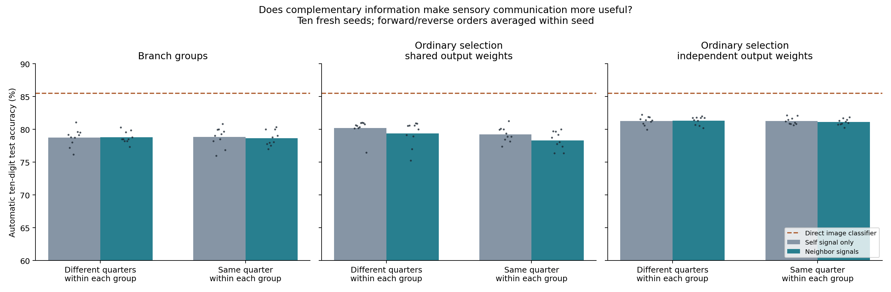
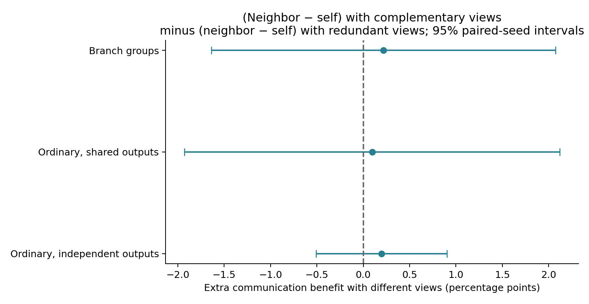

# Complementary sensory fields and communication: controlled confirmation

Completed 21 October 2026. This study tests whether communication helps more when alternatives see different image regions than when they repeatedly see the same region. It uses ten fresh initialization seeds, both digit-pair orders, common validation-selected settings, and an exactly matched ordinary-selection control.

**Main finding: the complementary-information hypothesis is not confirmed for this one-step exchange rule.** Branch automatic accuracy is 78.75% with self signals and 78.79% with neighbor signals under complementary views. Its extra communication benefit over redundant views is +0.22 percentage points (95% interval -1.64 to +2.07). Both ordinary-selection controls also have interaction intervals spanning zero. This does not establish exact equivalence or rule out every practically relevant effect.

The exactly matched ordinary-selection control reaches 80.23% without exchange and 79.40% with exchange under complementary views. Independent-output ordinary selection reaches 81.30% and 81.34%. There is no demonstrated automatic branch advantage. Old-digit branch accuracy changes from 76.63% to 76.25% with exchange, while newest-digit accuracy improves; the small overall change is not evidence of improved old-skill retention.

At fixed final weights, replacing neighbor signals by self signals changes complementary branch accuracy by only about 0.05 percentage points. The trained models have very little practical dependence on this exchanged evidence. The direct classifier remains stronger at 85.53%.

## What was controlled

- All models have 96 learned sensory responses and select exactly 24 of them per prediction. Each response reads exactly 196 pixels using 196 actual weights; no masked-out unused input parameters are allocated.
- In a **complementary group**, the four responses see different image quarters. In a **redundant group**, all four see the same quarter, but have different learned filters. Across the full network, every quarter supplies exactly 24 responses in both conditions. Thus global coverage and input-weight budgets match.
- **Neighbor exchange** lets a response mix signals from two other responses in its four-response group. **Self-only** uses its own signal in the same computation. Both have the same 96 trainable message gains and computation depth. Self-only means no exchange between responses, not absence of the extra transform.
- **Branch grouping** selects one response within every group and shares output connections within that group. **Ordinary global selection with shared outputs** selects any 24 of 96 responses, retaining precisely the same output-weight sharing and parameter count. This isolates the restriction on selection. **Ordinary independent outputs** also selects globally, but every response has separate output connections; it has 720 additional parameters.
- Shared-output networks have 19,258 learned parameters; independent-output networks have 19,978. All four view/communication conditions within each structure share the same initialization and parameter count.

## How automatic selection works

A fixed 64-dimensional summary of the current image is associated with the currently active response mask during training. An online ridge-regression learner stores covariance and cross-statistics, without storing old examples. At evaluation it predicts response scores from the image; the network selects its 24 active responses from those scores. No task identity or historical mask archive enters automatic predictions.

Labels supervise the neural prediction loss and a separate direct-classifier control. They do not supervise the image-to-mask association memory. Every association is written from the pre-update mask while the corresponding image is current.

**Historical recovery** instead uses the correct digit pair to select its phase-end mask. It is a diagnostic with task assistance, not automatic continual-learning accuracy. Final weights and classifier remain unchanged; all ten digit outputs remain eligible.

## Main automatic accuracy comparison

Percentages average both orders within each seed, then the ten seed means. Dots in the figure show those ten paired seed means. The plotted y-axis begins at 60% to expose differences.

| Selection structure | Different views: self | Different views: exchange | Same view: self | Same view: exchange |
|---|---:|---:|---:|---:|
| Branch groups; shared output weights | 78.75% | 78.79% | 78.84% | 78.66% |
| Ordinary global selection; same shared output weights | 80.23% | 79.40% | 79.26% | 78.34% |
| Ordinary global selection; independent output weights | 81.30% | 81.34% | 81.29% | 81.12% |

## The main causal comparison

The interaction below asks whether communication gains more from different sensory views than from repeated views. Specifically: (exchange minus self-only with complementary views) minus (exchange minus self-only with redundant views). A positive value favors the complementary-information hypothesis.

| Structure | Exchange effect, different views | Exchange effect, same view | Extra benefit from different views |
|---|---:|---:|---:|
| Branch groups; shared output weights | +0.04 [-1.21, +1.30] | -0.18 [-1.32, +0.97] | +0.22 [-1.64, +2.07] |
| Ordinary global selection; same shared output weights | -0.83 [-2.47, +0.81] | -0.92 [-1.40, -0.45] | +0.10 [-1.93, +2.12] |
| Ordinary global selection; independent output weights | +0.03 [-0.42, +0.48] | -0.16 [-0.66, +0.33] | +0.20 [-0.51, +0.90] |

Values are percentage-point differences with 95% paired-seed t intervals in brackets, using ten independent initialization seeds (nine degrees of freedom). Orders are paired, not independent seeds. The intervals are not adjusted for multiple comparisons.

## Retention and acquisition

**Old digits** means the eight digits from the earlier four pairs. **Newest digits** means the final pair. **Acquisition** measures current-pair accuracy immediately after learning each pair. These separate preserving old ability from merely learning the current task well.

| Structure | Views | Signals | Automatic | Old digits | Newest digits | Historical recovery | Acquisition |
|---|---|---|---:|---:|---:|---:|---:|
| Branch groups; shared output weights | complementary | self | 78.75% | 76.63% | 86.69% | 95.60% | 97.56% |
| Branch groups; shared output weights | complementary | neighbor | 78.79% | 76.25% | 88.38% | 96.26% | 97.87% |
| Branch groups; shared output weights | redundant | self | 78.84% | 76.59% | 87.28% | 95.64% | 97.59% |
| Branch groups; shared output weights | redundant | neighbor | 78.66% | 76.05% | 88.55% | 96.27% | 97.71% |
| Ordinary global selection; same shared output weights | complementary | self | 80.23% | 78.24% | 87.61% | 95.72% | 97.84% |
| Ordinary global selection; same shared output weights | complementary | neighbor | 79.40% | 76.75% | 89.44% | 94.17% | 98.27% |
| Ordinary global selection; same shared output weights | redundant | self | 79.26% | 76.96% | 87.93% | 95.01% | 97.39% |
| Ordinary global selection; same shared output weights | redundant | neighbor | 78.34% | 75.50% | 89.05% | 93.31% | 97.39% |
| Ordinary global selection; independent output weights | complementary | self | 81.30% | 79.70% | 87.22% | 95.62% | 97.46% |
| Ordinary global selection; independent output weights | complementary | neighbor | 81.34% | 79.60% | 87.82% | 95.78% | 97.56% |
| Ordinary global selection; independent output weights | redundant | self | 81.29% | 79.68% | 87.24% | 95.74% | 97.42% |
| Ordinary global selection; independent output weights | redundant | neighbor | 81.12% | 79.32% | 87.84% | 95.98% | 97.45% |

The direct classifier, trained from the same image summaries and current digit labels, achieves **85.53%** without a neural backbone. Its targets differ from mask prediction, so this is a complete-method baseline. Features are fixed; repeated seed values are not independent learned representations.

## Is there an advantage specifically from grouping?

These differences subtract the ordinary-selection control from the grouped branch model under the same view and communication condition. The shared-output comparison is exactly parameter matched and differs only in the restriction on selecting responses. The independent-output comparison additionally changes classifier sharing and has 720 more control parameters.

| Comparison | Automatic accuracy difference and 95% interval |
|---|---:|
| branch minus global shared / complementary / self | -1.47 [-2.90, -0.05] |
| branch minus global independent / complementary / self | -2.55 [-3.60, -1.51] |
| branch minus global shared / complementary / neighbor | -0.61 [-2.15, +0.94] |
| branch minus global independent / complementary / neighbor | -2.54 [-3.41, -1.67] |
| branch minus global shared / redundant / self | -0.42 [-1.32, +0.48] |
| branch minus global independent / redundant / self | -2.45 [-3.78, -1.11] |
| branch minus global shared / redundant / neighbor | +0.33 [-0.83, +1.49] |
| branch minus global independent / redundant / neighbor | -2.46 [-3.38, -1.53] |
| branch interaction minus global shared | +0.12 [-3.44, +3.68] |
| branch interaction minus global independent | +0.02 [-2.15, +2.19] |

## Frozen inference intervention

For each exchange-trained network, neighbor signals were replaced by self signals at the final fixed weights, with unchanged associative memory and therefore unchanged automatic masks. This measures dependence on exchanged evidence during prediction. It is distinct from comparing separately trained exchange and self-only networks, because an intervention can disrupt a learned computation.

| Exchange-trained model | Original exchange minus self-only intervention |
|---|---:|
| grouped shared / complementary / neighbor | +0.05 [+0.01, +0.08] |
| grouped shared / redundant / neighbor | +0.02 [+0.00, +0.04] |
| global shared / complementary / neighbor | +0.04 [-0.01, +0.09] |
| global shared / redundant / neighbor | -0.02 [-0.06, +0.03] |
| global independent / complementary / neighbor | +0.02 [-0.01, +0.05] |
| global independent / redundant / neighbor | -0.00 [-0.04, +0.03] |

## Selection, state, and verification

- Development initialization 600 uses a stratified 50,000/10,000 split of training images. All 12 cells are trained at Adam rates 0.001 and 0.003. One common rate and one common ridge strength are selected by mean automatic validation accuracy across all cells, avoiding separately tuned treatment settings. Selected rate: 0.001; selected mask-predictor ridge: 0.1; direct-classifier ridge: 0.1.
- The selection manifest and protocol hash were saved before any confirmation run. Confirmation uses seeds 601–610, forward and reverse pair order, all 60,000 training images and the official 10,000 test images: 240 neural confirmation runs, plus 24 development runs. No confirmation retuning, checkpoint selection, or optional stopping.
- Two epochs per pair, batch 128, one continuous Adam optimizer, gradient clipping 5, usefulness EMA decay 0.95. No replay, pretraining, task-ID input, optimizer resets, trace resets, or explicit protection penalties.
- Sensory exchange is one step: e = tanh(z), response = 0.75e + 0.25tanh(z + gain × incoming). Neighbor incoming averages two responses within the group; self incoming is e. The four complementary quarter views use geometrical adjacency around top-left, top-right, bottom-right, bottom-left. Gradients can pass through unselected senders, so the rule changes both integration and selective preservation.
- Each deployed mask-regression memory needs 40,960 numeric bytes: a 64×64 covariance and a 96×64 cross-statistic matrix. The direct classifier needs 18,944 bytes. A field-only sum-based reader is a separate secondary method needing 24,576 bytes. All candidates coexist in experiment checkpoints for paired analysis; their union is not a deployment budget.
- Shared-output model state occupies 81,256 numeric bytes, including parameter and routing/index buffers; adding mask-regression memory gives 122,216 bytes. Independent-output model state adds 2,880 bytes. Optimizer state, Python metadata, temporary tensors, and historical diagnostic banks are excluded. Actual input matrices contain only the allowed 196 contacts per response.
- Verification checks globally balanced fields, the intended within-group overlap, exact compact projection equivalence, invariance to out-of-field pixels before exchange, equal active counts, exact shared-output parameter matching, zero-gain exchange equivalence, finite gradients, usefulness finite differences, pre-update association targets, ridge agreement with a batch reference, and memory-write isolation.
- Every official evaluation verifies unchanged model and association-memory checksums. The frozen-inference audit covers all 120 exchange-trained models; it changes no learned weight, input association, or automatic selection. Historical masks enter only task-assisted diagnostics.

## Interpretation limits

This is a confirmation over new initializations of the same MNIST dataset, not a new dataset or evidence about arbitrary tasks. Repeated same-quarter views still contain distinct learned filters; they are spatially redundant, not identical response values. Both conditions cover the full image globally, but their within-group access differs by design. Global image keys give the selector whole-image information even when sensory responses have partial fields; a field-only reader is reported separately in raw records.

This is a controlled confirmation of the hypothesis, not an exact rerun of the earlier three-seed pilot: the earlier model used 25 groups and masked 784-input matrices, whereas this one uses 24 balanced groups, actual 196-input matrices with their native initialization, and one common validation-selected optimizer/reader setting. These changes make the new factorial comparisons cleaner but limit direct attribution of the old-versus-new result to seed count alone.

A positive interaction supports a benefit from complementary evidence under this update and selection rule. It does not by itself show a branch-specific advantage: that requires outperforming the exactly matched ordinary-selection control. Negative or uncertain effects apply to this one-step exchange rule and finite validation search, not all possible communication mechanisms. A direct-classifier advantage must remain visible when assessing practical value.

## Reproducibility

- [Training and evaluation driver](../../bdh_cl/scripts/complementary_exchange.py), [frozen inference audit](../../bdh_cl/scripts/audit_complementary_exchange.py), [protocol](../../results/complementary_exchange_20261021/protocol.json).
- [All development candidates](../../results/complementary_exchange_20261021/development.json), [frozen selection](../../results/complementary_exchange_20261021/selection.json), [240 confirmation records](../../results/complementary_exchange_20261021/results.json).
- [Summary and paired intervals](../../results/complementary_exchange_20261021/summary.json), [120 inference interventions](../../results/complementary_exchange_20261021/inference_intervention.json), [verification](../../results/complementary_exchange_20261021/verification.json), [completion](../../results/complementary_exchange_20261021/completion.json).
- Final model/memory checkpoints, phase-end diagnostic masks, run logs, and archived source are in the results directory. Primary and secondary analysis are retained for every cell.
