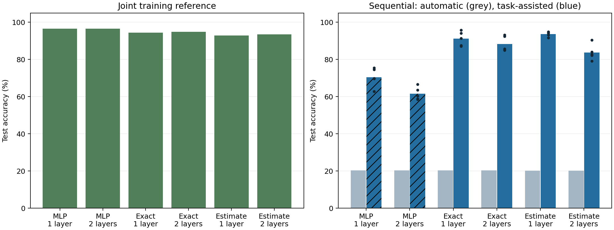
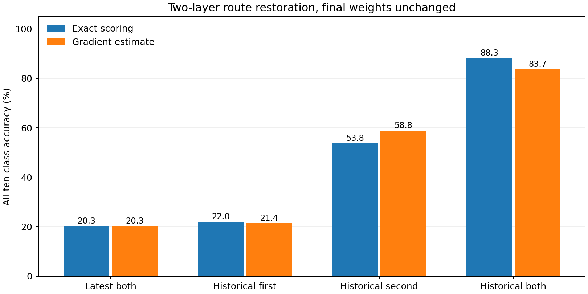

# Controlled depth comparison and layer-specific recovery

Completed on 20 October 2026. Across five fresh seeds and both class orders, oracle recovery was 91.19% → 88.27% for exact scoring and 93.67% → 83.74% for gradient estimates when moving from one to two hidden layers at nearly equal parameter budget. The exact-score depth difference is uncertain; the estimated-score decline is clearer under this protocol. Restoring both layer configurations outperforms either alone. All automatic sequential accuracies remain near 20%; automatic retrieval is not included.

## Accuracy

| Model | Parameters | Joint | Sequential automatic | Current-pair acquisition | Oracle / task-assisted | Oracle seed SD |
|---|---:|---:|---:|---:|---:|---:|
| MLP, one layer | 78,715 | 96.50% | 20.31% | 99.12% | 70.45% | 5.06 pp |
| MLP, two layers | 78,775 | 96.49% | 20.30% | 99.19% | 61.57% | 3.44 pp |
| Branches, one layer, exact | 78,760 | 94.32% | 20.32% | 99.09% | 91.19% | 3.88 pp |
| Branches, two layers, exact | 78,010 | 94.82% | 20.30% | 99.17% | 88.27% | 4.12 pp |
| Branches, one layer, gradient estimate | 78,760 | 92.89% | 20.24% | 99.00% | 93.67% | 1.30 pp |
| Branches, two layers, gradient estimate | 78,010 | 93.54% | 20.26% | 98.80% | 83.74% | 4.15 pp |

Branch oracle: the true digit pair selects saved hidden configurations, with final weights/head unchanged and all ten output classes eligible. MLP assistance: the true digit pair masks logits to two outputs. These are different interventions and cannot establish a pure architecture advantage. All automatic predictions allow ten classes and use no test labels or task ID.

## Does depth reduce recoverable accuracy?

Paired differences below are **two layers minus one layer**, averaging both orders within each seed. Intervals use five independent seed differences and a t distribution (four degrees of freedom); they describe this protocol, not all datasets or depths.

- exact: -2.92 pp (95% t interval -12.71 to +6.87).
- proxy: -9.93 pp (95% t interval -14.54 to -5.33).

At fixed parameter budget, depth trades off against layer width: one branch layer has 25 neurons × 4 branches; two layers each have 24 × 4. Thus this tests practical depth under a budget, not an isolated added layer with identical width and initialization. Learning rates are independently validation-selected. Five seeds do not establish a universal depth effect.

The old 98.02% result used one 24×4 layer, an auxiliary alternative loss and different seeds/settings. These new same-loss results do not directly replicate that earlier condition or prove that depth alone explains the historical difference.

## Which layer configurations must be restored?

| Scoring rule | Neither (latest routes) | First historical only | Second historical only | Both historical |
|---|---:|---:|---:|---:|
| exact | 20.30% | 22.01% | 53.77% | 88.27% |
| proxy | 20.26% | 21.39% | 58.81% | 83.74% |

For each image, the correct pair selects that pair’s snapshot in the indicated layer(s). Other layers retain their final global route. The all-historical condition exactly matches the ordinary route oracle; all-latest matches automatic accuracy. Restoring a single layer can disrupt compatibility with the other layer. These interventions identify configuration dependencies, not the anatomical location of all stored knowledge.

## Cost

| Model | CPU ms / training step | Versus same-depth MLP | Persistent model state | Saved forward storage |
|---|---:|---:|---:|---:|
| MLP, one layer | 0.352 | 1.00× | 314,860 bytes | 0.458 MB |
| MLP, two layers | 0.422 | 1.00× | 315,100 bytes | 0.499 MB |
| Branches, one layer, exact | 0.657 | 1.87× | 315,440 bytes | 0.472 MB |
| Branches, two layers, exact | 2.793 | 6.62× | 312,808 bytes | 0.531 MB |
| Branches, one layer, gradient estimate | 0.390 | 1.11× | 315,440 bytes | 0.472 MB |
| Branches, two layers, gradient estimate | 0.510 | 1.21× | 312,808 bytes | 0.531 MB |

Fresh process per arm, two CPU threads, batch 128, ten warmup updates and five blocks of twenty timed training steps; optimizer and routing updates included. Saved storage is deduplicated nonparameter storage retained for backward, including input, not total peak RAM. Exact alternatives run without gradients but still allocate transient workspace. No GPU or large-depth scaling inference follows. Detailed batch-1/batch-128 inference and process RSS are available in profile JSON files.

## Protocol and verification

- Real MNIST, full 60,000 training / 10,000 official test images in confirmation. Pixels divided by 255, tanh hidden responses, shared ten-output linear classifier.
- Five pairs (0/1 through 8/9), forward and reverse orders. Two epochs per current pair, batch 128, Adam, gradient clipping 5. No replay, pretraining, input-dependent retrieval, usage protection or boundary reset.
- All arms train factual cross-entropy only. Exact single-neuron alternative errors are computed without differentiation; approximate errors use factual backpropagated gradients. Error EMA 0.95 selects a global branch per neuron.
- Development seed 530 uses a stratified 50k fit / 10k validation split. For each arm and sequential/joint setting, choose among learning rates 0.0003, 0.001, 0.003 using final validation accuracy, with acquisition as a sequential tiebreak. Official test outcomes never choose settings.
- Fresh seeds 531–535: ten sequential and five independently trained joint runs per arm. Both orders are paired within seed. Total 36 development and 90 confirmation runs.
- Joint runs mix all classes with the same 120,000 example presentations as sequential training. No historical task snapshots affect ordinary training or predictions.
- Parameter count differences are below 1%. Branch state adds 400 bytes (one layer) or 768 bytes (two layers). A packed five-route oracle bank adds 125 or 240 bytes and is diagnostic-only.
- Exact alternatives match directly altered-route forwards in both depths; selected-row inference matches ordinary forwards; gradient derivatives match finite differences. Evaluation asserts unchanged model state. Both and neither restoration agree with independently computed oracle/automatic metrics.

## Selected learning rates

| Arm | Sequential | Joint |
|---|---:|---:|
| mlp1 | 0.003 | 0.003 |
| mlp2 | 0.003 | 0.003 |
| branch1_exact | 0.003 | 0.003 |
| branch2_exact | 0.003 | 0.003 |
| branch1_proxy | 0.003 | 0.001 |
| branch2_proxy | 0.003 | 0.003 |

## Reproducibility

- [Driver](../../bdh_cl/scripts/controlled_branch_depth.py), [archived driver](../../results/controlled_branch_depth_20261020/source.py), [protocol](../../results/controlled_branch_depth_20261020/protocol.json).
- [All validation candidates](../../results/controlled_branch_depth_20261020/selection.json), [90 confirmation records including per-pair restoration](../../results/controlled_branch_depth_20261020/results.json), [checks](../../results/controlled_branch_depth_20261020/verification.json), [checkpoints](../../results/controlled_branch_depth_20261020/models).
- Driver reuses the training/evaluation and profiling harness from [the preceding multilayer experiment](../../bdh_cl/scripts/multilayer_branch_comparison.py), adapting its MLP arm detection and replacing its architecture/update rule. No auxiliary objective is used.

## Next decision

Use the matched depth and restoration results to choose a backbone before adding online retrieval. A high oracle is a useful target but remains task-assisted. An autonomous follow-up must learn current input/activity associations during training, retrieve without labels/IDs, count all memory, and retain matched shared-memory and direct-input classifier controls.
