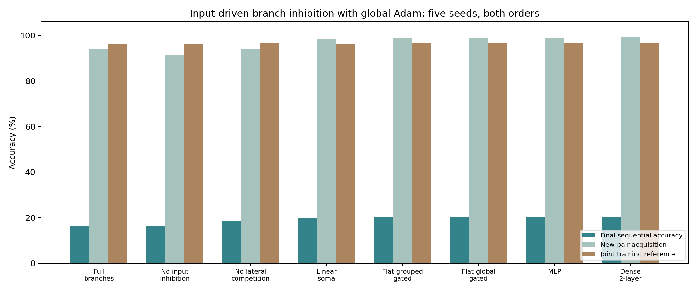

# Input-driven branches with global Adam — 26 October 2026

**Global Adam can fit the branch architecture, but this implementation does not solve continual retention.** The full model reaches 96.30% under joint training, yet only 16.26% after sequential training. Unlike the ordinary controls, it also has substantial current-task acquisition failures in some fresh runs. Thus this is not purely a routing/forgetting result.

## Architecture and learning

For each branch, $z_b=W_bx-\theta_b$, $I_b(x)=\operatorname{softplus}(V_bq(x)+c_b)$, and $r_b=\operatorname{ReLU}(z_b-I_b(x)-0.5\operatorname{mean}_{c\ne b}\operatorname{ReLU}(z_c))$. The mean is over the other three branches of the same neuron. The soma computes $h_n=\tanh(\sum_b a_{nb}r_{nb}+d_n)$, then a shared ten-class classifier reads the 25 soma outputs. The fixed input description $q$ is a normalized 4×4 pooled image.

Branches contribute directly according to their responses. Multiple branches can be active; there is no winner chosen by a usefulness state, no route bank, cue memory, separate retriever, recurrence or configuration search. Thresholds, gains, inhibition connections, soma biases and classifier weights all learn together via ordinary global Adam/backpropagation. There is no special plasticity-protection mechanism and no short-term memory state. This is a trainable architectural test, not a biologically local learning-rule claim.

## Matched controls

- **No context:** replace learned input-dependent inhibition with its fixed initial value, retaining lateral competition; 1,700 fewer weights than full branches.
- **No competition:** remove lateral competition while retaining learned inhibition; same parameters.
- **Linear soma:** remove the soma tanh; same parameters. This can be flattened into a gated ReLU layer with a constrained classifier, and that equivalence is verified.
- **Flat grouped gated:** use the same 100 input-driven units and four-unit competition groups, but give every unit its own classifier connection instead of nonlinear soma integration.
- **Flat global gated:** the flat control with competition over all 100 units.
- **MLP / dense two-layer:** ordinary 101-ReLU-unit MLP or 91-ReLU→91-tanh model, within 0.4% of the full branch parameter budget.

All arms received the same candidate sparsity penalty on mean first-layer activity. The main flat controls are within 1% of full-branch parameters. This is near-matched parameter/storage access, not exact equality of functions, FLOPs or CPU time.

## Validation and confirmation

Seeds 850/851 used a stratified 50,000-image fit/10,000-image training-validation split, forward task order. Learning rate .001/.003 and activity penalty 0/.01 were selected independently per architecture and separately for sequential versus joint training. All 128 development fits are retained. Sequential selection maximized the harmonic mean of acquisition and final accuracy; joint selection maximized accuracy. No official-test metrics selected settings.

Fresh seeds 852–856 used full 60,000/10,000 train/test splits. Each selected sequential arm ran both task orders (80 fits); each joint reference ran once per seed (40 fits). All used two passes over each current pair, batch 128, gradient clip 5, ordinary Adam, no resets, no old-task replay, no task IDs or task-boundary inputs, no output masking. Current training labels supervise CE; evaluation labels only produce metrics. The scheduler presents task blocks; task boundaries are not model inputs or triggers for state/optimizer changes.

## Results

| Model | Parameters | Final all-ten accuracy | New-pair acquisition | Earlier four final accuracy | Latest pair final accuracy | Joint reference |
|---|---:|---:|---:|---:|---:|---:|
| branch full | 80,585 | 16.26% | 94.07% | 0.00% | 79.34% | 96.30% |
| branch no context | 78,885 | 16.34% | 91.33% | 0.00% | 79.74% | 96.31% |
| branch no competition | 80,585 | 18.30% | 94.17% | 0.00% | 89.00% | 96.52% |
| branch linear soma | 80,585 | 19.73% | 98.29% | 0.02% | 96.07% | 96.23% |
| flat group gated | 81,210 | 20.25% | 98.84% | 0.00% | 98.79% | 96.65% |
| flat global gated | 81,210 | 20.27% | 98.98% | 0.00% | 98.86% | 96.68% |
| mlp | 80,305 | 20.14% | 98.69% | 0.00% | 98.26% | 96.73% |
| dense2 | 80,727 | 20.30% | 99.06% | 0.00% | 99.05% | 96.88% |

Final all-ten accuracy is micro-averaged over the test set. Acquisition averages per-digit balanced current-pair accuracy immediately after its training; earlier/latest accuracies are also balanced within pairs. All ten logits remain eligible for these measurements. Joint references mix all ten digits with the same total presentations, so they are not continual-learning results.

The full model’s average acquisition is more than two points below the ordinary MLP, crossing the predeclared interpretability threshold. Its lower final accuracy therefore combines acquisition failure and failure to retain earlier performance. Even flat controls with approximately 99% acquisition retain essentially no earlier-pair accuracy. There is no branch-specific retention advantage.

## Paired final-accuracy differences

Descriptive unadjusted 95% t intervals over five seed-level differences, averaging both orders within seed. Small seed count and multiple comparisons limit inference; acquisition differences prevent a pure forgetting interpretation.

| Full branch model minus control | Difference | 95% interval |
|---|---:|---:|
| full minus mlp | -3.88 pp | [-6.71, -1.06] |
| full minus flat group gated | -3.99 pp | [-6.83, -1.14] |
| full minus flat global gated | -4.00 pp | [-6.83, -1.18] |
| full minus branch no context | -0.08 pp | [-4.18, +4.02] |
| full minus branch no competition | -2.04 pp | [-5.50, +1.42] |
| full minus branch linear soma | -3.47 pp | [-6.42, -0.51] |

## Activity and optimization diagnostics

The following are post-hoc descriptions on 100 test images per digit, not tuned success criteria. A unit is counted as recruited by a pair if active on more than 10% of its probe images; that threshold is arbitrary and was not searched. Single-unit activity/task mutual information is descriptive and can miss information in distributed population codes.

| Model | Active response fraction | Units recruited by all five pairs | Units recruited by exactly one pair | Latest-pair failures below 75% |
|---|---:|---:|---:|---:|
| branch full | 6.27% | 6.70% | 0.70% | 4/10 |
| branch no context | 6.56% | 6.90% | 1.90% | 4/10 |
| branch no competition | 8.80% | 9.30% | 1.30% | 2/10 |
| branch linear soma | 3.01% | 3.00% | 4.00% | 1/10 |
| flat group gated | 6.93% | 6.50% | 11.50% | 0/10 |
| flat global gated | 2.33% | 2.30% | 3.00% | 0/10 |
| mlp | 5.99% | 5.74% | 11.78% | 0/10 |
| dense2 | 8.94% | 9.89% | 5.71% | 0/10 |

Input-driven activity is not the same thing as stable task separation. Global gradients still change shared input/inhibition/classifier parameters; Adam moments can also continue parameter motion after an activity change. The soma/activation diagnostics are saved to help investigate instability, but saturation, dead units and classifier drift have not been causally isolated by this experiment. Removing the soma nonlinearity improves acquisition reliability in this sample, while not yielding retention. A normalized or otherwise stabilized soma would require a new validation/confirmation study, not retrospective tuning of these test runs.

## Memory and measured compute

No auxiliary inference memory is stored beyond learned weights/biases. Full branches use 322,340 bytes of FP32 parameters versus 321,220 for the MLP; the extra inhibition parameters are already included in that budget. Training-state counts include weights, Adam moments and optimizer scalar steps, excluding gradients, activations, allocator/Python overhead and data.

| Model | Inference state | Training persistent state | Inference batch 1 | Inference batch 128 | Training step batch 128 |
|---|---:|---:|---:|---:|---:|
| branch full | 322,340 B | 967,052 B | 0.0617 ms | 0.3195 ms | 1.1235 ms |
| flat group gated | 324,840 B | 974,544 B | 0.0538 ms | 0.2649 ms | 0.9757 ms |
| mlp | 321,220 B | 963,676 B | 0.0155 ms | 0.0664 ms | 0.5928 ms |
| dense2 | 322,908 B | 968,748 B | 0.0233 ms | 0.1163 ms | 0.7216 ms |

Profiles use two-thread CPU, repeated fresh checkpoint clones, full image-to-logits inference and forward/backward/clipping/Adam training. These are unoptimized small-model timings, not GPU/energy estimates. Equal parameter count does not imply equal latency, and dense tensor execution still computes inactive units; biological sparsity does not automatically save arithmetic here.

## Answer and limits

**Yes:** a global differentiable optimizer can train input-driven inhibition and branch integration without an explicit routing controller. Gradient checks and joint accuracy establish that this implementation is trainable.

**No demonstrated continual-learning benefit:** this choice of architecture/loss is not sufficient to preserve old skills. Some sequential runs also fail acquisition. Biological compartmentalization was not fully modeled, no local plasticity mechanism or fading state was included, and a specific failure of this unnormalized soma does not refute all dendritic architectures or all global optimizers.

The next scientific question should distinguish optimization stability from preservation: first stabilize new-task learning on validation data, then test whether any local write/protection mechanism improves retention beyond an ordinary equally sparse/gated control. Adding another external retriever would not answer this architectural question. No oracle recovery is reported here because no configuration bank exists in this model.

## Verification and evidence

All 120 saved checkpoints reproduce recorded accuracy exactly; inference leaves state unchanged. Checks verify nonzero finite gradients through inhibition/input/gains, the soma formula, independence from inference batch composition and the linear-soma equivalence. Source and selection hashes are preserved.

- [Experiment code](../../bdh_cl/scripts/input_driven_branch_inhibition.py), [audit/report/profile code](../../bdh_cl/scripts/report_input_driven_inhibition.py).
- [Protocol](../../results/input_driven_inhibition_20261026/protocol.json), [all validation fits](../../results/input_driven_inhibition_20261026/development.json), [locked settings](../../results/input_driven_inhibition_20261026/selection_lock.json), [all confirmation trajectories](../../results/input_driven_inhibition_20261026/confirmation.json).
- [Summary](../../results/input_driven_inhibition_20261026/summary.json), [contrasts](../../results/input_driven_inhibition_20261026/contrasts.json), [activity diagnostics](../../results/input_driven_inhibition_20261026/activity_diagnostics.json), [profiles](../../results/input_driven_inhibition_20261026/profile.json), [audit](../../results/input_driven_inhibition_20261026/audit.json).
