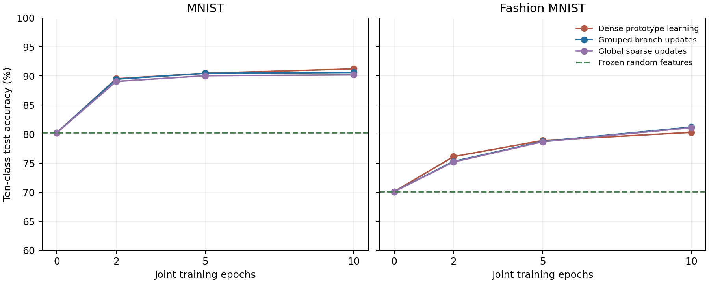

# Joint prototype-distance representation learning

Completed on 13 October 2026. This is an **acquisition test with all ten classes available together**, not continual learning. It tests whether gradient-based prototype learning can improve on the initial random representation.

## Main result

| Dataset | Frozen random features | Grouped branch updates | Dense updates | Global sparse updates |
|---|---:|---:|---:|---:|
| MNIST | 80.25% | 90.61% | 91.23% | 90.20% |
| Fashion MNIST | 70.11% | 81.21% | 80.30% | 81.11% |

All cells average three fresh paired seeds; every learned model trains for ten epochs. All arms store exactly 814,160 bytes of numeric persistent state. Class prototypes are explicit summary memory and included. The primary classifier is identical across arms.



## Experiment

Cached real MNIST and Fashion MNIST each supply 60,000 training images and 10,000 official test images. All ten classes are shuffled together. Images are normalized to unit length and augmented with a bias input. Each model has 256 tanh responses, with initial input weights sampled at standard deviation 0.02. Paired models share initial weights and minibatch order. There is no pretrained encoder, replay, task ID or learned output head.

Each class has a 256-dimensional mean response prototype μ_c. The training objective is cross-entropy over distance scores:

```text
h(x) = tanh([normalize(x), 1] W)
s_c(x) = -||h(x) - μ_c||² / T
p(c | x) = softmax(s(x))_c
L = -log p(y | x)
```

Prototypes are treated as detached targets when differentiating the loss. They are initialized from training-class means before learning. After each weight update, the current minibatch updates its class prototypes with EMA coefficient 0.1. After each epoch, all prototypes are refitted from the training images under the current weights. Frozen models fit their prototypes once from the same training data. Test labels are used only for scoring. Unlike the earlier sequential experiment, all classes remain available, so historical prototype staleness can be removed.

## What “branches” means in this test

- **Dense:** update all 256 response units using the prototype-loss gradient.
- **Grouped:** organize units into 64 groups of four; in each minibatch update the unit with the largest input-weight gradient norm in each group. Exactly 64 units update.
- **Global sparse:** update the 64 largest-gradient units over the whole layer without one-per-group constraints.
- **Frozen:** keep the initial input weights unchanged; learn only class prototypes.

This is a new gradient-based acquisition reference. Group structure restricts **learning**, while the prototype classifier reads the same full 256-dimensional response in all arms. It does not implement branch competition at inference, neighbor communication, usage protection, or the historical short-term error trace. Gradients are computed for all units before masking; this is neither a biological local-learning demonstration nor a sparse-gradient compute saving. It answers whether prototype-aligned learning is viable before trying a local approximation.

## Validation and confirmation

Each dataset uses one separate development seed (441/451), with 50,000 fitting images and 10,000 held-out training images, stratified at 1,000 per class. Each trainable arm independently selects among learning rates 0.03/0.3 and temperatures 0.03/0.3, based only on validation accuracy after ten epochs. Official test data never selects settings. Confirmation uses fresh seeds 442–444 and 452–454 with all 60,000 training images. Test checkpoints 0/2/5/10 were fixed in advance; no best-test-checkpoint selection. There are 24 development models, 18 learned confirmation models and six frozen references.

| Dataset | Arm | Selected rate | Selected temperature | Final test accuracy ± seed SD | Gain over paired frozen model |
|---|---|---:|---:|---:|---:|
| MNIST | dense | 0.3 | 0.3 | 91.23% ± 0.12 pp | 10.98 pp |
| MNIST | grouped | 0.3 | 0.03 | 90.61% ± 0.81 pp | 10.36 pp |
| MNIST | global_sparse | 0.3 | 0.03 | 90.20% ± 0.13 pp | 9.95 pp |
| Fashion MNIST | dense | 0.3 | 0.3 | 80.30% ± 0.06 pp | 10.19 pp |
| Fashion MNIST | grouped | 0.3 | 0.3 | 81.21% ± 0.12 pp | 11.10 pp |
| Fashion MNIST | global_sparse | 0.3 | 0.3 | 81.11% ± 0.22 pp | 11.00 pp |

The uncertainty term is sample standard deviation across three seeds, not a confidence interval. The paired gains are descriptive; no broad statistical significance claim is made.

## Previous fixed-code learner under joint training

A separate diagnostic trains the preceding fixed-code local learner jointly on all ten classes using the same fresh seeds, initial input weights, data order and ten-epoch budget. It uses its earlier class-incremental validation settings without joint retuning. The final classifier is again full-response nearest-class prototypes refitted after each epoch. This is not a pure loss ablation: branch selection, local weight updates, usage protection and learning-rate choices also differ.

| Dataset | Previous grouped fixed-code learner | Previous dense fixed-code learner |
|---|---:|---:|
| MNIST | 85.16% | 87.45% |
| Fashion MNIST | 74.09% | 77.40% |

This reference prevents attributing the difference between the earlier low sequential accuracy and the new joint accuracy solely to the prototype objective. Joint access to all classes removes interference and permits prototype refresh, both of which matter. A causal objective comparison would keep selection, protection, optimizer and tuning budget fixed while changing only the loss.

## Interpretation and next step

Exceeding the paired frozen baseline demonstrates useful representation learning in this joint setting. It does not demonstrate autonomous routing, anti-forgetting, or a uniquely dendritic advantage. Compare grouped versus global sparse and dense results before attributing gains to group structure; all can implement the same prototype objective.

The next gate is to freeze the selected settings and run sequential class learning with old prototypes left unchanged, reporting both acquisition and retention. Protection and local feedback should then be introduced as separately tested changes. A frozen-plus-learnable residual design is another candidate, but must have a matched dense counterpart and an explicit memory budget.

## Reproducibility and checks

- [Main driver](../../bdh_cl/scripts/joint_prototype_representation.py), [protocol](../../results/joint_prototype_representation_20261013/protocol.json), [validation selection](../../results/joint_prototype_representation_20261013/selection.json), [confirmation results](../../results/joint_prototype_representation_20261013/results.json).
- [Fixed-code diagnostic driver](../../bdh_cl/scripts/joint_fixed_code_reference.py), [reference protocol](../../results/joint_fixed_code_reference_20261013/protocol.json), [reference results](../../results/joint_fixed_code_reference_20261013/results.json).
- Verified distance logits match explicit squared-distance softmax, dense updates match the loss gradient, sparse updates leave inactive weights untouched, grouped selection activates exactly one response per group, frozen weights remain unchanged, and all expected result counts and persistent budgets are complete.
- Each learned epoch has one gradient-training pass and one non-learning prototype-fitting pass. Bootstrap prototype fitting adds another training-data pass. Reported gradient training time and subsequent fitting time are separate; bootstrap/evaluation time is excluded. No runtime or peak-working-memory advantage is claimed.
