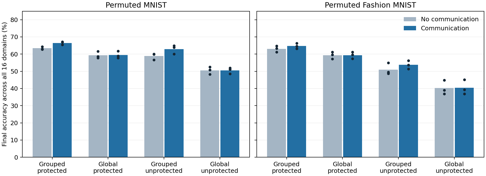

# What do branch competition, communication and recent memory contribute?

Completed on 13 October 2026. These experiments identify contributions inside the current model. They do **not** establish a general advantage over ordinary MLPs or a uniquely biological dendritic mechanism.

## Main findings

- Grouped competition outperformed global competition with the same input weights, teaching codes, active-unit count and decoder.
- Learned neighbor compatibility improved retrieval at unchanged final input weights. This improvement also occurred with plasticity protection switched off, so protection alone cannot explain it.
- A dense network with the same local coded teaching rule matched or exceeded protected branches on overall accuracy. Branches retained somewhat higher early-domain accuracy under protection, but had lower newest-domain accuracy.
- Recent error memory mostly changed the stability–plasticity trade-off. It did not consistently outperform cumulative error memory when protection was enabled.

## Experiment and interpretation

Each dataset has 16 domains: the original images followed by 15 pixel permutations. All domains use the same ten classes. Each current domain receives two passes over 60,000 training images. Final evaluation uses all 10,000 test images per domain. Three fresh paired seeds per dataset use identical initial input weights, permutations and minibatch orders across arms. Training and inference receive no task IDs; training receives class labels for the local teaching signal. No replay, example reservoir, input/configuration archive or task-boundary reset is used.

The model has 64 groups of four tanh responses (256 input-response units). A fixed class code gives every group a desired response during training. Grouped competition trains one branch per group. If the best recent error exceeds 0.4, it recruits the least-used branch in that group. Global competition selects 64 units across the full layer instead; it keeps the same structured decoder to isolate **training competition**. Neighbor coactivity records which adjacent branches were reliable together. The communicating decoder scores class hypotheses jointly with compatible branch routes. This is an exact compatibility decoder, not an experimentally established biological communication process.

Protection reduces each selected unit’s learning rate as reliable usage accumulates: rate = 1 / (1 + usage / 10,000). Turning protection off leaves the other mechanisms intact. Turning communication off changes only inference on the same final weights. Settings were fixed before scoring this cohort.

All-domain accuracy averages final performance on all 16 domains. First-four accuracy measures final performance on the earliest four domains; it is a retained-accuracy measure, not by itself a forgetting score. Newest accuracy measures acquisition of the last domain.

Bars are seed means; dots are individual seeds. Each communication comparison reuses the same final trained weights.

## Paired communication effects

| Dataset | Protection | Grouped communication gain | Global communication gain | Grouping × communication interaction |
|---|---|---:|---:|---:|
| Permuted MNIST | absolute | 3.09 ± 0.64 pp | 0.15 pp | 2.94 pp |
| Permuted MNIST | off | 4.05 ± 0.73 pp | 0.01 pp | 4.04 pp |
| Permuted Fashion MNIST | absolute | 1.62 ± 0.37 pp | 0.07 pp | 1.55 pp |
| Permuted Fashion MNIST | off | 2.73 ± 1.41 pp | 0.25 pp | 2.48 pp |

The ± term is sample standard deviation across three paired differences, not a confidence interval. Every grouped communication gain was positive across all three seeds in both protection settings and datasets. This supports a functional interaction between grouped learning and learned neighbor compatibility within this model. Three seeds and two related image benchmarks are insufficient for a broad statistical or novelty claim.

## Complete factorial results

| Dataset | Competition | Protection | Readout | All domains | First four | Newest |
|---|---|---|---|---:|---:|---:|
| Permuted MNIST | grouped | absolute | communicating | 66.49% | 71.90% | 66.98% |
| Permuted MNIST | grouped | absolute | grouped_no_communication | 63.40% | 67.69% | 65.97% |
| Permuted MNIST | grouped | absolute | unstructured_top64 | 64.75% | 71.38% | 64.87% |
| Permuted MNIST | grouped | off | communicating | 62.93% | 52.02% | 76.26% |
| Permuted MNIST | grouped | off | grouped_no_communication | 58.87% | 50.57% | 70.26% |
| Permuted MNIST | grouped | off | unstructured_top64 | 55.43% | 49.99% | 66.79% |
| Permuted MNIST | global | absolute | communicating | 59.47% | 57.76% | 72.00% |
| Permuted MNIST | global | absolute | grouped_no_communication | 59.32% | 57.66% | 71.67% |
| Permuted MNIST | global | absolute | unstructured_top64 | 61.37% | 62.69% | 70.62% |
| Permuted MNIST | global | off | communicating | 50.47% | 43.29% | 69.61% |
| Permuted MNIST | global | off | grouped_no_communication | 50.46% | 43.47% | 68.78% |
| Permuted MNIST | global | off | unstructured_top64 | 52.26% | 44.91% | 68.02% |
| Permuted MNIST | dense | absolute | dense_fixed_readout | 68.12% | 66.50% | 73.45% |
| Permuted MNIST | dense | off | dense_fixed_readout | 60.88% | 42.99% | 82.39% |
| Permuted Fashion MNIST | grouped | absolute | communicating | 64.70% | 68.35% | 65.78% |
| Permuted Fashion MNIST | grouped | absolute | grouped_no_communication | 63.08% | 65.91% | 65.27% |
| Permuted Fashion MNIST | grouped | absolute | unstructured_top64 | 60.83% | 68.18% | 53.72% |
| Permuted Fashion MNIST | grouped | off | communicating | 53.74% | 44.55% | 64.66% |
| Permuted Fashion MNIST | grouped | off | grouped_no_communication | 51.01% | 42.27% | 60.11% |
| Permuted Fashion MNIST | grouped | off | unstructured_top64 | 40.77% | 39.92% | 45.23% |
| Permuted Fashion MNIST | global | absolute | communicating | 59.39% | 57.75% | 67.33% |
| Permuted Fashion MNIST | global | absolute | grouped_no_communication | 59.32% | 57.69% | 67.29% |
| Permuted Fashion MNIST | global | absolute | unstructured_top64 | 58.76% | 59.80% | 60.29% |
| Permuted Fashion MNIST | global | off | communicating | 40.47% | 36.35% | 59.54% |
| Permuted Fashion MNIST | global | off | grouped_no_communication | 40.22% | 36.09% | 57.69% |
| Permuted Fashion MNIST | global | off | unstructured_top64 | 40.78% | 38.26% | 46.31% |
| Permuted Fashion MNIST | dense | absolute | dense_fixed_readout | 64.88% | 65.61% | 67.53% |
| Permuted Fashion MNIST | dense | off | dense_fixed_readout | 60.38% | 48.01% | 73.69% |

Grouped/global arms each store 812,480 bytes of numeric persistent state. The dense coded control stores 808,448 bytes, about 0.5% less, with the same input weights and teaching codes but no graph. It updates and reads all 256 units rather than 64 selected units. Its learning rate is 0.25 and protection scale 40,000 to compensate for four times the update exposure; these are nominal adjustments, not independently optimized settings. Its compute is larger per training step. This control is an ordinary hidden layer with a fixed coded linear output, **not** the strongest independently tuned learned-head MLP. The separate slowing-SGD MLP benchmark remains necessary.

## Recent versus cumulative error memory

The recent trace stores the previous minibatch’s local errors. The cumulative control uses the same arrays and averages errors from all previous presentations: E_new = (1 − α) E_old + α E_batch, with α = batch_size / (past_presentations + batch_size). No historical images are revisited. Historical errors were measured under earlier weights, so this is a cumulative historical-error control, not an exact current loss on past data. These follow-ups reuse the factorial seeds and are not an independent confirmation cohort. Both use the communicating decoder below.

| Dataset | Protection | Error trace | All domains | First four | Newest |
|---|---|---|---:|---:|---:|
| Permuted MNIST | absolute | recent | 66.49% | 71.90% | 66.98% |
| Permuted MNIST | absolute | cumulative | 66.35% | 68.65% | 68.23% |
| Permuted MNIST | off | recent | 62.93% | 52.02% | 76.26% |
| Permuted MNIST | off | cumulative | 48.84% | 29.13% | 84.86% |
| Permuted Fashion MNIST | absolute | recent | 64.70% | 68.35% | 65.78% |
| Permuted Fashion MNIST | absolute | cumulative | 65.29% | 67.19% | 66.52% |
| Permuted Fashion MNIST | off | recent | 53.74% | 44.55% | 64.66% |
| Permuted Fashion MNIST | off | cumulative | 51.00% | 32.63% | 76.14% |

Without protection, recent memory preserves substantially higher first-four accuracy but learns the newest domain less well. With protection, recent/cumulative overall accuracy is similar, and cumulative memory slightly improves Fashion overall accuracy. This does **not** demonstrate that short-term memory is necessary for continual learning. The trace affects training selection; inference here uses final weights and accumulated coactivity, rather than an adaptive short-term test-time state.

## What can be claimed about an ordinary MLP?

A defensible scoped statement is: **On our sequential permuted-MNIST and permuted-Fashion-MNIST streams, the branch model retained higher accuracy on the earliest domains than a similarly sized MLP trained with constant-rate SGD. This advantage was not consistent against validation-selected slowing-SGD MLPs.**

In the preceding 32-domain study, novelty branches versus constant-rate MLP retained 58.53% versus 27.09% on the earliest four MNIST domains, and 60.80% versus 29.22% on Fashion. However, a validation-selected slowing MLP achieved 63.37% and 64.72%, respectively, and also higher all-domain and newest-domain means. That study used a separate paired cohort; its numbers must not be treated as direct comparisons with the present 16-domain experiments. See [plasticity and ordinary controls](../local_graph_plasticity_20261013/REPORT.md).

## Attribution limits and next discriminating test

An ordinary 256-unit hidden layer plus the **same** grouping, gates, local memory and decoder computes the same function as this branch implementation. We verified that equivalence numerically. That augmented implementation is not a plain MLP, but it prevents attributing the effect to the anatomical name “dendrite.” The supported contribution is the computational organization and rules.

Global competition can give uneven coverage of the fixed teaching codes and fewer reliable adjacent pairs. Grouped competition guarantees one active response for every code coordinate. Thus code coverage, not only branch specialization, can explain its advantage. Dense controls also change active count and output aggregation; they are meaningful controls, not a pure single-factor comparison.

The next useful test is to vary neighbor topology and preserve teaching-code coverage independently of branch grouping, then compare against a separately tuned sparse ordinary learner at matched storage and acquisition. Learned versus shuffled compatibility should be tested on these same final weights. Such tests can distinguish useful compatibility structure from a generic sparsity or fixed-code effect. The present work already establishes a within-model communication benefit but not a general dendritic anti-forgetting advantage.

## Reproducibility and verification

- [Factorial driver](../../bdh_cl/scripts/local_graph_mechanism_factorial.py), [protocol](../../results/local_graph_mechanism_factorial_20261013/protocol.json), [84 result rows](../../results/local_graph_mechanism_factorial_20261013/results.json). Thirty-six trained models; multiple inference readouts are paired evaluations, not independent runs.
- [Cumulative driver](../../bdh_cl/scripts/local_graph_recent_trace_control.py), [protocol](../../results/local_graph_recent_trace_control_20261013/protocol.json), [24 result rows](../../results/local_graph_recent_trace_control_20261013/results.json). Twelve additional trained models, with two readouts each.
- Verified grouped training matches the prior novelty implementation; zero-communication decoding matches the reference decoder; ordinary hidden-layer routing is numerically equivalent; dense coded predictions equal the fixed linear output; cumulative and recent models match exactly on the first batch; all reported averages agree with their 16 domain values.
- Persistent-state budgets exclude temporary tensors, gradients and peak working memory. This study does not establish a runtime or equal-FLOP advantage.
