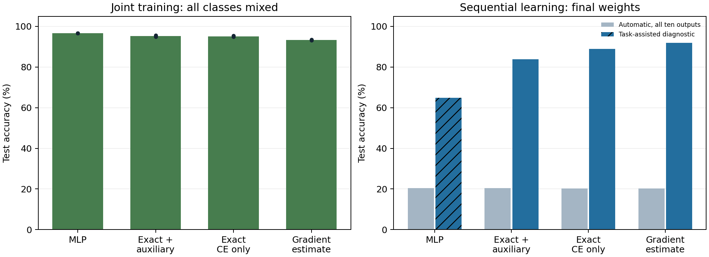
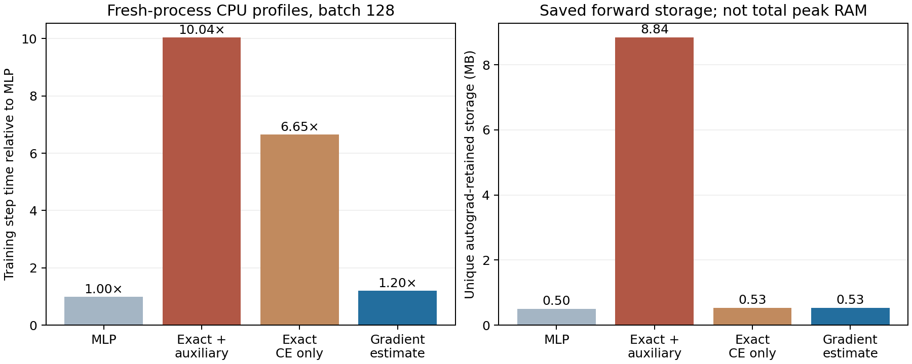

# Two-hidden-layer branches versus a parameter-matched MLP

Completed on 20 October 2026. **The gradient-estimated branch version retains high oracle-accessible accuracy at about 20% CPU training-step overhead, while exhaustive deep counterfactual training is about ten times slower. Neither network autonomously solves Split MNIST: all variants finish near 20% without an input-dependent retrieval mechanism.**

## Architectures and parameter budgets

| Architecture | Hidden computation | Trainable parameters | Inference numeric model state |
|---|---|---:|---:|
| Ordinary MLP | 784 → 88 tanh → 88 tanh → 10 | 77,802 | 311,208 bytes |
| Two-layer branch network | 784 → 24×4 tanh branches → 24 pooled → 24×4 tanh branches → 24 pooled → 10 | 78,010 | 312,808 bytes |

Trainable parameter counts differ by 208, or approximately 0.27%. The branch model adds 192 FP32 usefulness estimates (768 bytes), one for each branch in both layers. Output widths differ: 24 pooled units per branch layer versus 88 ordinary units. Matching parameters does not match every capacity constraint or learning rule. Both architectures have two nonlinear hidden layers and one shared linear ten-class head.

## Learning rules

- **MLP:** ordinary cross-entropy and backpropagation.
- **Exact branches + auxiliary:** restore the original-style rule at both hidden layers. For each of 192 alternatives, replace one neuron’s selected response with one branch, holding all other route choices fixed. First-layer alternatives recompute the nonlinear second layer; second-layer alternatives use the exact linear-head shortcut. Train factual cross-entropy plus 0.5 mean alternative cross-entropy. An EMA of exact alternative errors selects each layer’s branches.
- **Gradient-estimated branches:** train factual cross-entropy only. After one backward pass, estimate each alternative loss as L + Σ_batch[(∂L/∂h_n)(b_(n,k)−h_n)]. The sum accounts for the 1/batch-size already included in mean-loss gradients. Apply the same EMA 0.95 and minimum-score branch selection. No class-logit tensor per alternative or auxiliary objective is computed.
- **Exact branches, CE only:** a follow-up control calculates exact alternative errors without differentiating them and trains factual cross-entropy only. It separates the routing approximation from removal of the auxiliary loss. It has its own validation-selected learning rates.

The gradient estimate is a first-order approximation, not an exact alternative error. All layers still receive ordinary backpropagated gradients; this is not a biological local-learning claim. Hard routes are global across images at each training moment, selected from recent usefulness. No usage-based protection or online associative retrieval sidecar is included here.

## Accuracy

| Learning variant | Joint training | Sequential automatic | Current-task acquisition | Task-assisted diagnostic |
|---|---:|---:|---:|---:|
| Ordinary MLP | 96.64% | 20.34% | 99.28% | 64.80% (pair output mask) |
| Exact routing + auxiliary loss | 95.18% | 20.34% | 99.23% | 83.77% (both old layer routes) |
| Exact routing, CE only | 95.10% | 20.21% | 99.16% | 88.88% (both old layer routes) |
| Gradient-estimated routing, CE only | 93.35% | 20.30% | 99.06% | 91.95% (both old layer routes) |

Joint training mixes all classes and is a capacity/acquisition reference, not continual learning. Sequential automatic predictions always consider all ten digits. The network’s latest global configuration remains fixed at test time, so it mostly recognizes the newest pair.

For branch oracle recovery, the correct digit pair selects the two-layer configuration saved when that pair was learned. The final weights and classifier remain unchanged and all ten logits remain eligible. For the MLP diagnostic, the true pair explicitly masks the final classifier to two outputs. These are different task-assisted interventions; their numbers do not constitute a pure, equal-intervention architecture comparison or task-ID-free performance. Neither diagnostic means a plain MLP has lost all old information.

The hatched MLP task-assisted bar uses pair masking; branch bars use historical hidden routes without output masking. No test data or task ID enters automatic inference.

## Paired seed results and uncertainty

| Variant | Joint accuracy seed SD | Automatic accuracy seed SD | Task-assisted accuracy seed SD |
|---|---:|---:|---:|
| Ordinary MLP | 0.05 pp | 0.01 pp | 6.64 pp |
| Exact routing + auxiliary loss | 0.31 pp | 0.03 pp | 4.98 pp |
| Exact routing, CE only | 0.26 pp | 0.23 pp | 3.02 pp |
| Gradient-estimated routing, CE only | 0.12 pp | 0.04 pp | 1.76 pp |

The two class orders are averaged within seed before computing sequential SD; they are not six independent seeds. There are only three fresh seeds. The gradient estimate’s higher mean oracle recovery is descriptive, not evidence of statistical superiority or universal approximation quality.

## Computational efficiency

Each timing profile runs in a fresh process after accuracy experiments finish, on CPU with two Torch threads and synthetic batches of 128. Training uses ten warmup updates followed by five blocks of twenty updates. Values are median milliseconds per full training step, including optimizer, routing and usefulness updates.

| Variant | Training step | Relative to MLP | Mean full sequential training time |
|---|---:|---:|---:|
| Ordinary MLP | 0.428 ms | 1.00× | 0.444 s |
| Exact routing + auxiliary loss | 4.302 ms | 10.04× | 4.095 s |
| Exact routing, CE only | 2.850 ms | 6.65× | 2.706 s |
| Gradient-estimated routing, CE only | 0.515 ms | 1.20× | 0.525 s |

Full sequential training time covers 120,000 current-example presentations, excluding dataset loading, initialization and evaluations. It is recorded during the accuracy experiments and is less controlled than the dedicated profiles. Joint runs have the same number of training presentations; minibatch rounding differs slightly across task partitions. These measurements do not establish GPU performance or large-depth scaling.

## Memory measurements

| Variant | Model + Adam persistent numeric state | Autograd-retained unique nonparameter storage | Fresh-process peak RSS after training |
|---|---:|---:|---:|
| Ordinary MLP | 933,648 bytes | 0.498 MB | 265.6 MB |
| Exact routing + auxiliary loss | 936,912 bytes | 8.840 MB | 287.3 MB |
| Exact routing, CE only | 936,912 bytes | 0.531 MB | 280.0 MB |
| Gradient-estimated routing, CE only | 936,912 bytes | 0.531 MB | 264.4 MB |

Autograd storage counts deduplicated tensor backing storage saved for backward, excluding model parameters and including the input. It is not total peak tensor memory: exact CE-only alternatives allocate temporary forward workspace even though their graphs are not retained. Process RSS includes Python, Torch, allocator caches, optimizer state and workspaces; it must not be interpreted as model storage. The profile also records the earlier process high-water mark, not a clean current-RSS subtraction.

Both branch variants store nearly the same model state as the MLP. The exhaustive auxiliary graph, rather than routing state, accounts for its much larger retained activation storage. A bank of five two-layer configurations would add 240 packed uint8 indices/bytes; it is used only in the oracle audit and excluded from ordinary model inference state.

## Inference latency

Inference profiles use twenty warmups and ten blocks of 100 calls. Branch timings below use the gradient-estimated model as a representative of the shared architecture.

| Architecture/path | Batch 1 | Batch 128 |
|---|---:|---:|
| Ordinary MLP | 0.0122 ms | 0.0902 ms |
| Branches, compute all responses | 0.0248 ms | 0.1088 ms |
| Branches, gather only selected weight rows | 0.0361 ms | 0.0776 ms |

The selected-row path is mathematically equivalent for a supplied fixed configuration and was verified against the full forward. It gathers rows on every call; no packed-weight cache is assumed. Gathering overhead hurts single-image latency, while reduced matrix computation helps at batch 128. There is no input-dependent router cost in these numbers. Different per-image configurations would need a separate benchmark.

## Training protocol and controls

All models use cached real MNIST images scaled to [0,1], two passes over each current class pair, batch 128, Adam and clipping 5. No pretraining, replay, task-ID input, task output mask in primary predictions, or boundary reset is used. Configuration snapshots are external diagnostic artifacts, not an autonomous archive.

Development seed 520 uses 50,000 fitting and 10,000 held-out training images, stratified at 1,000 per digit. Each variant independently selects learning rate 0.0003/0.001/0.003. Sequential selection uses final all-class validation accuracy, with acquisition as a tiebreak; joint selection is independent. Official test labels never select settings.

Confirmation uses fresh seeds 521/522/523, both forward and reverse pair order, all 60,000 training images and the full 10,000-image test set. Branch variants share initial weights and minibatch order for a seed/order; the MLP shares data/order but necessarily has different-shaped initial weights. Joint controls are trained independently from random initialization.

The exact CE-only control was added after recognizing that the primary exact/proxy comparison changed both routing estimates and the auxiliary objective. Its settings were chosen on the same held-out development data before its own confirmation. It reuses the paired cohort and is not independent replication.

## Interpretation and next step

This small two-hidden-layer experiment supports a practical lead: the gradient-based usefulness estimate can be trained near ordinary MLP cost while preserving substantial accuracy accessible through old layer configurations. It avoids the expensive exact downstream counterfactual computation. It does not preserve the original algorithm unchanged, guarantee the same behavior at greater depth, or establish autonomous continual learning.

The MLP remains better in joint learning under the selected budgets. The branch model’s advantage is currently in the configuration-conditioned diagnostic, with different forms of assistance across architectures. The next stage is online input-driven retrieval of configurations at both layers, compared with ordinary memory-based controls and with all extra routing state counted. Earlier results already showed that a direct fixed-key RLS classifier is a strong control; it must not be omitted.

## Reproducibility

- [Main driver](../../bdh_cl/scripts/multilayer_branch_comparison.py), [protocol](../../results/multilayer_branch_comparison_20261020/protocol.json), [selection and all development candidates](../../results/multilayer_branch_comparison_20261020/selection.json), [27 main confirmation runs](../../results/multilayer_branch_comparison_20261020/results.json), [sequential checkpoints](../../results/multilayer_branch_comparison_20261020/models).
- [Same-loss control driver](../../bdh_cl/scripts/multilayer_exact_ce_control.py), [control protocol](../../results/multilayer_branch_comparison_20261020/exact_ce_control/protocol.json), [control selection](../../results/multilayer_branch_comparison_20261020/exact_ce_control/selection.json), [nine control confirmation runs](../../results/multilayer_branch_comparison_20261020/exact_ce_control/results.json).
- CPU profiles: [MLP](../../results/multilayer_branch_comparison_20261020/profile_mlp.json), [exact + auxiliary](../../results/multilayer_branch_comparison_20261020/profile_branch_exact.json), [gradient estimate](../../results/multilayer_branch_comparison_20261020/profile_branch_proxy.json), [exact CE-only](../../results/multilayer_branch_comparison_20261020/exact_ce_control/profile.json).
- Verified full downstream exact alternatives against directly changed routes, selected-row inference against the ordinary branch forward, first-order gradients against finite differences, parameter counts, model-state invariance during evaluations, and completion of 24 development plus 36 confirmation runs.
