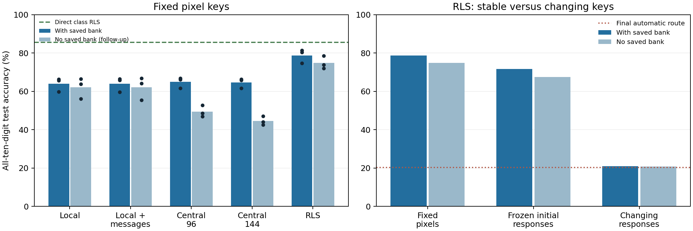

# Online acquisition of configuration retrieval memory

Completed on 20 October 2026. **Online current-input/current-branch associations recover old skills without replaying historical images. Stable keys work much better than changing network-response keys. However, branch-local memory does not beat the stronger RLS association baseline, communication adds no consistent gain, and a smaller direct RLS classifier performs best.**

## Main results

All results below use fixed 64-dimensional pixel keys, three fresh backbone seeds and two paired class orders. Every prediction competes across all ten digits.

| Method | With externally saved configuration bank | No external bank — exploratory follow-up |
|---|---:|---:|
| Branch-local | 63.92% | 62.08% |
| Branch-local + communication | 63.92% | 62.10% |
| Central 96 centroids | 64.87% | 49.43% |
| Central 144 centroids | 64.58% | 44.55% |
| RLS activity associations | 78.74% | 74.76% |

The same backbones achieve 20.26% using their final automatic configuration and 94.19% using the historical-route oracle. The direct fixed-key class RLS control reaches **85.61%**, without needing the branch network. These are fresh paired follow-ups, not the original three-seed 98.02% cohort.

Bars are seed means, with the two class orders averaged within each seed. Dots in the left panel are these three seed-level values. No significance claim follows from three seeds.

## What was learned online

The backbone remains the original hard-routed 24-neuron, four-branch network, trained for two passes per current digit pair with Adam 0.001, gradient clipping 5, factual cross-entropy plus 0.5 mean counterfactual cross-entropy, and error EMA 0.95. Current digit labels train the backbone as usual. The routing sidecars do not affect its gradient updates.

Before each training update, a memory receives only the current input key and the currently active branch in each neuron. It receives no digit label, task ID, task boundary or future end-of-task configuration. Once a class leaves the stream, its images are never revisited for association learning. The original two within-current-task passes are retained; no historical replay is added.

Five end-of-phase configurations are recorded externally by the harness. In the primary test they are provided only at inference; every memory must select from this same bank. This isolates retrieval, not autonomous configuration storage. Importantly, memory targets are the contemporaneous branches rather than the eventual saved route: future routes were not leaked backward into association training.

## Memory mechanisms

- **Branch-local:** each branch accumulates its coactive key sum and count. Cosine matches to these conditional means provide branch evidence. A ring of 24 neighboring neurons accumulates branch coactivity. The optional communication condition passes neighbor-belief messages for three iterations.
- **Central centroids:** a bounded bank of 96 or 144 online key centroids, each tagged with the full contemporaneous 24-branch pattern. Novelty threshold is 0.85. When full, a new route replaces the least-supported entry. These are explicit summary associations, not an individual-example reservoir; a newly initialized centroid can initially represent one observation.
- **RLS association baseline:** accumulate key covariance C and key-to-branch cross-statistics B from 96 one-hot branch-activity targets. Ridge strength is 1. The inferred map W = B C⁻¹ predicts branch preferences. This is an online least-squares/RLS associative baseline inspired by DeltaNet-PC’s memory rule, **not a reproduction of its predictive-coding architecture, learned addressing or settling procedure**.

RLS uses global covariance statistics and is not a branch-local biological mechanism. Its statistics are updated causally; no old keys or images need to be retained. A transient linear solve at readout recovers the map. The local associative sums also persist across tasks: they are not newly demonstrated fading short-term memory. The backbone still contains the original recent-error state.

## Key controls

Every key has 63 normalized features plus a constant 0.2 coordinate, renormalized to dimension 64. Fixed pixel keys use deterministic 7×9 average pooling. Response keys use all 96 first-layer tanh responses, pooled to 63 coordinates. One condition holds the initial first-layer encoder fixed; the other uses the current changing encoder. Those two response encoders begin identically.

The frozen-response control requires an extra copy of the initial encoder and is not equal-storage to the other key conditions. Pixel and response representations are different; their comparison alone cannot isolate drift. Comparing frozen versus evolving response keys, plus the measured movement below, supports drift as a substantial problem but does not prove it is the only source of failure.

## Validation and fresh confirmation

Development uses seed 510, forward order, a stratified 50,000/10,000 fitting/validation split from training data. Routers write associations only for the fitting stream; held-out images never write memory. Each key/method independently selects its allowed write stability (every batch or after ten consecutive identical active configurations), neighbor strength when applicable, and central bank-compatibility penalty. All validation candidates are archived. No official test labels select settings.

Confirmation uses seeds 511/512/513 and forward/reverse pair orders, full 60,000 training images and the official 10,000-image test set. Orders are paired repeats, not six independent seeds. Retrieval memory and final backbone stay fixed during test inference. The optional ten-batch stability gate uses whole-route agreement and is an engineering aid, not strictly local communication.

## Complete primary results: saved bank

| Key | Method | Final accuracy ± seed SD | Old eight classes | Newest pair |
|---|---|---:|---:|---:|
| fixed_pixels | Branch-local | 63.92% ± 3.57 pp | 64.70% | 59.59% |
| fixed_pixels | Branch-local + communication | 63.92% ± 3.70 pp | 64.72% | 59.48% |
| fixed_pixels | Central 96 centroids | 64.87% ± 2.77 pp | 65.21% | 61.85% |
| fixed_pixels | Central 144 centroids | 64.58% ± 2.57 pp | 64.91% | 61.69% |
| fixed_pixels | RLS activity associations | 78.74% ± 3.64 pp | 77.03% | 85.10% |
| frozen_responses | Branch-local | 58.55% ± 2.58 pp | 57.56% | 61.60% |
| frozen_responses | Branch-local + communication | 58.38% ± 2.71 pp | 57.39% | 61.44% |
| frozen_responses | Central 96 centroids | 59.70% ± 2.91 pp | 58.74% | 62.74% |
| frozen_responses | Central 144 centroids | 59.96% ± 2.98 pp | 59.05% | 62.66% |
| frozen_responses | RLS activity associations | 71.71% ± 3.17 pp | 70.91% | 74.50% |
| evolving_responses | Branch-local | 21.05% ± 0.90 pp | 1.02% | 98.80% |
| evolving_responses | Branch-local + communication | 21.00% ± 0.85 pp | 0.95% | 98.82% |
| evolving_responses | Central 96 centroids | 22.07% ± 1.21 pp | 2.41% | 98.43% |
| evolving_responses | Central 144 centroids | 22.07% ± 1.21 pp | 2.41% | 98.43% |
| evolving_responses | RLS activity associations | 20.87% ± 0.16 pp | 0.77% | 98.84% |

## Fresh oracle and order sensitivity

| Seed | Order | Final automatic accuracy | Historical-route oracle |
|---|---|---:|---:|
| 511 | forward | 19.39% | 88.27% |
| 511 | reverse | 21.14% | 90.06% |
| 512 | forward | 19.36% | 97.21% |
| 512 | reverse | 21.15% | 97.79% |
| 513 | forward | 19.38% | 95.29% |
| 513 | reverse | 21.14% | 96.55% |

The original 98.02% oracle was not universal: this fresh cohort ranges from 88.27% to 97.79%. This is additional evidence that retained accessibility depends on initialization and class order. The oracle is a diagnostic choice among recorded routes, not a strict upper bound over every possible branch configuration.

## Key movement diagnostic

Test class mean keys were measured immediately after each class was learned and again with the final encoder. These test means are reporting artifacts only; neither the original network nor associative memories receive them. The table averages squared mean-key movement over the old eight classes, then orders and seeds.

| Key type | Old-class mean-key movement (MSE) |
|---|---:|
| fixed_pixels | 0 |
| frozen_responses | 0 |
| evolving_responses | 0.013809611 |

Changing-response retrieval is close to the final-route baseline even with RLS, while both fixed key families retrieve substantially more. This is consistent with old associations becoming stale as their addresses change. A future control should hold the final feature quality and association targets fixed to quantify exactly how much loss is due to address drift.

## Exploratory follow-up: remove the external bank

After the primary result, the same cohort was rerun to obtain and save association states. Every repeated backbone exactly reproduced its primary final tensors. All primary validation-selected settings were kept fixed; the no-bank readout was **not independently tuned** and is not an independent confirmation.

At inference, local memories choose a branch independently in each neuron (with or without messages). RLS takes each neuron’s largest predicted branch value. Central centroids return the observed route stored at the nearest centroid. The external five-route bank never enters these predictions; it is used only for historical-match analysis afterward. Central centroids still explicitly store online full-route patterns, whereas local and RLS states represent associations through per-branch quantities.

| Key | Method | No-bank accuracy ± seed SD | Old eight classes | Newest pair |
|---|---|---:|---:|---:|
| fixed_pixels | Branch-local | 62.08% ± 5.42 pp | 61.47% | 63.15% |
| fixed_pixels | Branch-local + communication | 62.10% ± 5.96 pp | 61.51% | 63.11% |
| fixed_pixels | Central 96 centroids | 49.43% ± 3.04 pp | 51.68% | 38.87% |
| fixed_pixels | Central 144 centroids | 44.55% ± 2.30 pp | 48.09% | 29.33% |
| fixed_pixels | RLS activity associations | 74.76% ± 3.30 pp | 70.87% | 89.78% |
| frozen_responses | Branch-local | 57.30% ± 4.00 pp | 55.09% | 65.11% |
| frozen_responses | Branch-local + communication | 57.27% ± 3.93 pp | 55.04% | 65.08% |
| frozen_responses | Central 96 centroids | 46.83% ± 0.62 pp | 45.17% | 52.34% |
| frozen_responses | Central 144 centroids | 45.02% ± 0.02 pp | 43.92% | 47.76% |
| frozen_responses | RLS activity associations | 67.46% ± 2.89 pp | 63.56% | 82.61% |
| evolving_responses | Branch-local | 23.08% ± 0.63 pp | 5.66% | 90.89% |
| evolving_responses | Branch-local + communication | 22.81% ± 0.30 pp | 5.77% | 89.17% |
| evolving_responses | Central 96 centroids | 21.80% ± 1.30 pp | 2.05% | 98.58% |
| evolving_responses | Central 144 centroids | 21.80% ± 1.30 pp | 2.05% | 98.58% |
| evolving_responses | RLS activity associations | 20.78% ± 0.12 pp | 0.65% | 98.84% |

With fixed pixel keys, factorized local memories outperform the whole-route centroid controls in this no-bank follow-up. This is a useful structural lead: composing branch choices can be more robust than retrieving a complete observed configuration. But primary settings were selected with the bank present, which can favor different stability settings; the comparison needs independent no-bank validation and fresh confirmation before a strong advantage claim. Larger central centroid capacity does not establish an adequately optimized central baseline.

## Ordinary direct classifier control

A direct class RLS model receives the identical fixed pixel keys and current digit labels, rather than branch-activity targets. It accumulates covariance plus ten class cross-statistic rows during the same current-only two-pass sequence. It reaches **85.61%** at 18,944 bytes of numeric persistent state, without requiring the branch network or a route bank.

This stronger, smaller predictive baseline prevents claiming a general branch advantage. Its teacher is explicitly the digit label, whereas association memories see branch activity; it is a complete-method control, not a pure architecture intervention. Given fixed features and identical data, its final sufficient-statistics solution is essentially invariant to seed/order; the equal accuracies are not independent random-feature replications.

## Persistent storage

| Component | Numeric bytes |
|---|---:|
| Original final backbone and error buffer | 302,824 |
| External five-route bank, packed uint8 | 120 |
| Branch-local sums/counts/ring links | 26,496 |
| Central 96 centroids + observed routes/counts | 27,264 |
| Central 144 centroids + observed routes/counts | 40,896 |
| RLS association covariance/cross-statistics | 40,960 |
| Optional frozen initial key encoder | 301,440 |
| Direct fixed-key digit RLS (no backbone needed) | 18,944 |

Local and central96 are close in memory (central96 is 2.9% larger). RLS has about 55% more associative state than local; central144 nearly matches its budget. Without a bank, the fixed-key branch+RLS pipeline totals 343,784 bytes versus 329,320 for branch-local, before scalar metadata. A stability-10 updater additionally needs approximately 32 bytes for its previous route and streak counter. The frozen-response key condition adds the initial encoder cost.

These are per-method persistent numeric budgets. Experiment files contain multiple competing memories for paired measurement, not a claim that all are deployed together. Common Adam training state, scalar metadata and temporary gradients, solves, activations and key caches are excluded. No peak-RAM, runtime or equal-FLOP advantage is claimed.

## Interpretation and next decision

1. Online cue-to-branch associations can recover useful skills without old-image replay; the RLS no-bank follow-up also avoids an external configuration archive.
2. Key stability is a major practical constraint. Addresses based on a changing encoder are unreliable under these rules.
3. Local memory is competitive with similarly sized centroid memory under the bank and better in the exploratory no-bank readout, but RLS is stronger. Communication has no consistent positive effect.
4. A direct, much smaller classifier beats every retrieval pipeline, so task-ID-free retrieval alone is insufficient for a branch-specific scientific contribution.

The next focused test should independently validate no-bank storage/readout rules, then compare a more discriminative local cue update with equivalent shared controls. Avoid adding further task archives or global statistics while claiming locality. A stronger visual encoder can later test whether branch-held nonlinear skills offer something the simple fixed-key classifier cannot, with every comparator using the same encoder and honest storage accounting.

## Reproducibility and audits

- [Primary driver](../../bdh_cl/scripts/online_config_memory_benchmark.py), [protocol](../../results/online_config_memory_benchmark_20261020/protocol.json), [all development candidates](../../results/online_config_memory_benchmark_20261020/development.json), [selection](../../results/online_config_memory_benchmark_20261020/selection.json), [90 primary readouts](../../results/online_config_memory_benchmark_20261020/results.json).
- [Independent backbone/key-drift audit](../../bdh_cl/scripts/online_config_memory_audit.py), [audit results](../../results/online_config_memory_benchmark_20261020/key_drift_audit.json), [verification](../../results/online_config_memory_benchmark_20261020/audit_verification.json).
- [No-bank driver and direct RLS control](../../bdh_cl/scripts/online_config_no_bank_followup.py), [follow-up protocol](../../results/online_config_memory_benchmark_20261020/no_bank_followup/protocol.json), [90 follow-up readouts and six direct controls](../../results/online_config_memory_benchmark_20261020/no_bank_followup/results.json), [saved association arrays](../../results/online_config_memory_benchmark_20261020/no_bank_followup/memories).
- Checked online ridge against an offline synthetic reference; all inference methods leave persistent association arrays unchanged on a synthetic read-only audit; all six backbones exactly match independent original training; frozen current model tensors do not change during evaluation; and all expected result counts and numeric budgets are complete.
- Six underlying confirmation backbones are paired across methods; independent audit and no-bank reconstruction runs repeat these same conditions and do not increase the independent sample count.
