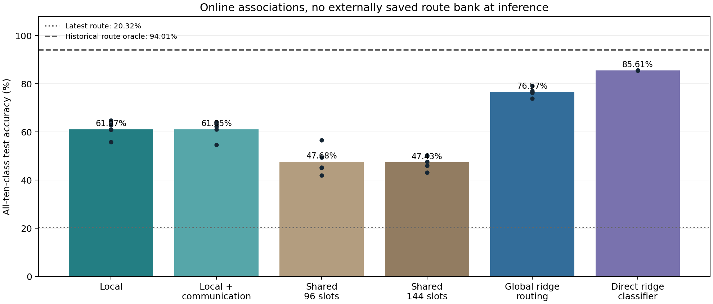

# Online input-to-branch retrieval: prospective no-bank test

Completed 20 October 2026. Current-input/current-branch associations were learned during sequential training, without task IDs or old-example replay. **Local memory achieves 61.07% automatic accuracy versus 20.32% with the latest global route. However, the direct input ridge classifier reaches 85.61%, and neighbor communication does not establish a benefit.**

## Results

| Method | Automatic accuracy | Seed SD | Earlier four pairs | Newest pair | Extra memory | Total inference numeric state |
|---|---:|---:|---:|---:|---:|---:|
| Local branch memory | 61.07% | 3.35 pp | 57.89% | 71.38% | 26,000 B | 341,440 B |
| Local + neighbor communication | 61.05% | 3.72 pp | 57.81% | 71.50% | 27,600 B | 343,040 B |
| Shared 96-centroid memory | 47.68% | 5.69 pp | 48.80% | 41.00% | 27,360 B | 342,800 B |
| Shared 144-centroid memory | 47.43% | 2.96 pp | 54.31% | 17.80% | 41,040 B | 356,480 B |
| Global ridge branch retrieval | 76.57% | 1.84 pp | 72.46% | 91.49% | 41,984 B | 357,424 B |
| Direct ridge classifier | 85.61% | 0.00 pp | 84.45% | 89.18% | 18,944 B | 18,944 B |

Latest global route, no extra associative memory: **20.32%**. Historical-route oracle on these fresh backbones: **94.01%**. The oracle requires the true digit pair and externally saved snapshots; automatic readouts above receive neither. A composed route can differ from every snapshot, so snapshot oracle is a reference, not a mathematical upper bound.

All methods predict among ten digits. Five seed means are shown; forward/reverse orders are paired within seed. The direct classifier is effectively deterministic under fixed image features and accumulated class sufficient statistics; its near-zero seed SD is expected, not five independently learned feature representations.

## What was learned online?

1. A 25-neuron network with four branches per neuron learns each digit pair using factual cross-entropy and gradient-estimated usefulness. Training is unchanged by the association modules.
2. Before each gradient update, fixed features of the current images are associated with the branches currently selected by the network. Neither future snapshots nor a teacher-selected historical route is available.
3. At inference, each local branch compares the current features with its accumulated feature description. The best matching branch wins independently at each neuron; optional learned ring connections exchange three rounds of compatibility messages.
4. The selected responses feed the unchanged final ten-class classifier. No external route archive constrains the selection.

Image keys have 64 dimensions: 63 values from fixed 7×9 average pooling, normalized and concatenated with a 0.2 bias before renormalization. There is no frozen learned encoder or extra pretrained model. Stable keys avoid the moving-feature problem seen in earlier work, but may limit recognition quality.

Local memory stores explicit per-branch sums and counts. Validation selects cumulative updates or decay 0.995 on each update to an active branch. Dormant branches do not decay. This is activity-dependent fading, not a globally ticking short-term memory. The backbone separately retains fading usefulness scores (EMA 0.95). These associative arrays are additional memory; claiming that nothing extra is stored would be incorrect.

## Controls and interpretation

- The shared memories learn 96 or 144 aggregate input prototypes tagged with the branch pattern observed at write time. They store explicit associations/configurations, but no individual replay examples or externally supplied phase-end routes. The 96-slot control is close in size to local memory.
- Global ridge routing learns the same current-branch targets, using shared input covariance and cross-statistics. It tests whether a stronger centralized associative learner retrieves better. It is not a local branch-learning rule.
- The direct ridge classifier uses the same input keys and current training labels, with no branch network at deployment. It is a strong predictive control, although its class targets differ from branch-activity targets.
- No matched ordinary-network associative sidecar was tested here. Superiority to shared branch retrieval, if present, would not by itself establish an anatomical dendrite advantage.

Local minus shared96: +13.40 pp (95% paired-seed t interval +5.85 to +20.95).
Communication minus local: -0.03 pp (95% paired-seed t interval -1.12 to +1.07).
Global ridge routing minus local: +15.50 pp (95% paired-seed t interval +10.47 to +20.53).

These are descriptive intervals over five independent seeds, averaging orders first. They are not adjusted for multiple comparisons or evidence of generalization beyond this small dataset. Results must be read alongside the stronger direct-classifier baseline.

## Selected settings

| Method | Validation-selected settings |
|---|---|
| Local branch memory | stable=1, decay=0.995, gamma=0.0 |
| Local + neighbor communication | stable=1, decay=0.995, gamma=0.05 |
| Shared 96-centroid memory | stable=1 |
| Shared 144-centroid memory | stable=10 |
| Global ridge branch retrieval | stable=1, ridge=0.1 |
| Direct ridge classifier | ridge=1.0 |

Stable=10 writes only after ten consecutive identical global configurations; stable=1 writes every batch. This gate sees branch activity only and never resets at a task boundary. Settings were chosen from development validation before any confirmation test result. All candidates are saved, including unsuccessful ones.

## Computational measurements

| Method | Batch-1 inference | Batch-128 inference | Accepted memory write, batch 128 |
|---|---:|---:|---:|
| Latest-route network | 0.017 ms | 0.065 ms | — |
| Local branch memory | 0.056 ms | 0.309 ms | 0.020 ms |
| Local + neighbor communication | 0.111 ms | 1.204 ms | 0.019 ms |
| Shared 96-centroid memory | 0.049 ms | 0.155 ms | 1.472 ms |
| Shared 144-centroid memory | 0.057 ms | 0.163 ms | 1.488 ms |
| Global ridge branch retrieval | 0.077 ms | 0.215 ms | 0.006 ms |
| Direct ridge classifier | 0.046 ms | 0.094 ms | 0.005 ms |

Fresh process, two CPU threads, selected seed-541 forward-order state; five warmups and five blocks of twenty calls. Inference includes feature extraction, routing, branch computation and classifier. Ridge methods solve the 64×64 system on every call; no derived-weight cache is counted. Accepted-write timings exclude feature extraction, neural gradient updates and stability rejection; a cloned trained memory receives a repeated batch. These are CPU microbenchmarks, not full-stream overhead measurements. The plain local implementation also updates unused ring links, making its write timing conservative.

Numeric-state counts include each deployed method only. Local without communication omits ring links; communication includes them. The direct classifier needs no neural backbone. Optimizer state, transient workspace and Python container overhead are excluded. Ridge statistics are solved at inference; caching derived weights would add storage unless statistics were discarded after training. The all-candidate training runtime is not the cost of any single deployed model.

## Protocol and audit

- One development backbone, seed 540, stratified 50k fit / 10k validation from training images. Routing settings selected independently for six methods using validation all-class accuracy. Backbone learning rate fixed at 0.003 from the prior depth study.
- Ten fresh confirmation backbones: seeds 541–545, forward/reverse Split MNIST; all 60,000 training images and the full 10,000-image test set. Two passes over each current pair, batch 128, Adam, clip 5. No replay, pretraining or old-image visits after leaving a pair.
- Routing writes receive only current fixed keys and current pre-update branch indices. Class labels supervise the original neural loss and the direct classifier control. Task IDs and phase-end configurations never supervise routing memory. Boundaries construct the benchmark stream and diagnostic snapshots only.
- Every automatic prediction is produced without bank access; true test labels enter accuracy and snapshot-agreement diagnostics afterward. Model and association-memory checksums assert no test-time updates.
- Synthetic checks verify local activity retrieval, ridge equivalence to batch sufficient-statistics solutions, memory sizes and backbone derivatives. A separate no-sidecar replay verifies the first confirmation backbone is unchanged by auxiliary memory writes.

## Reproducibility

- [Driver](../../bdh_cl/scripts/online_proxy_branch_retrieval.py), [protocol](../../results/online_proxy_branch_retrieval_20261020/protocol.json), [all validation candidates](../../results/online_proxy_branch_retrieval_20261020/development.json), [selected settings](../../results/online_proxy_branch_retrieval_20261020/selection.json).
- [Confirmation results](../../results/online_proxy_branch_retrieval_20261020/results.json), [saved models](../../results/online_proxy_branch_retrieval_20261020/models), [association states](../../results/online_proxy_branch_retrieval_20261020/memories), [checks](../../results/online_proxy_branch_retrieval_20261020/verification.json), [backbone audit](../../results/online_proxy_branch_retrieval_20261020/backbone_audit.json).
- [Timing driver](../../bdh_cl/scripts/profile_online_proxy_retrieval.py), [CPU timing records](../../results/online_proxy_branch_retrieval_20261020/profile.json).

## What this establishes

Online input/activity associations can retrieve useful branches without a task ID or external historical route bank. This includes auxiliary memory and supervised training of the backbone. It does not establish that branches alone prevent forgetting, that neighbor communication is necessary, that the full rule is biologically local, or that the model outperforms simpler memory-based classifiers.
