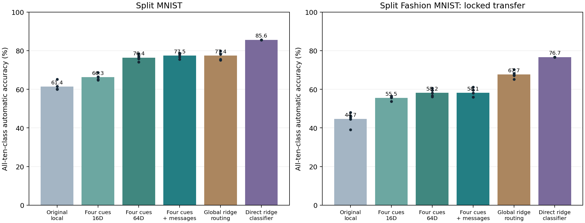

# Overnight research report — 24 October 2026

**There are two bounded positive findings, not a breakthrough:** multiple input cues per branch improve automatic retrieval at approximately fixed auxiliary-memory budget, and a learned local compatibility rule gives a small additional MNIST gain. The communication gain does not transfer to Fashion MNIST. A simpler direct input-memory classifier remains better on both datasets.

## Automatic task-ID-free results

| Method | MNIST | Fashion MNIST | Extra associative state | Total inference numeric state |
|---|---:|---:|---:|---:|
| Original local average | 61.39% | 44.66% | 26,000 B | 341,440 B |
| Four cues, 16D | 66.29% | 55.48% | 27,200 B | 342,640 B |
| Four cues, 64D | 76.39% | 58.18% | 104,000 B | 419,440 B |
| Four cues + local messages | 77.48% | 58.13% | 106,560 B | 422,000 B |
| Global ridge routing | 77.40% | 67.67% | 41,984 B | 357,424 B |
| Direct input ridge classifier | 85.61% | 76.66% | 18,944 B | 18,944 B |

The table uses matched controls within each dataset cohort: five fresh seeds and both task orders. Fashion uses the MNIST settings unchanged, with no Fashion-specific validation or retuning. All ten labels compete at prediction time. Current training labels supervise the neural network and the direct classifier; the routing/communication memories receive current image features and branch activity only. Task IDs, task-boundary notifications, old-task replay, external configuration banks and test-label feedback are absent from automatic predictions.

## Finding 1: multiple cues help local memory

A separate locked confirmation (seeds 562–566, both orders) compared one 64D input average per branch against four 16D cues at nearly the same storage cost. Accuracy improved **59.69% → 66.29%**; the paired difference was **+6.60 pp**, 95% t interval **+2.22 to +10.98 pp**. Extra memory increased from 26,000 to 27,200 bytes (4.6%). The method trades feature resolution for multimodal capacity; it is not an exact-byte equality or proof that slot count alone caused the gain.

Four full 64D cues reached 75.95% in that cohort, at 104,000 bytes of additional memory. These point estimates belong to a different cohort from the table above and should not be subtracted as paired effects. [Full capacity report](MULTICUE_REPORT.md).

## Finding 2: learned neighbor compatibility helps modestly on MNIST

For the 64D four-cue model, learned compatibility improved **76.39% → 77.48%** in a new five-seed confirmation. The learned tables encode which branches tend to be active together along 40 edges of a fixed 5×5 neuron lattice. Three message rounds combine current input evidence with these learned pair preferences.

- Learned versus no messages: **+1.09 pp (95% paired-seed t interval +0.25 to +1.93)**.
- Learned versus shuffled edge tables: **+2.26 pp (95% paired-seed t interval +1.45 to +3.07)**.
- Fashion transfer, learned versus no messages: **-0.05 pp (95% paired-seed t interval -0.55 to +0.45)**.

The shuffled control shows that arbitrary coupling is insufficient in this MNIST condition. However, messages hurt 16D memory and provide no detectable benefit on Fashion. This is a restricted mechanism result, not a general communication advantage. No matched ordinary-network implementation of the same rules was tested, so uniquely dendritic credit remains unestablished. [Communication report](PMI_REPORT.md).

## Fashion transfer is an important limitation

All settings, including optimizer, prototype decays, message strength and rounds, transferred unchanged from MNIST. Fresh seeds 610–614 and both orders used the full 60 k/10 k split. Local four-cue retrieval improves on the original local average, but remains below global ridge routing and the direct classifier. Historical-route oracle recovery averages 92.92%, whereas automatic four-cue retrieval is 58.18%. Thus useful skills remain accessible under task-assisted configurations, but the current cue mechanism still fails to retrieve many of them. The oracle uses true-pair selection of phase-end snapshots and must never be presented as automatic class-incremental performance.

Fashion no-message and learned-message all-condition records, including the 16D negative control, are in [the transfer report](FASHION_TRANSFER.md). No attempt was made to rescue the transfer result by retuning Fashion settings.

## Memory and compute are real costs

The one-layer network has 78,760 trainable parameters and 400 bytes of fading usefulness state: 315,440 bytes total. Four full-dimensional cue prototypes add 104,000 bytes; communication adds another 2,560 bytes of edge counts. The direct ridge classifier needs 18,944 bytes and no neural backbone at deployment. These are explicit aggregate input/statistical memories, not a system that stores nothing extra. No individual examples are replayed, but input information is retained in prototypes.

On two-thread CPU, within the same fresh profile the 64D four-cue model took 0.686 ms per batch 128; adding messages took 1.857 ms (about 2.7×). Single-image latency increased 0.105→0.447 ms. The earlier memory-capacity profile also found extra write/inference cost for multicomponent cues. These microbenchmarks do not establish GPU scalability or full-training speed. State counts exclude transient workspace, optimizer state and Python overhead.

## Negative and diagnostic work retained

- Restricted patch cues and per-image usefulness teaching did not improve the initial validation pilot over whole-image activity associations.
- A bounded local delta-rule study failed badly: best validation 29.98% versus 61.16% for the average-based control; all 40 candidates and the unstable setting were retained.
- Centered prototype metrics produced at most sub-percentage-point gains in the single-cue condition and hurt or inconsistently changed multicue retrieval. No further confirmation was pursued.
- Local persistence traces for gating writes produced small, seed-dependent gains and did not consistently help low-memory retrieval. No threshold search was expanded.
- TRAIN-holdout analysis found that projecting predictions onto an external historical-route bank recovered only a few points. Those assisted diagnostics were never used as autonomous results.
- The local communication pilot retained all gamma and shuffled-control candidates. A small coupling was locked before confirmation; no test-driven adjustment was made.

## What can be claimed

With the trained branched backbone held to a fixed learning protocol, the design of additional local cue memory changes how effectively earlier skills are retrieved without task IDs. Multiple cues give a reproducible local-memory improvement, and learned local compatibility gives a small MNIST-specific gain beyond the same no-message model.

What cannot be claimed: a breakthrough, top-conference readiness, superiority to simple memory-based classifiers, uniquely dendritic causation, broad transfer of the communication effect, or a full biologically local learning rule. The neural network still trains by backpropagation; the associations and messages are engineered mechanisms.

## Recommended next research decision

Prioritize stable, informative cue representations and the quality of online associations, rather than adding more message rounds. The large Fashion gap between oracle and automatic recovery makes this a sharper target than further coupling sweeps. If pretraining is explored, specify its dataset/label access and give the same encoder to ordinary-memory controls. Keep the direct classifier baseline, include complete memory/compute costs and confirm on held-out seeds/datasets before making a general claim.

## Evidence and reproducibility

- [Capacity study](MULTICUE_REPORT.md), [communication study](PMI_REPORT.md), [Fashion transfer](FASHION_TRANSFER.md).
- [Research status and decision log](../../results/overnight_branch_research_20261024/STATUS.md).
- [Raw capacity confirmation](../../results/overnight_branch_research_20261024/multicue_confirmation), [raw communication confirmation](../../results/overnight_branch_research_20261024/pmi_confirmation), [raw locked Fashion transfer](../../results/overnight_branch_research_20261024/pmi_fashion_transfer).
- All development candidates, negative pilots, protocols, sources, models and association states are preserved under results/overnight_branch_research_20261024.

## Final verification

A saved-state audit verified all 30 confirmation backbones and 300 automatic readouts, seed/order completeness, immutable evaluation state, 120,000 current presentations and memory counts. Independent NumPy forwards reproduced a saved MNIST and Fashion no-message result exactly, with 100% agreement with Torch predictions. Image-key extraction was shared; no training or settings changed. Protocol/source/result/data file hashes are preserved in [audit.json](../../results/overnight_branch_research_20261024/audit.json).
