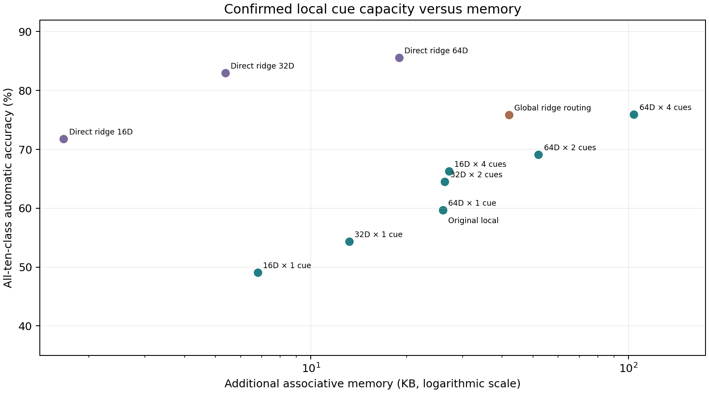

# Overnight result: multimodal branch-local retrieval

Confirmed on five fresh seeds and both Split MNIST orders, 24 October 2026. **Four lower-dimensional input cues per branch improve automatic accuracy from 59.69% to 66.29% with nearly the same associative-memory budget. Four full-dimensional cues reach 75.95%, comparable in mean to global ridge routing at 75.90%, but require more auxiliary memory. The direct input classifier remains stronger and smaller.**

## All locked confirmation conditions

| Method | Automatic accuracy | Seed SD | Earlier four pairs | Newest pair | Extra memory | Total inference numeric state |
|---|---:|---:|---:|---:|---:|---:|
| Original local average | 59.69% | 4.84 pp | 55.41% | 74.12% | 26,000 B | 341,440 B |
| Local 16D × 1 cue | 49.05% | 3.85 pp | 45.03% | 61.85% | 6,800 B | 322,240 B |
| Local 16D × 4 cues | 66.29% | 1.97 pp | 61.77% | 81.84% | 27,200 B | 342,640 B |
| Local 32D × 1 cue | 54.36% | 4.12 pp | 50.30% | 67.72% | 13,200 B | 328,640 B |
| Local 32D × 2 cues | 64.52% | 4.51 pp | 59.72% | 81.55% | 26,400 B | 341,840 B |
| Local 64D × 1 cue | 59.69% | 4.86 pp | 55.41% | 74.16% | 26,000 B | 341,440 B |
| Local 64D × 2 cues | 69.12% | 2.85 pp | 64.75% | 83.74% | 52,000 B | 367,440 B |
| Local 64D × 4 cues | 75.95% | 2.70 pp | 73.79% | 82.46% | 104,000 B | 419,440 B |
| Global ridge routing | 75.90% | 2.80 pp | 71.41% | 91.99% | 41,984 B | 357,424 B |
| Direct ridge 16D | 71.77% | 0.00 pp | 71.00% | 72.54% | 1,664 B | 1,664 B |
| Direct ridge 32D | 82.99% | 0.00 pp | 82.03% | 85.70% | 5,376 B | 5,376 B |
| Direct ridge 64D | 85.61% | 0.00 pp | 84.45% | 89.18% | 18,944 B | 18,944 B |

Primary contrast, local 16D×4 minus original local: **+6.60 pp (95% paired-seed t interval +2.22 to +10.98)**.

Orders are averaged within each of five independent seeds before SD/interval calculation. Intervals describe this dataset/protocol and are not multiplicity-adjusted. Seven capacity shapes were declared and all are reported; the primary comparison was specified before confirmation. The direct ridge classifier is effectively deterministic because its sufficient statistics use fixed keys and the same examples; its zero seed SD is not five independently learned representations.

## Mechanism

The earlier local association mechanism compressed every branch’s input history into one average. Different digit styles and inputs can therefore be merged into a single unrepresentative cue. The new mechanism allocates several input prototypes to each branch. During the original stream, current fixed image features are assigned to the nearest prototype belonging to the currently selected branch; that prototype’s sum and count are updated. At inference, each branch is scored by its best-matching prototype, and each neuron selects its branch. No complete historical configuration is supplied.

The four-cue 16D condition trades feature resolution for multiple modes: it uses 27,200 bytes, versus 26,000 bytes for one 64D average. The additional 4.6% includes the extra counts. Feature dimensions 16/32/64 and one-cue controls separate resolution from multimodal capacity; this is not an exact-byte equality or an isolated slot-count intervention. Full 64D four-cue memory uses 104,000 bytes. Input cues are explicit memory, initialized from current batch features and updated as aggregates; claiming that no input information is stored would be false. They are never replayed into the neural learner.

The neural backbone stays the same one-layer 25×4 model (78,760 trainable parameters plus 400 bytes of fading usefulness). It is trained using current labels, factual cross-entropy and gradient-estimated usefulness. The cue memories see only current fixed keys and pre-update selected branch indices. No classlabels, taskIDs, task-boundary signals or future phase-end routes enter association writes. Predictions use current image features and final model weights, with all ten digits eligible. This remains task-ID-free class-incremental inference under a benchmark stream constructed from digit pairs.

## What failed before this result

- Whole-image activity cues remained better than restricted patch cues in the initial validation pilot. Replacing activity targets with per-image best single-neuron alternatives also failed to improve that pilot.
- A local MSE/softmax delta-rule association pilot reached at most 29.98% validation accuracy versus 61.16% for cumulative/fading averages. All 40 delta candidates are retained, including one unstable setting; no additional learning-rate search was pursued.
- Local multicomponent cues improved on two development seeds before confirmation. Settings were locked by mean validation performance on 560/561. They were not chosen from the official test outcomes.

## Computational costs

| Method | Batch 1 inference | Batch 128 inference | Accepted memory write, batch 128 |
|---|---:|---:|---:|
| Original local average | 0.053 ms | 0.355 ms | 0.018 ms |
| Local 16D × 1 cue | 0.062 ms | 0.233 ms | 0.089 ms |
| Local 16D × 4 cues | 0.077 ms | 0.588 ms | 0.167 ms |
| Local 32D × 1 cue | 0.059 ms | 0.289 ms | 0.082 ms |
| Local 32D × 2 cues | 0.063 ms | 0.478 ms | 0.152 ms |
| Local 64D × 1 cue | 0.050 ms | 0.287 ms | 0.064 ms |
| Local 64D × 2 cues | 0.055 ms | 0.456 ms | 0.128 ms |
| Local 64D × 4 cues | 0.066 ms | 0.648 ms | 0.221 ms |
| Global ridge routing | 0.080 ms | 0.264 ms | 0.006 ms |
| Direct ridge 16D | 0.039 ms | 0.142 ms | 0.048 ms |
| Direct ridge 32D | 0.050 ms | 0.172 ms | 0.048 ms |
| Direct ridge 64D | 0.040 ms | 0.150 ms | 0.012 ms |

Freshprocess,2CPUthreads,562 forwardstate;3 warmups,5 x 20 calls. Inferenceincludeskeycreation/compression,routing,neuralheadwhereused;ridgeweights solvedeachcall(noadditionalcache). AcceptedwritesexcludeoriginalNNgradientstep/keygeneration,clonedmemoryrepeatedbatch;directlabelsconstructedinthecall. CPUmicrobenchmarks,notend-to-endtrainingtime. All-candidateexperimentruntimeisnotdeployablecost.

Counts exclude optimizer state, transient working memory, Python overhead and checkpoints. Total inference state includes 315,440 bytes of the backbone for branch-retrieval methods, but none for direct classifiers. Ridge timings solve the statistic system on each inference call; no derived-weight cache is counted. The combined all-candidate training runtime is not the deployed cost of one method.

## Protocol and limits

- Development: seeds 560/561, separate stratified 50 kfit/10 kvalidation splits of training data. All 28 multicue settings per seed retained. Seven predeclared dimension/slot combinations each select decay 1/.995 and route stability 1/10 by mean validation accuracy.
- Confirmation: fresh 562–566, forward/reverse five digit pairs, full 60 ktraining/full 10 ktest. Two passes per current pair, Adam.003, batch 128, gradientclip 5. No old-task replay, pretraining, inputtaskIDs, test-label feedback or external route bank in predictions. All 120 automaticreadouts retained.
- The data loader returns both raw splits, but development code uses only training arrays; official test metrics/labels do not select settings. Phase identities construct the stream and analysis only. Stability gates never reset at boundaries.
- Evaluation checks unchanged network and associative states. Historical banks are stored only for an explicitly task-assisted oracle after automatic predictions; they are not available to retrieval.
- Main evidence is improved branch association at an approximately fixed extra-memory budget. There is no matched ordinary-network sidecar ablation here. Another architecture implementing the same factorized memory can in principle behave similarly. No unique biological or dendritic mechanism, top-conference readiness, or breakthrough is established.

## Reproducibility

- [Locked protocol](../../results/overnight_branch_research_20261024/multicue_confirmation/protocol.json), [settings](../../results/overnight_branch_research_20261024/multicue_confirmation/selection.json), [all confirmation results](../../results/overnight_branch_research_20261024/multicue_confirmation/results.json), [saved states](../../results/overnight_branch_research_20261024/multicue_confirmation/memories).
- [Confirmation driver](../../bdh_cl/scripts/overnight_multicue_confirmation.py), [prototype pilot](../../bdh_cl/scripts/overnight_multicue_pilot.py), [timing driver](../../bdh_cl/scripts/overnight_multicue_profile.py).
- [Activity/usefulness and patch pilot](../../results/overnight_branch_research_20261024/cue_pilot), [local delta pilot](../../results/overnight_branch_research_20261024/local_delta_pilot), [multicue development560](../../results/overnight_branch_research_20261024/multicue_pilot), [development561](../../results/overnight_branch_research_20261024/multicue_pilot_seed561).
