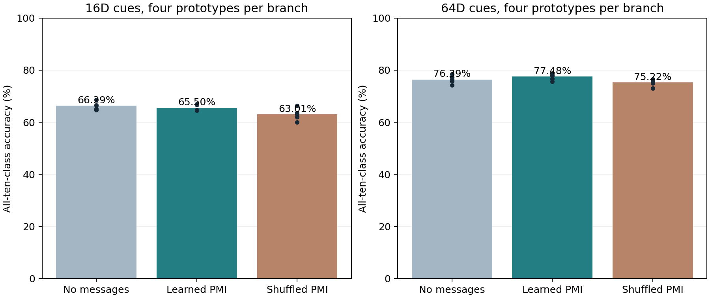

# Overnight result: learned local neighbor compatibility

Five fresh seeds and both Split MNIST orders confirm a **small, configuration-dependent communication gain**. Full-dimensional four-cue retrieval improves from 76.39% to 77.48% with learned neighbor compatibility. Shuffling the learned edge potentials gives 75.22%. The same rule hurts the lower-dimensional memory condition. A direct input-memory classifier remains stronger at 85.61%.

## All locked conditions

| Method | Cue dimension | Automatic accuracy | Seed SD | Earlier four pairs | Newest pair | Extra memory |
|---|---:|---:|---:|---:|---:|---:|
| no_message | 16 | 66.29% | 1.53 pp | 61.74% | 82.10% | 27,200 B |
| learned_pmi | 16 | 65.50% | 1.25 pp | 60.27% | 84.03% | 29,760 B |
| shuffled_pmi | 16 | 63.01% | 2.34 pp | 58.97% | 76.75% | 29,760 B |
| no_message | 64 | 76.39% | 1.58 pp | 74.43% | 82.19% | 104,000 B |
| learned_pmi | 64 | 77.48% | 1.35 pp | 75.23% | 84.49% | 106,560 B |
| shuffled_pmi | 64 | 75.22% | 1.34 pp | 73.26% | 80.99% | 106,560 B |
| original_local | — | 61.39% | 2.17 pp | 58.03% | 72.63% | 26,000 B |
| global_ridge | — | 77.40% | 2.05 pp | 73.42% | 91.59% | 41,984 B |
| direct_ridge | — | 85.61% | 0.00 pp | 84.45% | 89.18% | 18,944 B |

Primary full-dimensional contrasts:

- Learned minus no-message: **+1.09 pp (95% paired-seed t interval +0.25 to +1.93)**.
- Learned minus shuffled: **+2.26 pp (95% paired-seed t interval +1.45 to +3.07)**.
- Learned minus global ridge routing: +0.08 pp (95% paired-seed t interval -1.27 to +1.43).

Both class orders are averaged within seed. Intervals use five independent seed means and a t distribution (four degrees of freedom); no multiple-comparison adjustment is applied. These are small-sample, single-dataset effects, not universal guarantees. The direct classifier uses fixed image features and sufficient statistics, so its zero seed SD is expected.

## How the local communication works

Place the 25 neurons on a fixed 5×5 lattice, with 40 neighbor edges. During the original training stream, each edge counts which pair of branches is simultaneously selected. It sees current activity only: no task IDs, class labels, boundaries or future saved configurations. At inference, local input-prototype matches supply branch preferences. Three damped message rounds encourage combinations supported by edge co-occurrence beyond what their individual frequencies predict (pointwise mutual information). All ten class outputs remain eligible.

Unit Laplace smoothing, unary temperature 0.05, three rounds, damping 0.5 and coupling 0.01 are fixed. The shuffled control permutes edge potentials with a fixed seed, preserving the pool of potential values but breaking their correspondence to particular neighboring neurons. It is a control for this learned compatibility structure, not a proof that only dendrites can implement it. The lattice is an engineering choice, not a measured biological circuit.

## Memory and computation

Forty 4×4FP32 co-occurrence tables add 2,560 bytes. Four 64D prototypes per branch already require 104,000 bytes; communication therefore needs 106,560 bytes of auxiliary state, plus 315,440 bytes of neural model state (422,000 bytes total). Global ridge routing uses 41,984 extra bytes plus the same model; the direct classifier uses 18,944 bytes and no neural model at deployment. Counts and prototypes are explicit memory. No individual examples are replayed, and no external historical configuration bank enters automatic predictions.

| Method | Cue dimension | Batch 1 inference | Batch 128 inference |
|---|---:|---:|---:|
| no_message | 16 | 0.105 ms | 0.610 ms |
| learned_pmi | 16 | 0.463 ms | 1.913 ms |
| shuffled_pmi | 16 | 0.523 ms | 2.056 ms |
| no_message | 64 | 0.105 ms | 0.686 ms |
| learned_pmi | 64 | 0.447 ms | 1.857 ms |
| shuffled_pmi | 64 | 0.444 ms | 1.779 ms |

Freshprocess,2CPUthreads,602 forward,train-imagebatch;3 warmups,5 x 20 calls. Fullkey/routing/branch/headinference;PMIcomputedfromcountseachcall,3 rounds,graph 40 edges. No weightcache/latencyoptimization. CPUmicrobenchmark,nottrainingtime.

The additional communication is not free. Its numerical benefit should be assessed against this latency and memory overhead. No claim of GPU efficiency or lower training cost follows.

## Protocol and limits

- Development 600/601 used stratified 50 kfit/10 kheld-out training images. Coupling candidates 0/.01/.05/.2 were retained with learned and shuffled potentials for both 16D and 64D four-cue memories.
- Coupling 0.01 was locked before confirmation: it was the smallest positive value within 0.1 percentage points of the best mean validation score. The 0.05 candidate was only 0.035 points higher in mean and less consistent across development seeds. This parsimony decision was made after development, not pre-registered before the pilot, and never used official test outcomes.
- Confirmation 602–606, forward and reverse orders, full 60 ktraining/full 10 ktest, two current epochs per pair, batch 128, Adam 0.003, clip 5. Prototype decays 16D0.995/64D1.0 were fixed from earlier development. All 90 automatic conditions are retained. No subsequent coupling adjustment or seed search.
- The neural network remains supervised with current labels. The association and communication memories receive current keys/branch activity only. The model is task-ID-free at inference, not unsupervised.
- Model/memory checksums verify no evaluation writes. Gamma 0 matches the unary route; uniform co-occurrence produces zero PMI effect. Each learned edge records exactly 120,000 current-image presentations. Historical snapshots are used only for a separately labeled oracle diagnostic after predictions.
- The 16D negative control deteriorates with communication. No global superiority to input-memory classifiers or unique dendritic mechanism is established. The memory gain in MULTICUE_REPORT.md and this communication effect are separate cohorts; do not subtract their headline numbers as a paired effect.

## Reproducibility

- [Confirmation driver](../../bdh_cl/scripts/overnight_pmi_confirmation.py), [pilot](../../bdh_cl/scripts/overnight_pmi_message_pilot.py), [profile driver](../../bdh_cl/scripts/overnight_pmi_profile.py).
- [Locked protocol](../../results/overnight_branch_research_20261024/pmi_confirmation/protocol.json), [all results](../../results/overnight_branch_research_20261024/pmi_confirmation/results.json), [checks](../../results/overnight_branch_research_20261024/pmi_confirmation/verification.json), [CPU profiles](../../results/overnight_branch_research_20261024/pmi_confirmation/profile.json), [saved association states](../../results/overnight_branch_research_20261024/pmi_confirmation/memories).
- [Development candidates](../../results/overnight_branch_research_20261024/pmi_message_pilot/results.json), [earlier capacity report](MULTICUE_REPORT.md).
