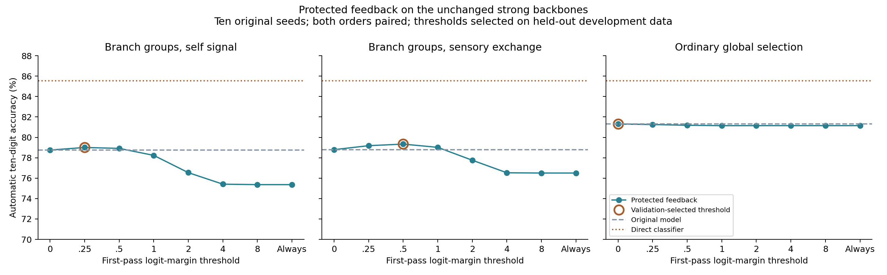

# Protected top-two feedback on the strong existing models

Completed 22 October 2026. **The protections substantially reduce damage from unrestricted feedback, but do not close the gap to the 85.53% direct classifier.** The 78.75% model improves to79.01%; its sensory-exchange counterpart improves from78.79% to79.34%. Validation selects no feedback for the81.30% ordinary-selection control.

## Main result

| Frozen backbone | Original accuracy | Protected feedback | Gain, 95% paired-seed interval | Selected margin threshold |
|---|---:|---:|---:|---:|
| Branch groups, self signal | 78.75% | 79.01% | +0.25 pp [+0.08, +0.43] | 0.25 |
| Branch groups, sensory exchange | 78.79% | 79.34% | +0.54 pp [+0.29, +0.79] | 0.5 |
| Ordinary global selection | 81.30% | 81.30% | +0.00 pp [+0.00, +0.00] | 0.0 |

These are reanalyses of the original ten initialization seeds601–610 in both class orders, not a new independent cohort. Each baseline is reproduced exactly from its saved final model and online association state. No compact5×5 architecture substitution, retraining of confirmation networks, or historical bank enters predictions.

## Exact protections and calibration

1. Use the existing image-to-mask ridge scores for bottom-up evidence. Within each branch group, permit only its top two alternatives.
2. Take the first prediction's top two digit classes. For each candidate class, rank permitted branches by current response multiplied by that class's L2-normalized output-weight row.
3. Construct candidate routes, recompute all ten classifier logits, and select the route with the larger candidate-class log probability. The final prediction is that route's unrestricted ten-class argmax.
4. Apply this correction only when the first pass's top-one minus top-two raw-logit margin is below the selected threshold. Otherwise retain the original prediction exactly.

Threshold candidates are0,0.25,0.5,1,2,4,8,and always-on. Zero is a no-feedback policy. For each architecture, its original development run is reproduced: initialization600,50,000 fitting images and10,000 held-out training images, fixed Adam0.001 and mask-regression ridge0.1. The threshold maximizing validation accuracy is saved before official feedback evaluation. Official test results select no settings; every threshold is retained.

The ordinary-neuron model is not changed into a branch model. It retains its exact24 active neurons and its original count within every four-response message group. Only a group containing one active neuron may swap that neuron to another top-two alternative. Empty or multiply active groups remain unchanged. This is a conservative ordinary-model adaptation, not the unrestricted global feedback design.

## What each protection contributes

| Backbone | Unprotected, always on | Top-two branch restriction, always on | Plus row normalization, always on | Plus validation-selected margin gate |
|---|---:|---:|---:|---:|
| Branch groups, self signal | 65.08% | 75.37% | 75.37% | 79.01% |
| Branch groups, sensory exchange | 64.77% | 76.50% | 76.50% | 79.34% |
| Ordinary global selection | 81.08% | 81.15% | 81.15% | 81.30% |

L2 row normalization cannot change a per-class branch argmax: dividing every contribution for the same candidate class by the same positive norm leaves the ranking unchanged. The top-two-restricted normalized and unnormalized separate-class predictions are checked to be identical. Normalization here changes neither the actual final classifier nor the probability used to compare complete candidate routes.

## Weighted common-consensus implementation check

A second interpretation combines the first pass's two classes into one feedback direction: softmax(top-two logits)-weighted sum of their normalized output rows. Branch response times this common direction selects permitted alternatives; final classification still uses the original unnormalized head. Here normalization can change relative class contributions. The same bottom-up restriction and validation-selected margin gate apply.

This supplemental check was specified after the primary separate-class diagnostic to resolve the implementation ambiguity. It reuses the same cohort and independently calibrates its thresholds on reproduced development data before its own official evaluation. It is not independent replication.

| Backbone | Weighted consensus, normalized rows | Weighted consensus, raw rows |
|---|---:|---:|
| Branch groups, self signal | 78.91% | 78.64% |
| Branch groups, sensory exchange | 79.09% | 78.80% |
| Ordinary global selection | 81.30% | 81.30% |

Neither implementation exceeds the direct-classifier baseline. The compression prerequisite is therefore not met; no projection-based resized network is claimed as tested here.

## Repairs, damage, and remaining opportunity

| Backbone | Gate triggered | Wrong → correct | Correct → wrong | True class among initial top two |
|---|---:|---:|---:|---:|
| Branch groups, self signal | 6.71% | 1.10% | 0.84% | 85.70% |
| Branch groups, sensory exchange | 11.74% | 1.86% | 1.31% | 85.51% |
| Ordinary global selection | 0.00% | 0.00% | 0.00% | 85.02% |

The historical route oracle and the first pass's two class hypotheses provide different information. A high historical oracle does not guarantee that the correct class is present among these two hypotheses.

| Backbone | Historical-route oracle | Perfect two-class reranker, no gate | Perfect two-class reranker, fixed selected gate | Any perfect corrector, fixed selected gate |
|---|---:|---:|---:|---:|
| Branch groups, self signal | 95.60% | 85.70% | 80.65% | 83.19% |
| Branch groups, sensory exchange | 96.26% | 85.51% | 81.83% | 86.19% |
| Ordinary global selection | 95.62% | 85.02% | 81.30% | 81.30% |

These ceilings use true test labels for analysis only and are not algorithms. The two-class ceilings apply to a predictor restricted to the first two candidate classes; the actual implementation allows all ten final outputs. The absolute gated ceiling assumes every initially wrong triggered example is repaired and no initially correct example is damaged. The selected policies produced no predictions outside their initial top two in these records.

The78.75% checkpoint's historical oracle is95.60%, not96.26%. The96.26% number belongs to its78.79% sensory-exchange counterpart. Both are explicitly included rather than mixing the two conditions.

## State, verification, and scope

- All model weights, association statistics, and optimizer-independent routing buffers are frozen. Every evaluation asserts an identical model/memory checksum. Predictions depend on images only; neither candidate selection nor the margin gate sees true labels, task IDs, or saved historical configurations.
- The direct classifier is taken from the identical original cohort and fixed64-dimensional image features; it remains85.53%. Feedback needs no learned extra weights or route archive, but its transient working tensors and gate threshold still exist. No new low-memory deployment claim follows from this fixed-backbone diagnostic.
- Verification checks active-count preservation, the branch top-two eligibility restriction, exact ordinary per-group active-count preservation, row-normalization invariance for separate-class routes, exact reproduction of all60 original baseline predictions at the accuracy level, and60 independent gate-opportunity reconstructions that reproduce the selected feedback predictions.
- Intervals use ten paired seed differences with both orders averaged first, t distribution with nine degrees of freedom. The many ablations are descriptive and not multiplicity-adjusted. The same repeatedly studied MNIST test dataset and old confirmation cohort limit generalization claims.

## Clarifications for the proposed next paths

A seed-generated projection can avoid storing its full matrix, but not the projected branch weights and retrieval vectors. With96 branches and32 FP32 dimensions, those two arrays alone occupy96×32×4×2 =24,576 bytes, already above18,944 before output weights, traces, counts, seed storage, or optimizer state. Projection alone therefore does not establish the proposed budget under the current duplicated-memory design.

Unifying a prototype and its retrieval vector is a separate, testable model change. The direct ridge learner also stores shared feature covariance, not only one raw prototype per class; accumulating multiple local centroids is not automatically the same learning rule. Likewise, the abstract of [Poirazi and Mel (2001)](https://pubmed.ncbi.nlm.nih.gov/11301036/) supports nonlinear dendritic subunits and structural synapse formation/stabilization, but does not establish the particular running-prototype/ridge algorithm proposed here. That algorithm should be evaluated as a new implementation rather than credited to this feedback test.

## Reproducibility

- [Primary driver](../../bdh_cl/scripts/protected_feedback.py), [gate audit](../../bdh_cl/scripts/audit_protected_feedback.py), [weighted-consensus check](../../bdh_cl/scripts/protected_feedback_consensus.py).
- [Protocol](../../results/protected_feedback_20261022/protocol.json), [development candidates](../../results/protected_feedback_20261022/development.json), [frozen thresholds](../../results/protected_feedback_20261022/selection.json), [60-model primary records](../../results/protected_feedback_20261022/results.json).
- [Gate opportunities](../../results/protected_feedback_20261022/gate_opportunity_audit.json), [consensus records](../../results/protected_feedback_20261022/consensus_results.json), [complete summary](../../results/protected_feedback_20261022/summary.json).
- Original checkpoints remain in the preceding experiment directory. All feedback candidates, raw records, protocol hashes, completion files, and source snapshots are retained.
