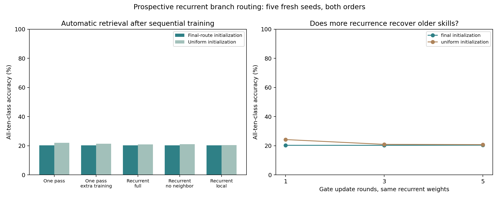

# Recurrent branch-gate retrieval — 26 October 2026

**The tested recurrent updater did not recover earlier skills.** This is a negative result for this small, prospectively trained updater, not proof that recurrent retrieval is impossible. Labels supervised current-example training only; inference used input/network signals and no task IDs, classification-error feedback or route banks.

## Experiment

Split MNIST introduces five digit pairs sequentially, two passes per current pair. The existing one-layer 25-neuron, four-branch tanh backbone learns by factual cross-entropy, Adam and gradient-estimated branch usefulness. Updaters learn alongside it from the same current stream, using the first 32 examples of each backbone minibatch of up to 128. Their branch responses and classifier parameters are detached before updater training; they never affect backbone gradients or routing. Each updater sees approximately one quarter as many current-example presentations as the backbone, before extra optimizer repetitions; all updater controls have identical access. No old-task examples are revisited after moving on.

A shared 856-parameter rule receives each neuron’s four branch responses, four current gate probabilities, a 16-dimensional fixed image description, a learned four-dimensional neuron identity, optional neighboring gates and optional global class probabilities. It makes bounded residual updates to four gate logits. Neighbor communication uses a fixed ring. The recurrent rule is trained through three rounds; the one-pass rule has identical parameters. A one-pass extra-training control performs three optimizer updates on the current batch, matching recurrent-cell call counts approximately rather than exact FLOPs.

Training initializes each example with a random choice between current-route and uniform logits, plus small noise. Inference tests final-route and uniform initialization without noise. All weights are frozen at inference; only per-image gate activations change. The default classifier uses a soft branch mixture, with hard projection retained as a secondary readout. The original trained backbone uses hard gates, so deployment with mixtures is a functional change and a possible limitation.

Two training-validation seeds (810/811) selected per-family learning rates from .001/.003 at the declared trained horizon and final-route initialization. Five fresh seeds (812–816), both orders, confirmed locked settings on the official test split. All predefined 1/3/5-round, initialization and hard-projection conditions are retained. Learning curves on a fixed test subset were added before confirmation as diagnostics only; they did not affect weights or settings.

## Automatic results

| Updater | Final-route initialization | Uniform initialization | Earlier four pairs, final init | Latest pair, final init |
|---|---:|---:|---:|---:|
| one pass | 20.31% | 21.98% | 0.07% | 98.78% |
| one pass extra | 20.26% | 21.38% | 0.02% | 98.76% |
| recurrent full | 20.26% | 20.92% | 0.05% | 98.61% |
| recurrent no neighbor | 20.25% | 20.98% | 0.01% | 98.75% |
| recurrent local | 20.21% | 20.43% | 0.00% | 98.59% |

The table uses each updater’s trained horizon (one or three rounds). Both initialization conditions use the same trained weights and learning rate; uniform was not independently optimized. All ten output classes remain eligible.

| Matched-backbone reference | All-ten-class accuracy |
|---|---:|
| final hard | 20.30% |
| final soft | 20.26% |
| uniform soft | 33.60% |
| local average | 59.87% |
| direct ridge 16 | 71.77% |
| direct ridge 64 | 85.61% |
| historical oracle — label-assisted diagnostic | 92.12% |

The oracle selects historical hard configurations using the true digit pair. It is computed only after automatic predictions and is not autonomous continual learning. Local-average routing has 26,000 bytes of input-association memory and sees all current backbone examples. Direct ridge classifiers use current labels and no neural backbone at inference; these are stronger memory-based references, not memory-matched recurrent controls.

## Paired comparisons

Unadjusted 95% t intervals over five seed differences, first averaging both orders within seed; descriptive supporting contrasts are not multiplicity-corrected. Independently validation-selected learning rates differ across some families. Same-weights iteration curves hold that factor fixed.

| Final-initialization contrast | Difference | 95% interval |
|---|---:|---:|
| recurrent3 minus one pass | -0.05 pp | [-0.25, +0.15] |
| recurrent3 minus one pass extra | -0.00 pp | [-0.19, +0.19] |
| recurrent3 minus no neighbor | +0.01 pp | [-0.17, +0.20] |
| same recurrent weights 3 minus 1 | -0.02 pp | [-0.25, +0.21] |
| same recurrent weights 5 minus 3 | +0.10 pp | [-0.21, +0.42] |

## Acquisition and retention diagnostics

| Updater, initialization | Mean current-pair accuracy immediately after its training | Final earlier-four-pair probe accuracy |
|---|---:|---:|
| one pass final | 98.75% | 0.04% |
| one pass uniform | 97.17% | 3.02% |
| one pass extra final | 98.71% | 0.00% |
| one pass extra uniform | 96.92% | 2.77% |
| recurrent full final | 98.73% | 0.02% |
| recurrent full uniform | 98.73% | 0.78% |
| recurrent no neighbor final | 98.75% | 0.00% |
| recurrent no neighbor uniform | 98.67% | 0.87% |
| recurrent local final | 98.69% | 0.00% |
| recurrent local uniform | 98.69% | 0.25% |

These curves use 100 fixed test observations per class, all ten output classes eligible. They distinguish current acquisition from earlier-skill access, but cannot isolate forgetting of updater weights from drift in backbone representations/head. The entire trained system changes during acquisition.

## Resource cost

Each updater has 856 learned parameters: 3,424 bytes of FP32 persistent inference weights. Its Adam weights/moments/scalar steps require approximately 10,292 bytes during training. The backbone adds 315,440 bytes including usefulness state; its parameters are 78,760. Gate logits alone require 400 bytes per image temporarily, in addition to probabilities, branch responses and recurrent workspace; no per-image gates or input examples persist across predictions. No prototype or configuration bank is needed by the updater.

All 100 branch responses are computed once per image and reused across rounds; this single-layer implementation does not require a full backbone pass per round. Multilayer routing could invalidate that simplification. The dynamics are finite learned updates, with no proof of convergence or energy descent.

| Updater | Rounds | End-to-end batch 1 | End-to-end batch 128 |
|---|---:|---:|---:|
| one_pass | 1 | 0.2182 ms | 0.9217 ms |
| one_pass_extra | 1 | 0.2132 ms | 0.8683 ms |
| recurrent_full | 1 | 0.2035 ms | 0.8599 ms |
| recurrent_full | 3 | 0.3641 ms | 1.8182 ms |
| recurrent_full | 5 | 0.5222 ms | 2.7793 ms |
| recurrent_local | 1 | 0.1940 ms | 0.8194 ms |
| recurrent_local | 3 | 0.3374 ms | 1.7118 ms |
| recurrent_local | 5 | 0.4787 ms | 2.7167 ms |

Two-thread CPU timings include key extraction, branch computation, updater and classifier. They exclude loading/model construction. These are small-model measurements, not GPU/energy claims.

| Training sidecar | Mean router-only training time | Optimizer updates per backbone step | Recurrent-cell calls per backbone step |
|---|---:|---:|---:|
| one_pass | 0.667 s | 1 | 1 |
| one_pass_extra | 1.916 s | 3 | 3 |
| recurrent_full | 1.449 s | 1 | 3 |
| recurrent_no_neighbor | 1.364 s | 1 | 3 |
| recurrent_local | 1.239 s | 1 | 3 |

Router-only times exclude shared feature extraction, backbone learning, association controls and evaluation. Combined all-candidate runtime must not be interpreted as a deployable method’s cost. Equal call count is only an approximate compute control; measured sidecar times can differ.

## Interpretation

This updater did not learn a durable label-free retrieval procedure through sequential supervised training. More inference iterations did not supply the missing evidence needed to select earlier routes. Initializing near the final route can retain a latest-task bias; uniform initialization is a relevant control, not a guaranteed remedy. Historical oracle recovery continues to indicate accessible skills under assisted configurations, but does not guarantee that this small updater can infer them.

The conclusion is limited to this architecture, training schedule, learning-rate range and soft-gate objective. The experiment does not rule out generative/predictive feedback, a better preserved updater, joint backbone–router training, different capacity, or recurrent associative memory. Those would be new hypotheses, not explanations established here. No post-test tuning or favourable-seed search was performed.

A sharper next mechanism would give gates a label-free observation-prediction objective and test whether decreasing that objective actually improves classification, using frozen feature controls and matched one-pass inference. Without such a signal, recurrence can settle into a confidently wrong or recent-task solution. Do not claim attractor retrieval merely because the gates iterate.

## Verification and evidence

All 50 primary saved-updater readouts reproduce recorded accuracy exactly under frozen reevaluation. Backbone training without any sidecar reproduces development seed 810 bitwise, verifying that sidecars did not change acquisition. Probability normalization, mixture readout and finite training gradients are checked. Historical routes remain analysis-only.

- [Experiment driver](../../bdh_cl/scripts/recurrent_branch_gate_test.py), [report/audit/profile driver](../../bdh_cl/scripts/report_recurrent_branch_gate.py).
- [Protocol](../../results/recurrent_branch_gate_20261026/protocol.json), [locked selection](../../results/recurrent_branch_gate_20261026/selection_lock.json), [pre-confirmation diagnostic addendum](../../results/recurrent_branch_gate_20261026/confirmation_addendum.json).
- [All validation candidates](../../results/recurrent_branch_gate_20261026/development.json), [all confirmation conditions and curves](../../results/recurrent_branch_gate_20261026/confirmation.json), [summary](../../results/recurrent_branch_gate_20261026/summary.json), [contrasts](../../results/recurrent_branch_gate_20261026/contrasts.json).
- [Audit](../../results/recurrent_branch_gate_20261026/audit.json), [profiles](../../results/recurrent_branch_gate_20261026/profile.json), [source hashes](../../results/recurrent_branch_gate_20261026/source_hashes.json).
