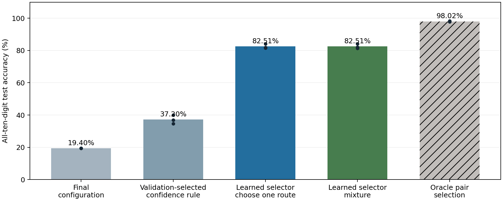

# Retrieving five saved branch configurations from network responses

Completed on 14 October 2026. **Response-based retrieval recovers 82.51% all-digit accuracy at unchanged final network weights and classifier, versus 19.40% for the final configuration and 98.02% for oracle pair selection.** This is a retrospective retrieval diagnostic using externally saved configurations and supervised selector fitting on historical training data. It is not autonomous replay-free continual learning.

## Direct answer to the requested test

Every image was evaluated under each of the five saved configurations. Each configuration produced all ten digit logits. Predictions were selected or combined without the true test label, digit pair or task ID. Independent original-model forward passes matched all candidate logits. The original final network state, including classifier and error buffer, remained unchanged.

| Evaluation | Mean test accuracy | Seed SD |
|---|---:|---:|
| Final configuration | 19.40% | 0.02 pp |
| Validation-selected confidence rule | 37.20% | 2.68 pp |
| Learned response selector: choose one configuration | 82.51% | 1.41 pp |
| Learned response selector: weighted mixture | 82.51% | 1.50 pp |
| Correct digit-pair route oracle — analysis only | 98.02% | 0.26 pp |



Dots are the three original seeds, 34/35/36. All use the original natural pair order. Oracle selection uses true digit-pair information only after producing predictions; the other methods do not. Seed SD is descriptive, not a confidence interval.

## What was held fixed

The original hard-gated network has 24 neurons, four tanh branches per neuron and one learned ten-logit classifier. It was trained sequentially on five Split MNIST pairs for two epochs per pair. We loaded the final checkpoints and the 24 branch indices recorded after each stage. No original weight, classifier or usefulness-memory update was applied during this experiment.

For an image x, all branch responses are computed once. Each saved configuration selects one branch per neuron, producing a 24-dimensional hidden vector, which the unchanged final classifier turns into ten logits. This yields a 5×10 response array. No candidate is restricted to its historical two classes.

## Confidence and averaging baselines

The following fixed methods use temperature 1 and no fitted selector:

| Rule | Mean test accuracy |
|---|---:|
| Choose route with highest maximum class probability | 33.90% |
| Choose route with largest top-two probability margin | 35.43% |
| Choose route with lowest class entropy | 32.36% |
| Average all five probability vectors | 29.58% |
| Choose route with largest raw logit | 29.87% |
| Average all five logit vectors | 27.31% |

We separately selected one baseline per seed using training-image validation only. Confidence, margin, entropy and probability averaging used temperatures 0.25/0.5/1/2/4; raw-logit methods had no temperature tuning. The best validation candidate was fixed before test scoring. It reached 37.20% on average, far short of oracle recovery. Confident predictions under the wrong configuration are therefore a substantial problem.

## Learned response selector

The selector receives the 50 logits produced by the five configurations. Each coordinate is standardized using means and standard deviations fitted on selector-training images. A linear 50→5 layer produces five softmax weights:

```text
z(x) = flatten(the five ten-class logit vectors)
a(x) = softmax(A · standardize(z(x)) + b)
P(c | x) = sum_r a_r(x) · softmax(logits_r(x) / T)_c
```

Training minimizes −log P(y|x) using ordinary digit labels. It is not trained with task IDs or the correct route index. The mixture objective allows routes that predict the right digit to receive credit. At inference, **only the image-derived logits enter the selector**. A hard variant picks the route with the largest selector weight and uses that route’s ten-class prediction; it uses the same trained selector and settings without additional tuning.

Each seed trained six selector candidates: Adam learning rates 0.003/0.03 and temperatures 0.5/1/2, for 20 epochs. The model with best final validation mixture accuracy was selected. All seeds selected rate 0.03 and temperature 2. There was no test-label-based selection.

**Important training-data qualification:** the selector was fitted retrospectively on 50,000 labeled original training images, including old classes. Another 10,000 training images (1,000 per digit) were held out from selector fitting for selection. The frozen encoder had already seen these images during its original training, so this is a selector holdout, not an independent encoder holdout. Historical data were revisited to train the selector; this is not an online system that builds retrieval automatically without replay. The official 10,000-image test set supplied no learning feedback.

## Recovery across digit pairs

| Evaluation | 0/1 | 2/3 | 4/5 | 6/7 | 8/9 |
|---|---:|---:|---:|---:|---:|
| Final configuration | 0.00% | 0.00% | 0.00% | 0.00% | 97.85% |
| Learned hard selector | 94.12% | 78.26% | 77.37% | 86.12% | 75.73% |
| Learned mixture | 92.59% | 76.15% | 77.07% | 86.71% | 79.24% |
| Oracle pair route | 98.98% | 95.12% | 98.86% | 99.35% | 97.85% |

The hard selector chose the historical route corresponding to the true digit pair on 83.31% of test images. Pair identities are used only for this analysis. A true-label diagnostic asking whether **any** of the five route predictions is correct reaches 98.02%; this also cannot be used as an autonomous prediction method.

## Storage and compute

| Deployed components | Numeric persistent storage |
|---|---:|
| Original final weights, classifier and error buffer | 302,824 bytes |
| Original model + five int64 configurations | 303,784 bytes |
| Above + learned selector and standardization buffers | 305,204 bytes |

The five configurations contain 120 int64 indices (960 bytes). The selector adds 255 FP32 parameters (1,020 bytes) plus 100 normalization values (400 bytes). These are additional central retrieval memory. Historical input images and training-logit caches are not required at deployment. Scalar metadata and temporary working tensors are excluded. Adam state is present during selector training but absent in deployment.

All routes share the first-layer response computation, so inference does not run five separate complete networks. It performs five pooled hidden vectors/head evaluations and the small selector. A CPU timing diagnostic on seed 34, two threads, synthetic inputs, 30 warmups and 20 blocks of 100 calls measured:

| Batch size | Final configuration | All routes + mixture selector |
|---|---:|---:|
| 1 | 0.0226 ms | 0.0479 ms |
| 128 | 0.0750 ms | 0.1660 ms |

This is a representative latency measurement, not a GPU benchmark, equal-FLOP comparison or peak-memory audit.

## What this establishes and what remains

The original network’s responses contain enough information for a small supervised selector to retrieve much of the skill accessible under historical configurations. Simple confidence ranking does not recover it reliably. The 98.02% oracle result was independently reproduced with unrestricted ten-digit predictions; the recovery did not rely on masking the classifier to the correct pair.

This does not establish that the network autonomously stores or retrieves configurations during continual learning. The bank was externally recorded at training-stage boundaries, and the selector learned retrospectively from old labeled data. Nor does it show a unique advantage over an ordinary network with comparable routing/retrieval capacity.

A useful next test would form input–route associations while each class is current, without revisiting old images, and assess whether they remain useful after the network changes. Only after that should we test replacing the central selector and full configuration bank with branch-local associative state and neighbor communication. Strong controls should include equivalent shared routing and explicitly count every stored association.

## Reproducibility

- [Retrieval driver](../../bdh_cl/scripts/saved_config_response_retrieval.py), [protocol](../../results/saved_config_response_retrieval_20261014/protocol.json), [all results and validation candidates](../../results/saved_config_response_retrieval_20261014/results.json), [saved selectors](../../results/saved_config_response_retrieval_20261014/selectors).
- [Timing driver](../../bdh_cl/scripts/saved_config_retrieval_timing.py), [timing results](../../results/saved_config_response_retrieval_20261014/timing.json), [verification](../../results/saved_config_response_retrieval_20261014/verification.json).
- Verified all five cached-route logits match independent original forward passes, all candidates emit ten logits, original final model state remains unchanged, final-route accuracy reproduces the source checkpoints, and persistent state matches the stated budget.
