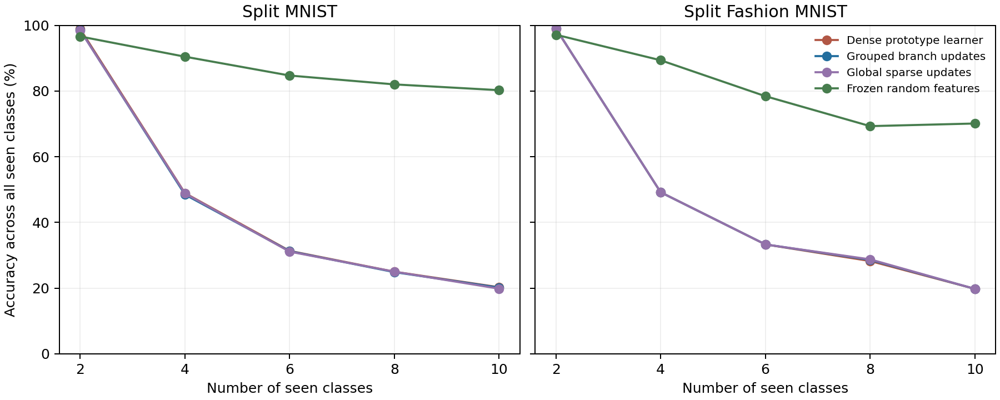

# Sequential prototype-distance representation test

Completed on 13 October 2026. **The joint-trained objective transfers poorly to sequential learning with old prototypes unchanged. All three learned variants suffer severe forgetting; frozen features remain substantially stronger.** This tests the prototype-gradient version without protection or communication, not the earlier complete local branch-memory model.

## Protocol

Five disjoint pairs of MNIST/Fashion MNIST classes arrive sequentially. Both forward pair order (0/1 → 2/3 → 4/5 → 6/7 → 8/9) and reversed order are evaluated. Each current pair receives ten learning epochs, matching the joint study’s total 600,000 gradient presentations per full sequence. At every test, all classes observed so far compete; old classes remain eligible. No correct task, pair or test label enters prediction.

All arms use the same L2-normalized inputs, 256 tanh responses, nearest-class prototype classifier, paired initialization and current minibatch order. Dense updates all response units; grouped updates the largest-gradient unit in each of 64 four-unit groups; global sparse updates the largest-gradient 64 units globally. Frozen features never change. All arms have exactly 814,160 bytes of numeric persistent state, including class prototypes/counts. Gradients are computed for the full layer before sparse masking; no sparse-compute or biologically local-learning claim is made.

Rates and temperatures are taken unchanged from independent joint-validation selection. There is no sequential retuning or test-based selection. Three seeds per dataset reuse the joint cohort to enable a paired follow-up; this is not an independent replication. The two orders are paired repeats, not six independent seeds. All 60,000 training images and 10,000 test images are used.

Only current-class prototypes are bootstrapped before learning, updated online from current labeled minibatches, and refitted after each current epoch. Old prototypes and their counts remain exactly unchanged after their classes leave. The loss compares each current example against **all seen classes**, including old prototypes. Training-stage boundaries schedule the current fitting passes; this is task-ID-free inference but not a boundary-free streaming protocol. No old images, replay reservoir or historical configuration bank is used by the primary learner.

## Primary replay-free result

| Dataset | Model | Final ten-class accuracy | Old eight classes | Newest pair | Final accuracy seed SD |
|---|---|---:|---:|---:|---:|
| Split MNIST | Dense prototype learner | 20.28% | 0.00% | 98.94% | 0.01 pp |
| Split MNIST | Grouped branch updates | 20.17% | 0.00% | 98.37% | 0.09 pp |
| Split MNIST | Global sparse updates | 19.84% | 0.01% | 96.69% | 0.71 pp |
| Split MNIST | Frozen random features | 80.25% | 79.23% | 83.23% | 0.62 pp |
| Split Fashion MNIST | Dense prototype learner | 19.79% | 0.00% | 98.96% | 0.00 pp |
| Split Fashion MNIST | Grouped branch updates | 19.78% | 0.00% | 98.90% | 0.00 pp |
| Split Fashion MNIST | Global sparse updates | 19.78% | 0.00% | 98.91% | 0.00 pp |
| Split Fashion MNIST | Frozen random features | 70.11% | 66.25% | 85.53% | 0.44 pp |

Seed SD is computed after averaging the two orders within each seed. Old/new accuracies are pair averages; all-class accuracy is weighted by official test class sizes. Near 20% overall accuracy can therefore coexist with near-perfect newest-pair classification and near-zero old-class accuracy.

## Representation drift and backward transfer

Test class mean responses were recorded at acquisition and after later learning, only for analysis. No test-derived statistic enters learning or prototypes. Drift is mean squared movement of old-class mean responses. It is a proxy, not a complete information-retention metric. Backward transfer is final minus acquisition accuracy, averaged across the first four pairs; this also includes competition from newly introduced classes.

| Dataset | Model | Old-class mean drift (MSE) | Backward transfer |
|---|---|---:|---:|
| Split MNIST | Dense prototype learner | 0.069723 | -98.88 pp |
| Split MNIST | Grouped branch updates | 0.284680 | -98.37 pp |
| Split MNIST | Global sparse updates | 0.279745 | -98.53 pp |
| Split MNIST | Frozen random features | 0.000000 | -8.63 pp |
| Split Fashion MNIST | Dense prototype learner | 0.077448 | -98.93 pp |
| Split Fashion MNIST | Grouped branch updates | 0.034880 | -98.94 pp |
| Split Fashion MNIST | Global sparse updates | 0.037563 | -98.93 pp |
| Split Fashion MNIST | Frozen random features | 0.000000 | -15.26 pp |

## Offline prototype-refit diagnostic — uses old training data

For analysis only, the final feature weights were held unchanged and all ten class prototypes were rebuilt using all labeled training images, including historical classes. No gradients were applied and no test labels selected a route. This asks whether useful class separation remains in the final responses despite stale old prototypes. **These numbers are not valid replay-free continual-learning performance:** the diagnostic accesses old training data. Original saved model states and primary results remain unchanged.

| Dataset | Model | Primary accuracy | Offline all-class prototype refit | Old eight classes after refit |
|---|---|---:|---:|---:|
| Split MNIST | Dense prototype learner | 20.28% | 67.22% | 63.20% |
| Split MNIST | Grouped branch updates | 20.17% | 64.04% | 59.54% |
| Split MNIST | Global sparse updates | 19.84% | 65.05% | 61.32% |
| Split MNIST | Frozen random features | 80.25% | 80.25% | 79.23% |
| Split Fashion MNIST | Dense prototype learner | 19.79% | 64.92% | 60.06% |
| Split Fashion MNIST | Grouped branch updates | 19.78% | 65.43% | 60.24% |
| Split Fashion MNIST | Global sparse updates | 19.78% | 65.59% | 60.44% |
| Split Fashion MNIST | Frozen random features | 70.11% | 70.11% | 66.25% |

A recovery after refitting means final features still contain class information accessible to the same nearest-mean classifier when fresh class summaries are supplied. It does not prove the old representation was preserved, that prototypes can be updated autonomously without old data, or that branches uniquely retained information. Dense recovery must be considered alongside branch recovery.

## What this means

Joint prototype-loss learning successfully acquired useful features, but without stability mechanisms it did not preserve accessible old-class performance during sequential learning. Updating fewer response units, even one per group, was insufficient under the fixed transferred settings. This rules out a simple claim that prototype-aligned learning plus grouping alone solves forgetting. It does not rule out the original hypothesis involving branch-specific memory, selective protection and communication, which are absent here.

The next discriminating intervention is protection under the same prototype objective, with matched dense/global sparse protection controls and explicit old/new accuracy reporting. Any prototype correction or frozen-plus-learnable residual mechanism should have a corresponding ordinary control. The current offline refit diagnostic is evidence about remaining features, not an autonomous solution.

## Reproducibility and verification

- [Sequential driver](../../bdh_cl/scripts/sequential_prototype_representation.py), [protocol](../../results/sequential_prototype_representation_20261013/protocol.json), [48 primary models](../../results/sequential_prototype_representation_20261013/results.json), [final model files](../../results/sequential_prototype_representation_20261013/models).
- [Refit diagnostic driver](../../bdh_cl/scripts/sequential_prototype_refit_diagnostic.py), [diagnostic protocol](../../results/sequential_prototype_representation_20261013/refit_protocol.json), [48 diagnostic evaluations](../../results/sequential_prototype_representation_20261013/refit_diagnostic.json).
- Checked old prototype/count invariance at every stage, old-class eligibility, unseen-class exclusion, exact agreement with joint updates when all classes are observed, frozen-weight invariance, saved-primary prediction reproduction, unchanged feature weights during diagnostic refitting, complete counts and equal persistent state.
- Stored histories/test means are reporting artifacts, not model memory or learner input. Each learned epoch adds a current-data-only prototype-fitting pass; bootstrap adds another. Temporary gradient/working memory and evaluation artifacts are excluded from model storage.
