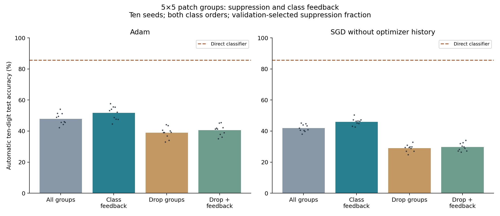
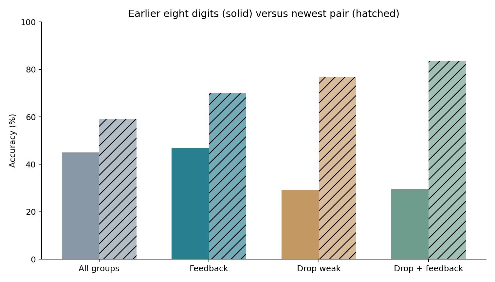

# Somatic suppression, class feedback, and compact patch groups

Completed 21 October 2026. These experiments test the three proposed fixes separately and together. They include 160 Adam sequential runs, 60 SGD sequential controls, and 20 joint-capacity references. All confirmation uses ten paired initialization seeds and both digit-pair orders; these are not 240 independent initializations.

**Main finding:** class feedback improves the compact independent-output model from 47.91% to 51.65% (+3.74 percentage points; 95% paired-seed interval +2.56 to +4.93). Trace-ranked somatic suppression instead reduces it to 39.00%; suppression plus feedback reaches 40.54%. The direct classifier remains stronger at 85.53%.

Patch restriction meets the model-plus-local-memory budget at 18,520 bytes. Adam raises the full persistent state to 46,264 bytes. SGD without momentum meets the stricter 18,520-byte continuing-learning budget, but reaches only 45.99% with feedback. Thus the state-saving goal is achievable here; the joint state-and-accuracy advantage is not.

## Definitions and exact implementation

- **Group and branch:** 24 groups each have four learned tanh responses. Each group initially selects one branch. Independent output connections give each branch its own weight for each digit class, implementing W[class, group, branch]. Shared-output alternatives are explicit controls.
- **Somatic thresholding:** after branch selection, retain either 17 of 24 groups (drop about 29%) or 12 of 24 (drop 50%). Suppressed groups output zero. The primary ranking is the selected branch's recent training usefulness, an EMA of negative loss-gradient times response. This score is global recent-task state, not usefulness measured on the current image.
- **Cue-ranked suppression:** a separate secondary variant ranks groups by their current image-to-memory similarity. This is retrieval confidence, not supervised usefulness. It is kept separate from the proposed trace-ranked rule.
- **Class feedback, called bAP consensus in the proposal:** Pass 1 produces ten logits. Its top two predicted classes each propose a route. For candidate class c, every active group selects the branch maximizing current response × W[c, group, branch]. Groups suppressed in Pass 1 remain suppressed. Each candidate route produces ten new logits. The route with the larger candidate-class log probability wins, and its unrestricted ten-class argmax is the final prediction. There is no true-label feedback, route bank, task ID, stored per-class configuration, or test-time learning. This is a mathematical two-pass feedback rule, not a biophysical bAP simulation.
- **Patch-restricted group:** all four branches within a group read the same small image region, with different learned filters. Twenty-four overlapping 5×5 patches cover a central 20×25 rectangle. Each branch stores only 25 input weights. A 6×6 shared-output control is also included.
- **Local retrieval memory:** before each neural update, associate each group's current winning branch with the current patch summary. The summary is normalized 3×3 average pooling plus a constant bias coordinate (10 numbers). Store per-branch sums and counts, not images. A group's winner is recorded before somatic suppression, even if its output will later be zeroed. No class label enters these association writes.
- **Direct classifier:** ridge regression on a fixed 64-dimensional whole-image summary, accumulating statistics from current digit labels. This baseline needs no branch network or configuration selector.

## Main compact-model result

The following table uses the 5×5 independent-output model trained with all 24 groups active. Suppression is then a fixed-weight inference intervention. The fraction dropped is chosen on validation separately for each reported family, never on test outcomes. Both Adam primary trace-based families chose 17 retained groups in development.

| Inference rule | Adam accuracy | Adam old eight digits | Adam newest pair | SGD accuracy |
|---|---:|---:|---:|---:|
| All groups; no feedback | 47.91% | 44.99% | 59.04% | 41.89% |
| All groups; class feedback | 51.65% | 46.88% | 69.95% | 45.99% |
| Suppress weak groups using usefulness trace | 39.00% | 29.20% | 76.95% | 29.01% |
| Trace suppression plus class feedback | 40.54% | 29.44% | 83.53% | 29.69% |
| Suppress groups using image-cue similarity | 38.40% | 35.58% | 49.39% | 37.37% |
| Cue suppression plus class feedback | 43.46% | 39.24% | 59.83% | 40.91% |

The direct classifier reaches **85.53%**. The compact branch pipeline remains substantially below this simpler control.

## Paired effects of each fix

Differences are percentage points versus all groups/no feedback, on identical final weights and local associative state. Intervals are 95% paired-seed t intervals with nine degrees of freedom; both orders are averaged within each seed. They are exploratory and not corrected for multiple comparisons.

| Optimizer | Feedback alone | Trace suppression alone | Trace suppression + feedback | Cue suppression alone |
|---|---:|---:|---:|---:|
| adam | +3.74 [+2.56, +4.92] | -8.92 [-10.29, -7.54] | -7.37 [-8.53, -6.21] | -9.51 [-10.36, -8.65] |
| sgd | +4.10 [+2.41, +5.79] | -12.88 [-14.07, -11.69] | -12.20 [-14.01, -10.39] | -4.52 [-5.30, -3.74] |

## Both requested suppression fractions

All predetermined fractions are shown below on the same Adam compact backbone trained with 24 groups. No fraction is selected from these test scores.

| Groups retained | Ranking | No feedback | Class feedback |
|---|---|---:|---:|
| 24 | trace | 47.91% | 51.65% |
| 17 | trace | 39.00% | 40.54% |
| 17 | cue | 38.40% | 43.46% |
| 12 | trace | 32.23% | 32.72% |
| 12 | cue | 29.60% | 33.79% |

## Did suppression need to be present during training?

These rows train with 24, 17, or 12 active groups and evaluate with the same retained count and trace ranking. This avoids interpreting a failed posthoc intervention as a failure of every suppression-trained model.

| Adam training groups retained | Same-count inference, no feedback | Same-count inference, feedback | Current-pair acquisition | Historical recovery |
|---|---:|---:|---:|---:|
| 24 | 47.91% | 51.65% | 97.33% | 96.34% |
| 17 | 33.38% | 34.51% | 96.28% | 94.82% |
| 12 | 24.29% | 24.10% | 94.57% | 91.91% |

Historical recovery uses the true digit pair to restore the actual branch-and-group mask saved after learning that pair, at final fixed weights. It is a task-assisted diagnostic and never enters automatic inference.

## Every neural architecture and memory budget

Baseline and feedback columns retain all groups at inference; training retention is named explicitly. The shared-head controls cannot assign different output connections to branches within a group. Their feedback can still distinguish branches through different responses multiplied by a shared class weight.

| Adam architecture | Baseline | Class feedback | Acquisition | Historical recovery | Model + local memory bytes |
|---|---:|---:|---:|---:|---:|
| full independent keep24 | 44.81% | 45.30% | 99.03% | 91.03% | 309,976 |
| full independent keep17 | 45.76% | 45.43% | 99.00% | 93.76% | 309,976 |
| full independent keep12 | 40.26% | 42.78% | 98.92% | 90.17% | 309,976 |
| patch5 independent keep24 | 47.91% | 51.65% | 97.33% | 96.34% | 18,520 |
| patch5 independent keep17 | 44.05% | 48.60% | 96.28% | 94.82% | 18,520 |
| patch5 independent keep12 | 41.07% | 45.63% | 94.57% | 91.91% | 18,520 |
| patch5 shared keep24 | 33.37% | 31.68% | 96.94% | 94.95% | 15,640 |
| patch6 shared keep24 | 31.75% | 30.17% | 97.44% | 95.46% | 17,944 |

**Optimizer state changes the memory conclusion.** The compact model uses fewer bytes than the direct classifier only when comparing model-plus-retrieval state, or when using SGD without momentum. Adam retains additional moment arrays needed to continue its training trajectory.

| Compact system | Model + retrieval | Optimizer history | Total persistent numeric state |
|---|---:|---:|---:|
| 5×5 independent outputs, Adam | 18,520 B | 27,744 B | **46,264 B** |
| 5×5 independent outputs, SGD without momentum | 18,520 B | 0 B | **18,520 B** |
| Direct 64-feature ridge classifier | 18,944 B | 0 B | **18,944 B** |

Counts include actual input/output weights and biases, usefulness traces, local cue sums/counts, and patch coordinates. Gradients, temporary indexing/feedback routes, solve workspace, and Python metadata are excluded for all methods. No cached derived coefficients are stored. A deployment-only frozen direct classifier could discard its continual-learning statistics and keep much less state; the 18,944-byte comparison retains the statistics needed for further online updates.

The SGD supplement uses the same cohort and training stream, selecting one common rate from 0.03/0.1/0.3 on development validation before its own confirmation. It was added specifically to resolve the optimizer-state budget issue; it is not independent replication of the Adam experiment.

## What does class feedback correct or destroy?

These changes are measured on identical test images and frozen weights. Labels enter only after both predictions are complete. Values are percentages of all test examples, not conditional rates.

| Adam compact configuration | Wrong → correct | Correct → wrong | Net gain | True class in first-pass top two |
|---|---:|---:|---:|---:|
| feedback | 10.78% | 7.04% | +3.74 pp | 64.04% |
| somatic trace feedback | 8.34% | 6.79% | +1.55 pp | 54.83% |
| somatic cue feedback | 11.50% | 6.45% | +5.05 pp | 55.76% |

First-pass top-two coverage diagnoses the quality of the proposed class hypotheses. It is not a formal accuracy ceiling because all ten outputs remain eligible after feedback. The audit also records predictions outside those first two classes and asserts exact reproduction of the primary feedback predictions.

## Larger-cue and joint-capacity controls

The same trained models are also tested with per-branch 64-dimensional whole-image prototype cues. This is a larger-memory control, not the compact pipeline: for the independent-output 5×5 model it requires 39,256 model-plus-memory bytes before optimizer state.

| Model trained with 24 groups | Local cue baseline | Whole-image 64-feature cue baseline | Whole-image cue + feedback |
|---|---:|---:|---:|
| full independent keep24 | 44.81% | 63.07% | 60.68% |
| patch5 independent keep24 | 47.91% | 65.62% | 65.45% |

Joint training, with all classes mixed and the same total example presentations, reaches **94.11%** for the full-image network and **87.61%** for the compact 5×5 network. Each joint arm independently chooses its learning rate on development validation. These are acquisition/capacity references, not continual-learning results.

## Protocol and limitations

- Real MNIST, pixels/255, five class pairs, two passes per pair, batch 128, gradient clipping 5, continuous optimizer, and usefulness EMA decay 0.95. No replay, pretraining, task-ID input, boundary reset, or historical route bank in automatic inference.

- Development initialization 700 uses a stratified 50,000/10,000 fitting/validation split. Eight Adam backbones each test rates 0.001/0.003. One common rate is selected by mean automatic local-memory accuracy evaluated at each training retention count. Inference retention 17/12 is selected separately within each trace/cue/feedback family on validation. All predetermined test settings are retained, not just chosen readouts. Joint references have four separate development runs. The SGD supplement has nine development runs.

- Frozen Adam learning rate: 0.003; frozen SGD learning rate: 0.1; direct classifier ridge: 0.1. Confirmation uses initializations 701–710, both class orders, full 60,000 training and 10,000 test images. All Adam/SGD paired comparisons share initialization and sample order where shapes match. Joint references use ten seeds and have no class order.

- Class feedback is an inference-only intervention; it is not trained end-to-end through the revised routes. The rule can increase a candidate class's own score without making it correct. There is no learned confidence guard or fallback to the first-pass route. Conclusions apply to this explicit literal implementation, not every feedback rule.

- Trace-ranked suppression uses recent training usefulness, which can favor the newest pair. Worse old accuracy alongside better newest-pair accuracy is consistent with this bias; the present ablations do not fully identify the causal source. Cue similarity is a different signal and is reported separately.

- The compact patch and full-image models differ in effective input capacity and local cue access. A patch-versus-full comparison is a complete-design comparison, not an isolated spatial-mask intervention. The lower joint accuracy of the compact model must remain visible.

- All evaluation calls checksum model and memory before and after. The 640-case feedback audit reproduces the exact primary predictions and separates repaired errors from newly introduced errors. Shared-output expansion, exact active counts, local memory writes, class-contribution maximization, and numerical-state budgets are verified.

- These are new initializations of the same repeatedly studied MNIST dataset, not a new dataset. Ten paired seeds reduce initialization uncertainty but do not establish broad generalization. Secondary intervals are not corrected for multiple comparisons.

## Reproducibility

- [Main driver](../../bdh_cl/scripts/somatic_consensus.py), [SGD budget control](../../bdh_cl/scripts/somatic_consensus_sgd.py), [feedback audit](../../bdh_cl/scripts/audit_somatic_consensus.py).
- [Primary protocol](../../results/somatic_consensus_20261021/protocol.json), [primary frozen selection](../../results/somatic_consensus_20261021/selection.json), [SGD protocol](../../results/somatic_consensus_20261021/sgd_protocol.json), [SGD selection](../../results/somatic_consensus_20261021/sgd_selection.json).
- [Adam results](../../results/somatic_consensus_20261021/results.json), [SGD results](../../results/somatic_consensus_20261021/sgd_results.json), [joint references](../../results/somatic_consensus_20261021/joint_results.json), [summary and paired intervals](../../results/somatic_consensus_20261021/summary.json).
- [Feedback transitions](../../results/somatic_consensus_20261021/feedback_transition_audit.json), [state budget audit](../../results/somatic_consensus_20261021/state_budget_audit.json), [verification](../../results/somatic_consensus_20261021/verification.json).
- Complete checkpoints, every validation candidate, primary and supplemental completion manifests, logs, and archived source are retained in the results directory.
