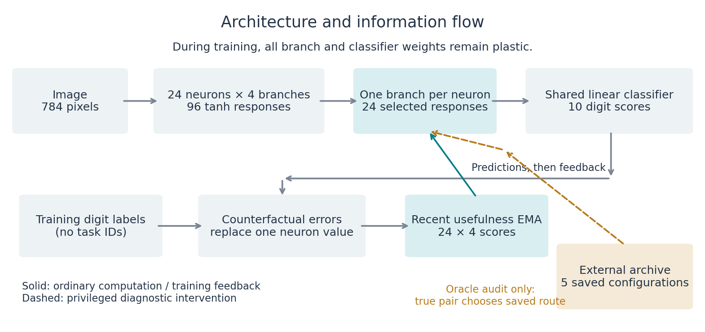
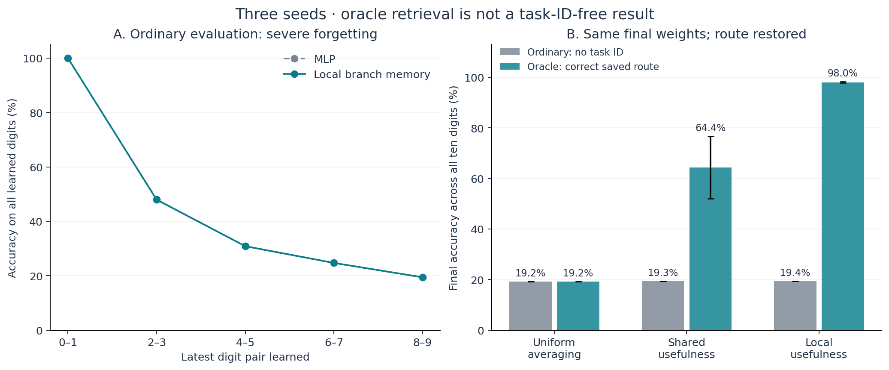
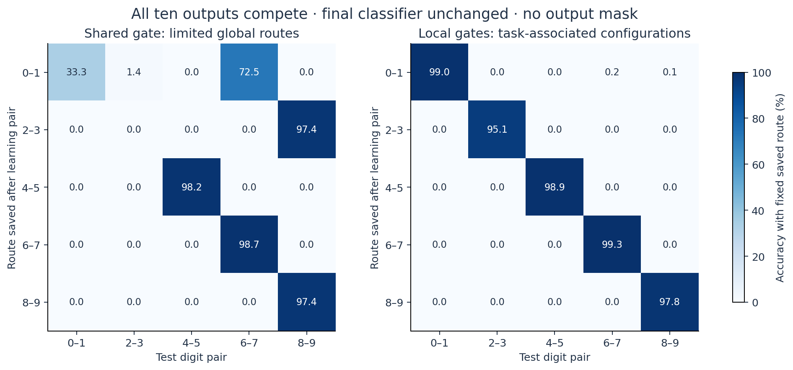
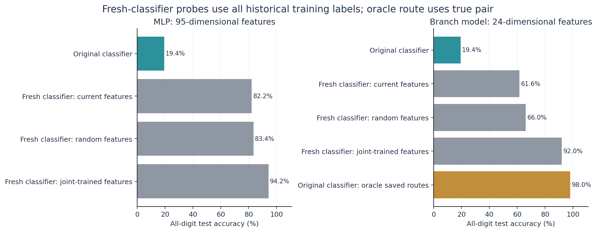

# Earlier digit skills remain accessible through historical branch configurations

**Experiment report · 12 October 2026**  
**Dataset:** Split MNIST, full-resolution images  
**Main runs:** three random initialization seeds, 34–36

## 1. Main finding

A branch network trained sequentially on five digit pairs performed poorly when tested without task information: **19.40% accuracy across all ten digits**, with essentially zero accuracy on the earlier digits 0–7. However, restoring the branch configuration recorded after each pair was learned recovered **98.02% accuracy**, using the **same final connection weights and the same final classifier**. Accuracy on the older digits 0–7 recovered to **98.06%**.

This supports a specific conclusion:

> **Sequential training without explicit task IDs produced branch configurations under which earlier classification skills remained usable. The final recent-context configuration failed to access those skills; restoring the appropriate historical configuration largely recovered them.**

The 98.02% result is an **oracle retrieval diagnostic**, not successful task-ID-free continual learning. The experimenter saved configurations at known training-phase boundaries and used the correct digit-pair identity to select a configuration during analysis. Automatic storage and retrieval remain unsolved. The ordinary task-ID-free score is still 19.40%.

Here, “skill” means the ability to classify held-out images accurately under a particular configuration. The experiment does not directly identify biological memory traces or prove that a particular synapse stores a particular task.

## 2. The question tested

Poor performance on an earlier task can have several causes:

1. **Representation damage:** learned features no longer distinguish its inputs.
2. **Classifier damage:** useful features remain, but the output mapping no longer reads them correctly.
3. **Access failure:** useful computations remain under another branch configuration, but the current route does not activate them.

The diagnostic asked whether changing the route alone could recover earlier performance after all five tasks had been learned. A separate fresh-classifier experiment tested whether relearning the output mapping alone was sufficient.

## 3. Dataset and training protocol

The official MNIST training set contains 60,000 labeled 28×28 images; the test set contains 10,000 images. Images were flattened to 784 values and divided by 255. There was no feature pretraining or fitted preprocessing using future classes.

Training followed the fixed sequence:

$$
\{0,1\}\;\longrightarrow\;\{2,3\}\;\longrightarrow\;\{4,5\}
\;\longrightarrow\;\{6,7\}\;\longrightarrow\;\{8,9\}.
$$

| Setting | Value |
|---|---|
| Training exposure | Two epochs per digit pair; 120,000 image presentations in total |
| Minibatch size | 128 |
| Optimizer | One Adam optimizer, learning rate 0.001 |
| Gradient clipping | Global norm 5 |
| Resets between pairs | No optimizer or usefulness-memory reset |
| Replay | None |
| Model inputs | Image pixels; no task, pair, boundary, or calendar signal |
| Training supervision | Ordinary digit labels, used for classification loss and branch error estimates |
| Output space | Ten digit scores at every stage, including not-yet-trained digits |
| Ordinary testing | No test-label feedback, task IDs, output masks, or state updates |
| Evaluation | Official test images after each phase; all learned classes scored together |

The experimenter controlled the curriculum and knew its phase boundaries. Those boundaries were not supplied to the network. Nevertheless, blocked training makes the current distribution task-informative: the network repeatedly sees examples from the current pair and their ordinary labels. “No explicit task ID” does not mean “no information about the current task.”

## 4. Architecture and the meaning of a local configuration

The branch model has **24 hidden neurons, four branches per neuron, and one shared ten-class linear classifier**. Every branch receives the full image. It is a small fully connected model, not a convolutional network or a biological dendritic simulation.



*Figure 1. Labels update usefulness estimates during training. The external archive and oracle selection are diagnostic additions; they are not autonomous capabilities of the tested network.*

### 4.1 Branch responses

For image $x\in\mathbb{R}^{784}$, branch $b$ of neuron $j$ produces:

$$
q_{j,b}(x)=\tanh\!\left(w_{j,b}^{\mathsf T}x+a_{j,b}\right),
\qquad j=1,\ldots,24,\quad b=1,\ldots,4.
$$

Thus, each neuron has four learned responses available for the same input. Branches do not communicate with neighboring branches in this implementation.

### 4.2 Hard competition and neuron output

Each neuron stores a separate recent error score $E_{j,b}$ for each branch. Its current choice is:

$$
r_j=\underset{b}{\arg\min}\;E_{j,b},
\qquad
h_j(x;r)=q_{j,r_j}(x).
$$

The complete configuration is a vector of 24 branch choices:

$$
r=(r_1,r_2,\ldots,r_{24})\in\{1,2,3,4\}^{24}.
$$

A configuration does not designate an entire neuron or an entire network as belonging to one task. It selects one branch independently for every hidden neuron. Different tasks may use overlapping branches in different combinations. No task-to-branch assignments were prescribed before training.

### 4.3 Shared classifier

The selected responses are read by a single ten-class classifier:

$$
z_c(x;r)=\sum_{j=1}^{24}U_{c,j}h_j(x;r)+d_c,
\qquad
\widehat y=\underset{c\in\{0,\ldots,9\}}{\arg\max}\;z_c.
$$

Changing $r$ changes the features reaching this classifier without requiring a change to $w$, $a$, $U$, or $d$.

### 4.4 How branch usefulness is estimated

For each training image, the model considers replacing one neuron's selected response with one candidate branch response while holding the other neuron responses fixed:

$$
z_c^{(j,b)}=z_c+U_{c,j}\big(q_{j,b}-h_j\big).
$$

This is a **counterfactual output**, computed from the current network. It is not an additional observed environmental outcome.

Given the ordinary training digit label $y$, its classification error is:

$$
e_{j,b}=-\log\!\left[\operatorname{softmax}\!\left(z^{(j,b)}\right)_y\right].
$$

The score is averaged over the minibatch and written into an exponential moving average:

$$
E_{j,b}\leftarrow0.95E_{j,b}+0.05\overline e_{j,b}.
$$

All scores begin at $\log 10$. Equal scores initially select branch one through the deterministic tie rule. A prediction uses the existing scores; the current training labels subsequently determine errors and update the scores. No test labels update these memories.

“Local” means that each neuron has its own branch-score vector. These scores are shared across incoming images; there is no separate memory per image, per minibatch position, or per inferred task. After training the last pair, the same final configuration is applied to every image in ordinary evaluation.

### 4.5 Connection-weight learning

The branch models use current classification loss plus an auxiliary loss over the counterfactual outputs:

$$
\mathcal L=
\frac{1}{B}\sum_{i=1}^{B}\operatorname{CE}(z_i,y_i)
+\frac{0.5}{BJK}\sum_{i=1}^{B}\sum_{j=1}^{J}\sum_{b=1}^{K}
\operatorname{CE}\!\left(z_i^{(j,b)},y_i\right),
\qquad J=24,\;K=4.
$$

The auxiliary objective gives every candidate branch a training signal. **All branch and classifier weights remain plastic. There is no freezing, explicit consolidation rule, or task-specific weight protection.** Old branch configurations can therefore survive even though their weights continue to receive updates; their survival is an empirical observation here, not a guarantee built into the method.

## 5. Controls and matching

| Model | Routing rule | Slow parameters | Usefulness-state allocation |
|---|---|---:|---|
| Local usefulness | Separate branch scores and choices for each neuron | 75,610 | 96 float32 scores |
| Shared usefulness | Branch errors averaged across neurons; one common slot choice | 75,610 | Four distinct scores replicated into 96 slots |
| Uniform averaging | Average all four responses per neuron | 75,610 | 96 allocated scores, ignored by routing |
| Ordinary MLP | 784 → 95 tanh units → 10 outputs | 75,535 | None |

The branch parameter count is:

$$
(784+1)(24\times4)+(24+1)10=75{,}610.
$$

Local, shared, and uniform models have identical slow architecture, branch training objective, initial slow weights for a given seed, and sample order. Their training trajectories can diverge because their gates differ. The MLP's parameter count differs by less than 0.1%, but its objective is ordinary cross-entropy without the branch auxiliary term.

In the shared control, the branch error used for the memory update is:

$$
\overline e_b^{\mathrm{shared}}=\frac{1}{24}\sum_{j=1}^{24}\overline e_{j,b}.
$$

All neurons consequently select the same slot under hard gating. Shared hard routing has only **four** globally aligned configurations. Local hard routing has up to $4^{24}$ combinations, although this experiment uses only five archived snapshots per run.

Equal allocated buffer size does **not** mean equal independent information or equal routing expressiveness. The comparison tests neuron-specific routing granularity; it does not establish a uniquely biological or uniquely dendritic advantage over every conditional architecture.

## 6. Ordinary evaluation: learning succeeds, access to older tasks fails

The local branch model achieved **98.84% mean acquisition accuracy**: each pair was classified well immediately after it was introduced, with unrestricted ten-class predictions. After the fifth pair, its accuracy on 8–9 was **97.85%**, but accuracy on 0–7 was zero in these runs.

| Model | Final ordinary accuracy, mean ± seed SD |
|---|---:|
| MLP | 19.36% ± 0.02 |
| Uniform averaging | 19.19% ± 0.03 |
| Shared usefulness | 19.32% ± 0.01 |
| Local usefulness | 19.40% ± 0.02 |

The approximately 19% score is not ten-class chance accuracy, which is 10% for uniform random predictions. It reflects good performance on the newest two classes and failure on almost all other classes. Roughly one-fifth of the test images belong to the last pair.

An earlier soft-gating pilot, seeds 31–33, also failed: local usefulness memory reached 19.21% final accuracy, versus 19.39% for the MLP. Its softmax gates stayed nearly uniform. This observation motivated the separate hard-competition run reported here, with fresh seeds 34–36. Hard competition did not fix ordinary retention; the historical-route diagnostic was performed on these hard-gate checkpoints. Its recovery result should not automatically be attributed to the untested soft-gate route archive.

A joint-exposure control, mixing all ten classes during training for the same total number of image presentations, reached **94.82% for the MLP** and **93.03% for the local branch model**. This supports adequate model capacity and a functioning learning setup. Joint exposure is a different curriculum, not a continual-learning solution; minibatch boundaries also differ slightly from the sequential schedule.



*Figure 2. Left: accuracy on all classes learned so far; shaded ranges span the three seeds. Right: final all-digit accuracy before and after oracle route restoration; whiskers show sample SD across seeds, not confidence intervals. The oracle result has privileged task information.*

## 7. The route-restoration diagnostic

### 7.1 What was saved

After each known training phase, the experimenter recorded the 24 preferred branch indices. There were five snapshots per run. These snapshots were not chosen by searching test performance.

The network itself did not identify phase boundaries, decide when to archive a route, assign a task key to an archive entry, or retrieve an earlier entry. Those operations were external experimental bookkeeping.

### 7.2 What was held fixed

After all five pairs had been learned, we loaded the final network checkpoint. The branch weights and shared classifier stayed unchanged. For each archived route, a copy of the usefulness-score buffer was set so that the hard gate selected those recorded branch indices.

For task group $t$, the diagnostic therefore evaluated:

$$
\widehat y(x,t)=\underset{c\in\{0,\ldots,9\}}{\arg\max}
z_c\!\left(x;r^{(t)},W_{\mathrm{final}},U_{\mathrm{final}}\right).
$$

No old connection-weight checkpoint was restored. No classifier was refitted in this intervention. All ten outputs competed; there was no restriction to the correct pair.

### 7.3 Where task identity entered

Each fixed route was evaluated on the **entire test set**, without label or task inputs to the forward function. Only after these passes did the analysis use the true pair identity to select the corresponding route's predictions for each image. This is equivalent to an oracle telling the evaluator which archived route to use.

**The absence of an output mask does not remove the oracle advantage.** Pair identity still determines the route. The diagnostic measures retained conditional performance, not autonomous recognition of the appropriate context.

### 7.4 Main results

| Model | Ordinary evaluation | Correct-route oracle | Cyclically wrong-route control |
|---|---:|---:|---:|
| Uniform averaging | 19.19% | 19.19% | 19.19% |
| Shared usefulness | 19.32% | 64.37% | 0.01% |
| Local usefulness | **19.40%** | **98.02%** | **0.02%** |

Uniform averaging ignores route interventions, so its predictions do not change. The wrong-route control assigns each pair the route saved for the next pair, wrapping around after the fifth.

| Seed | Local ordinary accuracy | Local correct-route oracle | Local wrong-route control |
|---|---:|---:|---:|
| 34 | 19.42% | 97.95% | 0.00% |
| 35 | 19.40% | 97.80% | 0.05% |
| 36 | 19.39% | 98.30% | 0.00% |
| Mean | 19.40% | 98.02% | 0.02% |
| Sample SD | 0.02 pp | 0.26 pp | 0.03 pp |

The shared oracle score varies more: **78.64%, 57.29%, and 57.17%**, with a mean of 64.37% and sample SD of 12.36 percentage points. Three seeds are a pilot, not a broad statistical replication across task orders or datasets.



*Figure 3. Seed-mean accuracy for each fixed saved route on each digit pair, with the final classifier unchanged. The strong local diagonal shows usable task-associated computations. Shared gating has fewer independent configurations and can reuse a global route across different phases. Each cell is conditional accuracy, not an autonomous route-selection score.*

The local correct-route diagonal is **98.98%, 95.12%, 98.86%, 99.35%, and 97.85%** for the five pairs. The overall 98.02% result is weighted by the official test-set class counts rather than the unweighted mean of these five values.

## 8. Fresh-classifier and representation diagnostics

We also froze representations and fitted a **new linear ridge classifier** using all 60,000 historical training labels. Features were standardized with training-feature moments, ridge regularization was fixed at 1, and the intercept was unpenalized. No setting was selected using test accuracy.

These probes deliberately provide historical labeled data unavailable to the original no-replay learner. They diagnose decodability; they are not deployable continual-learning results from this experiment.

| Diagnostic | MLP: all digits | Local branch model: all digits |
|---|---:|---:|
| Original final classifier and current features | 19.36% | 19.40% |
| Fresh classifier on current frozen features | 82.15% | 61.58% |
| Fresh classifier on random initialized features | 83.43% | 66.02% |
| Fresh classifier on jointly trained features | 94.23% | 91.99% |
| Original classifier, oracle saved routes | Not applicable | 98.02% |
| Fresh classifier, oracle saved routes | Not applicable | 98.59% |
| Fresh classifier, all 96 branch responses | Not applicable | 85.31% |
| Fresh classifier, random 96 branch responses | Not applicable | 83.42% |
| Fresh classifier, jointly trained 96 branch responses | Not applicable | 92.38% |

Current pooled branch features have 24 dimensions; the full branch vector has 96, and MLP features have 95. The expanded branch probe changes decoder capacity and is not an equal-budget method comparison.



*Figure 4. Fresh-classifier bars use all historical training labels. The gold bar additionally uses oracle task identity for routing, but retains the original classifier. The distinction is essential: current-route classifier repair alone reaches 61.58%, while route restoration alone reaches 98.02%.*

The random-feature controls show why decodability alone should not be interpreted as retained learned knowledge: random representations already support substantial MNIST accuracy after a supervised decoder is fitted. The strongest intervention here is therefore the route restoration using the **original final classifier**, without any new classifier training.

A separate pair-mask oracle—restricting the current classifier's outputs to the true two digits—reached 89.70% for the MLP and 85.10% for the local model. This is another privileged diagnostic and was **not** used to obtain the 98.02% route result.

## 9. Verification and scope of the conclusion

The route result was verified in two implementations:

1. Directly gather selected branch activations and apply the saved final classifier.
2. Restore route-selecting error scores on a model copy and call the original full forward function.

They agreed exactly for all three local seeds. State snapshots verified that feature extraction and probe fitting did not modify the original network. Joint training was reproduced and matched its earlier recorded test accuracy.

Eight implementation checks passed across the classifier and diagnostic suites. They covered counterfactual outputs, gradient coverage, hard selection, equal branch-model budgets, evaluation invariance, saved-route forward equivalence, a separable-data ridge check, and the distinction between privileged pair masks and ordinary global scoring.

### Supported by this experiment

- Training received **no explicit task IDs**; branch choices developed from ordinary supervised errors in the sequential stream.
- Earlier conditional skills remained usable after subsequent weight updates.
- Changing the route alone, with the final classifier unchanged, largely restored those skills.
- Local per-neuron configurations supported more complete oracle recovery than the tested shared global-slot control.
- Recent-context routing is a major access bottleneck in this particular model and sequence.

### Not established

- Successful autonomous task-ID-free continual learning: ordinary accuracy remains 19.40%.
- Autonomous task discovery, archive creation, or retrieval: known phase boundaries and true pair identity were used externally.
- General retention across additional tasks, different pair orders, or other datasets.
- A uniquely dendritic or biological mechanism. Conditional routing can be implemented in other architectures.
- Benefit from neighbor-to-neighbor dendritic communication: no such communication was implemented.
- Necessity of every architectural component. In particular, local and shared gates have different effective route expressiveness despite identical allocated buffer size.
- Superiority over the joint-exposure control. Oracle retrieval receives true pair information, whereas ordinary joint evaluation does not; their accuracy figures are not a matched method comparison.

The oracle was introduced as an exploratory diagnostic after the ordinary failure. This result should therefore be described as a mechanistic lead, not a preregistered confirmation of the full project hypothesis.

## 10. Next experiment

The next objective is to retrieve an appropriate preserved configuration from the image and available causal history, without task IDs or test-label feedback. A complete method also needs to decide when to preserve a useful configuration without relying on known phase boundaries.

A useful comparison should hold slow parameter count, meaningful memory capacity, archive size, training supervision, and evaluation information as closely matched as possible between local and shared routing. The current oracle score supplies a reference target for this exact set of saved configurations; it does not guarantee that a learned selector will reach it.

Before claiming a general continual-learning benefit, the combined storage-and-retrieval system should be tested on new seeds, multiple task orders, and additional datasets, with ordinary accuracy and forgetting reported separately from all oracle diagnostics.

## 11. Reproduction and source records

Run commands from the repository root using the project's PyTorch environment:

```bash
python -m bdh_cl.scripts.split_mnist_usefulness \
  --out results/split_mnist_hard_reproduction \
  --seeds 34,35,36 --epochs 2 --gate hard

python -m bdh_cl.scripts.split_mnist_retention_diagnostic \
  --source results/split_mnist_hard_reproduction \
  --out results/split_mnist_diagnostic_reproduction

python -m bdh_cl.scripts.split_mnist_route_audit \
  --source results/split_mnist_hard_reproduction \
  --diagnostic results/split_mnist_diagnostic_reproduction \
  --out results/split_mnist_route_reproduction

python -m unittest discover -s bdh_cl/tests \
  -p 'test_split_mnist_usefulness.py'
python -m unittest discover -s bdh_cl/tests \
  -p 'test_split_mnist_retention_diagnostic.py'

python -m bdh_cl.scripts.report_split_mnist_routes
```

MNIST IDX files must be available in `data_cache/mnist`. Result output directories must not already exist for the experiment scripts. The figure script reads the original recorded results; it regenerates this report's figures, not new experimental measurements.

| Record | Location |
|---|---|
| Classification implementation | [split_mnist_usefulness.py](../../bdh_cl/scripts/split_mnist_usefulness.py) |
| Original hard-gate results and protocol | [results](../../results/split_mnist_usefulness_hard_20261011/results.json), [protocol](../../results/split_mnist_usefulness_hard_20261011/protocol.json) |
| Earlier soft-gate pilot | [results](../../results/split_mnist_usefulness_20261011/results.json) |
| Frozen-feature and fresh-classifier diagnostic | [implementation](../../bdh_cl/scripts/split_mnist_retention_diagnostic.py), [results](../../results/split_mnist_retention_diagnostic_20261011/results.json) |
| Independent saved-route audit | [implementation](../../bdh_cl/scripts/split_mnist_route_audit.py), [results](../../results/split_mnist_route_audit_20261011/results.json), [protocol](../../results/split_mnist_route_audit_20261011/protocol.json) |
| Figure generator | [report_split_mnist_routes.py](../../bdh_cl/scripts/report_split_mnist_routes.py) |
| Figure sources and aggregation notes | [figure_manifest.json](figure_manifest.json) |

All four figures are provided as PNG images and editable SVG files in [figures](figures/).

## 12. Concise statement for a supervisor update

> On Split MNIST, a branch network trained sequentially without explicit task IDs achieved only 19.4% autonomous accuracy after five digit pairs. A diagnostic restoring historical branch configurations recovered 98.0% accuracy with the final network weights and original ten-class classifier unchanged. This suggests that earlier skills remained accessible under task-associated configurations and that route retrieval was a major bottleneck. The restoration used oracle pair identity and externally archived routes, so automatic context storage and task-ID-free retrieval remain the next research targets.
