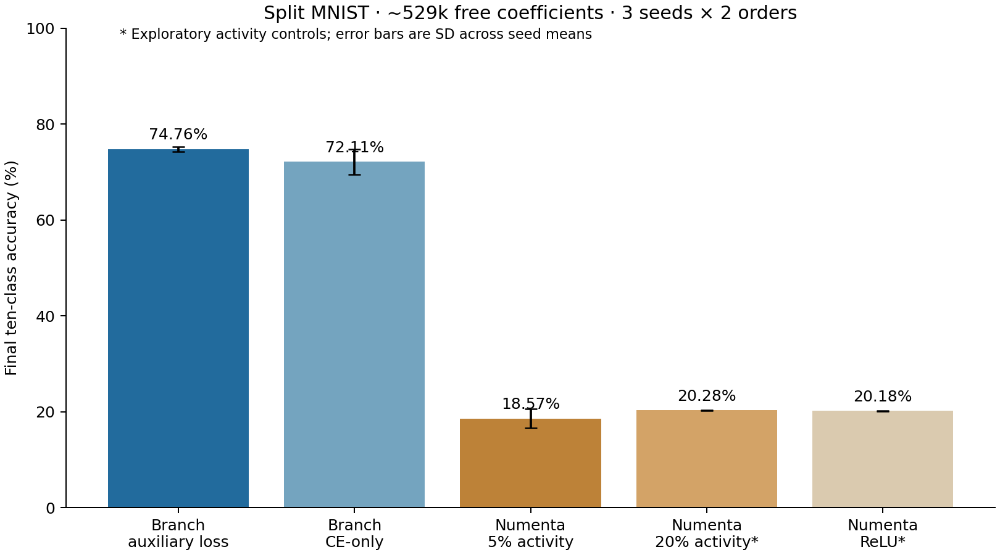

# Matched-size results and fairness assessment

All models use approximately 529,000 unconstrained learnable coefficients, identical normalized inputs, 55,000 training images, two epochs per pair, batch 128, Adam without task resets, gradient clip 5, common task-mean context assignments, three independent learning-rate trials per configuration, and three evaluation seeds in both forward and reverse order. No replay, SI, test IDs or label masks.

| Model | Final inferred-context accuracy ± seed SD | Oracle-context accuracy |
|---|---:|---:|
| Branch + auxiliary loss | 74.76 ± 0.53% | 97.39% |
| Branch CE-only | 72.11 ± 2.64% | 93.45% |
| Numenta 5% activity | 18.57 ± 1.99% | 18.65% |
| Numenta 20% activity (exploratory) | 20.28 ± 0.03% | 20.28% |
| Numenta ReLU (exploratory) | 20.18 ± 0.06% | 20.18% |

Each SD is computed over three seed means after averaging both orders within seed, not over six independent runs. Numenta activity alternatives were added after inspecting the initial run and validation acquisition instability; they are exploratory controls and reported separately, with their own three-trial validation selections.

## Resource matching

| Model | Free coefficients | Allocated parameters | Persistent numeric bytes | Training seconds | Batch-256 inference ms |
|---|---:|---:|---:|---:|---:|
| numenta | 529,354 | 556,810 | 3,356,784 | 1.76 | 0.896 |
| branch_aux | 529,210 | 529,210 | 2,136,048 | 3.72 | 0.601 |
| branch_ce | 529,210 | 529,210 | 2,136,048 | 2.39 | 0.604 |

Free coefficients count all parameters except permanently masked zeros. Allocated tensors differ by 5.2%; Numenta also stores mask buffers. Persistent bytes include the shared 15,680-byte prototype bank and, for branch arms, error traces and a 5×168-byte route archive. Counts exclude optimizer, Python overhead, temporary activations and checkpoint file metadata. Optimizer state is separately logged. Timing is CPU wall time, not FLOPs or an M4 benchmark; training times exclude prototype preparation, validation and saving.

## What the result supports

Under this fixed coefficient and exposure budget, the branch models retain substantially higher Split MNIST accuracy than these Numenta variants. Higher native activity and ReLU controls help check that the result is not solely an artifact of retaining only three winners per layer.

The auxiliary-loss arm improves over the matched CE-only branch arm by **+2.65 percentage points** on average. Paired seed differences are +2.15, +0.55, +5.26 pp. A descriptive paired t interval with only three seeds is [-3.30, +8.61] pp (95%). This small cohort does not establish a reliable auxiliary-loss advantage.

## Remaining fairness limits

This is one resource budget and a small validation search. Depth, initialization, activation sparsity and architectural mechanisms differ. Equal free coefficients do not mean equal active capacity, memory, compute or tuning FLOPs. The prototype protocol permits known training boundaries and task-associated route archives; it is not autonomous context acquisition. Numenta's SI extension and statistical batch-clustering variant remain outside this comparison. More budgets, independent task orders, validation of method-specific settings and harder datasets are needed for a broad superiority claim. A longer convergence-matched schedule is also needed to separate learning speed from eventual performance.

## Reproduce

Primary: `python -m bdh_cl.scripts.matched_numenta_comparison --out NEW_PRIMARY`.

Activity controls: `python -m bdh_cl.scripts.matched_numenta_activity_sensitivity --base NEW_PRIMARY --out NEW_ACTIVITY`.

Summary: `python -m bdh_cl.scripts.summarize_matched_numenta --base NEW_PRIMARY --sensitivity NEW_ACTIVITY`.

All final evaluations verified unchanged model tensors and route archives. Validation selections were saved before evaluating official test images in each experiment. The primary and exploratory protocols and results remain separate on disk.

